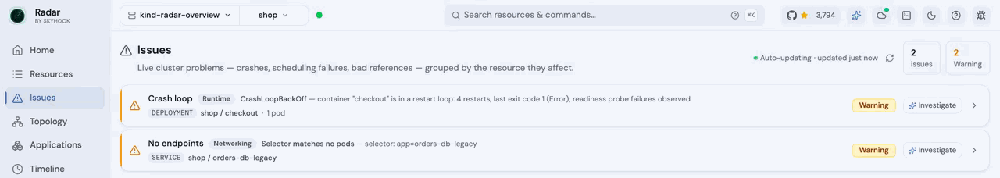
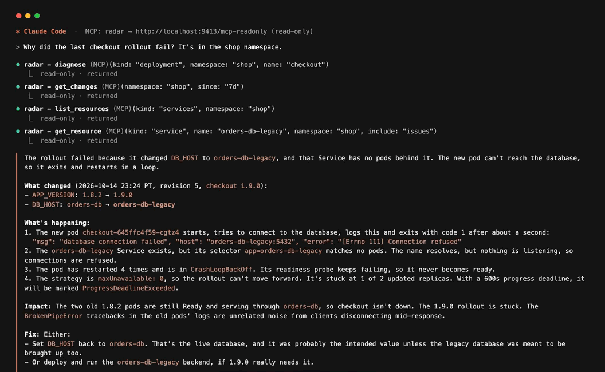
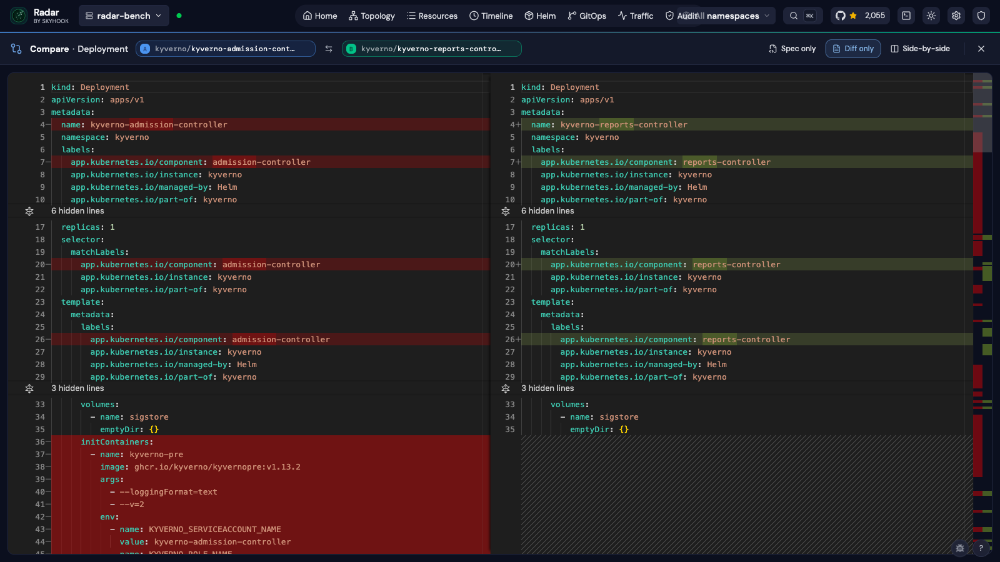
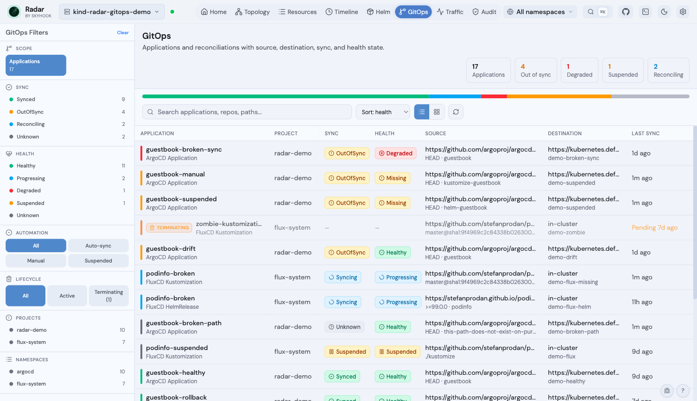

# Radar

**The missing open-source Kubernetes UI, with a built-in MCP server for your AI agent.**
<br>Single binary. No account required. Free forever.

🌐 **[radarhq.io](https://radarhq.io)** · [Docs](https://radarhq.io/docs) · [Benchmarks](https://radarhq.io/benchmark) · [Releases](https://github.com/skyhook-io/radar/releases)

Radar shows you what's broken in a Kubernetes cluster, why, and what changed: issues, topology, a timeline of events and resource changes, Helm, GitOps, traffic, audit, and upgrade impact. Your AI agent reads the same cluster data and relationships through Radar's MCP server, and Radar can run an AI investigation for you with the agent CLI you already use. It runs on your laptop as a `kubectl` plugin or desktop app, or in-cluster with Helm.

<a href="https://www.producthunt.com/products/radar-7?launch=radar-101&utm_source=github-readme&utm_medium=badge&utm_campaign=ph-launch-2026-10" target="_blank"></a>

🚀 **We're on Product Hunt today** with Radar's upgraded MCP server and AI investigations. [Come say hi and drop us a comment](https://www.producthunt.com/products/radar-7?launch=radar-101&utm_source=github-readme&utm_medium=text&utm_campaign=ph-launch-2026-10).

[](https://github.com/skyhook-io/radar/actions/workflows/ci.yml)
[](https://github.com/skyhook-io/radar/actions/workflows/codeql.yml)
[](https://github.com/skyhook-io/radar/releases/latest)
[](https://github.com/skyhook-io/radar/releases)
[](https://artifacthub.io/packages/helm/skyhook/radar)
[](https://radarhq.io/community/chat)
[](LICENSE)

<details>
<summary><b>Table of contents</b></summary>

- [Why Radar?](#why-radar) · [Debugging in the UI](#debugging-in-the-ui)
- [AI agents: MCP server and AI investigations](#ai-agents-mcp-server-and-ai-investigations) — Connect your agent · AI investigations · Benchmarks
- [Installation](#installation)
- [Usage](#usage)
- [Views](#views) — Issues · Topology · Resources · Image Filesystem · Timeline · Helm · Compare · TLS · GitOps · Traffic · Metrics · Capacity · Cost · Audit · Network path · Upgrade impact · RBAC · Auth
- [Supported Resources](#supported-resources)
- [Keyboard Shortcuts](#keyboard-shortcuts)
- [Security](#security)
- [Development](#development) · [Contributing](#contributing)

</details>

<p align="center">
  
</p>

**Install and run in 30 seconds:**
```bash
curl -fsSL https://get.radarhq.io | sh && kubectl radar
```
Or `brew install kubectl-radar`. [Windows, Krew, desktop app and Helm ↓](#installation)

**Then, with Radar running, connect your AI agent** (read-only):
```bash
claude mcp add --transport http radar http://localhost:9280/mcp-readonly
```
[Codex, Cursor, GitHub Copilot, other clients, and the desktop app ↓](#connect-your-agent)

## Why Radar?

- **Nothing to install in your cluster** — a single binary on your laptop that talks to the Kubernetes API with your kubeconfig. No agents, no CRDs, no dependencies
- **Fast on big clusters** — tested on tens of thousands of pods; watches the cluster through informers and pushes live updates to the browser over SSE
- **Private by design** — your cluster data stays on your machine. No account, no agents, no cloud sync. Usage reporting is off unless you opt in, and then sends only anonymous usage counts and coarse cluster facts: Kubernetes version, platform, node-count range, known integrations ([what Radar sends](docs/configuration.md#what-radar-sends)). An AI agent you connect sends what it reads to its own model provider
- **Airgapped-friendly** — runs as a single binary against the Kubernetes API and works in locked-down environments with outbound egress blocked
- **Works everywhere** — GKE, EKS, AKS, minikube, kind, k3s, or any conformant cluster
- **One model of the cluster, for you and your agent** — the UI, the [MCP server](#ai-agents-mcp-server-and-ai-investigations), and AI investigations read the same live data: relationships, health, events, and changes
- **Ready for teams** — deploy in-cluster with Helm for shared access, with SSO (OIDC or an auth proxy) and per-user Kubernetes RBAC in the open-source build

> "Have Radar deployed at work. As far as Kubernetes dashboards go, this is one of the best." — u/TheRealNetroxen

---

## Debugging in the UI

Start from **[Issues](#issues)**, a ranked queue of what's broken right now. Open a failing resource to see it in context: its owners, Pods, Services, and config on the **[Topology](#topology)**, what changed and when on the **[Timeline](#timeline)** (with diffs), and its events, logs, and YAML in the detail drawer. **[Helm](#helm)**, **[GitOps](#gitops)**, and **[Traffic](#traffic)** cover how it got deployed and who talks to it. When you want help, **Investigate** hands the same evidence to your agent ([AI investigations](#ai-investigations)). Radar records resource changes while it watches the cluster; history is in memory by default, and `--timeline-storage=sqlite` or `postgres` keeps it across restarts.

<p align="center">
  
  <br><em>Issues for the incident the agent diagnoses below: a crash loop on checkout and a Service with no endpoints</em>
</p>

---

## AI agents: MCP server and AI investigations

Pointed at raw `kubectl`, an agent spends its context window on YAML and its time on round trips. Radar's built-in [Model Context Protocol](https://modelcontextprotocol.io) (MCP) server gives it what Radar already knows instead: how resources connect, what is unhealthy, deduplicated events, recent changes with diffs, and filtered logs. In our benchmarks, the same agent and model reached a diagnosis about 3× faster through Radar than through kubectl ([details](#benchmarks)).

<p align="center">
  
  <br><em>Claude Code on Radar's read-only endpoint, finding why a rollout failed (replay of a real session)</em>
</p>

<a id="ai-integration-mcp"></a>

### Connect your agent

MCP is on by default and served on the same port as the UI: `9280` unless you set `--port`. The desktop app picks its own port: copy the URL from Radar's MCP dialog and change the final `/mcp` to `/mcp-readonly`. Start with the read-only endpoint:

```bash
# Claude Code
claude mcp add --transport http radar http://localhost:9280/mcp-readonly

# Codex
codex mcp add radar --url http://localhost:9280/mcp-readonly
```

Setup for Cursor, VS Code (GitHub Copilot), Copilot CLI, OpenCode, Google Antigravity, Kiro, JetBrains, Cline, Devin, Claude Desktop, Zed, Gemini CLI, and any other MCP client is in the **[MCP guide](docs/mcp.md#setup-instructions)**. Its examples use `/mcp`; use `/mcp-readonly` instead to keep Radar's tools read-only. Your agent's other tools follow its own configuration.

- **Context, not raw YAML** — topology, health assessments, events, changes, and logs, minified so they don't burn the context window. The [tools](docs/mcp.md#available-tools) cover resources and topology, issues, events and changes, logs, Helm, audit, upgrade readiness, RBAC, cost, and Prometheus
- **You pick the endpoint** — `/mcp-readonly` has no write tools. The full `/mcp` endpoint, also on by default, adds write tools (restart, scale, apply, rollback, GitOps sync, node drain) marked destructive so clients can ask before running them. On `/mcp`, `diagnose` can also run an in-cluster reachability probe that creates short-lived pods. Calls use Radar's Kubernetes access: your kubeconfig locally, or each user's own RBAC when authentication is on. `--mcp-read-only` turns `/mcp` off (and with it, applying a fix from an AI investigation); `--no-mcp` turns MCP and AI investigations off. Neither blocks ordinary UI writes
- **Secret values are withheld** — Secret reads never include `.data` or `.stringData`. Environment variables, Helm values, and logs are scrubbed for known secret patterns, which can't catch everything, and the opt-in `exec_pod` tool returns raw command output. See [MCP security](docs/mcp.md#security)

### AI investigations

Radar can also run the investigation for you, with the agent CLI you already have — Claude Code, Codex, Cursor, or OpenCode — on your machine and signed in with your own account. Radar needs no API key of its own. Start one from a resource's **Investigate** action, from an issue, by describing what you're seeing on the AI investigations page (where to start, since when, and optionally the resource it's about), or from a terminal against a running Radar:

```bash
radar diagnose deploy/checkout -n shop
radar diagnose deploy/checkout -n shop --json > conclusion.json
```

Every investigation ends on the same Findings page, with the evidence behind each claim. Radar's investigation tools can only read the cluster, and Radar applies a fix only when you approve it, from an investigation of the resource it changes. What else the agent can do depends on how Radar runs it. **Radar safeguards** (Claude Code and Codex) shuts off the agent's other MCP servers and its ability to write. **Your agent setup** (the only option for Cursor and OpenCode) runs the agent with its normal configuration, tools, and MCP servers, which Radar cannot constrain and which may be able to change your cluster. Cursor and OpenCode approve tool requests automatically in these runs, without asking you. See [agents and isolation](https://radarhq.io/docs/features/diagnose#agents-and-isolation).

Investigations need a supported agent CLI on the machine running Radar, MCP on, and authentication off. In-cluster installs don't run them. See the [AI investigations guide](https://radarhq.io/docs/features/diagnose) and [agent CLI setup](docs/configuration.md#ai-investigations-agent-cli).

### Benchmarks

Three studies of an AI agent diagnosing live faults from [SREGym](https://github.com/SREGym/SREGym) (Microsoft and UIUC) on a 3-node EKS cluster, with the same judge scoring every tool. Times are averages to a submitted answer, right or wrong. These are our own benchmarks; compare numbers within a study, not across studies.

| Study | Faults | Result |
|-------|--------|--------|
| [Radar MCP vs raw kubectl](https://radarhq.io/benchmark/mcp-vs-kubectl) — same agent and model | 50 | 64s vs 191s to a diagnosis (about 3× faster); 86% vs 60% diagnosed correctly within two minutes |
| [Kubernetes MCP servers](https://radarhq.io/benchmark/kubernetes-mcp-servers) — Radar, containers/kubernetes-mcp-server, Flux159/mcp-server-kubernetes, Amazon EKS MCP Server, k8sgpt, raw kubectl | 25 | Radar took 57s, 2.3× faster than the next-fastest MCP server; on the 14 faults every tool got right, 33s vs 58s for the next-fastest |
| [AI SRE tools](https://radarhq.io/benchmark/ai-sre-tools) — Claude Code + Radar MCP vs kubectl-ai, HolmesGPT, OpenSRE, kagent, AWS DevOps Agent | 50 | Claude Code + Radar MCP was the most accurate (44/50 correct), fastest (79s), and cheapest ($0.27 a fault) |

Per-scenario scores and timings are downloadable from the [benchmark pages](https://radarhq.io/benchmark); the AI SRE study also includes costs.

---

## Installation

**Quick Install:**
```bash
curl -fsSL https://get.radarhq.io | sh
```

**Homebrew:**
```bash
brew install kubectl-radar
```

Also available from our tap: `brew install skyhook-io/tap/radar`.

Then run: `kubectl radar`. Quick install, PowerShell, Homebrew, and Scoop also set up the `radar` shorthand. Krew and direct downloads use `kubectl radar` unless you add your own `radar` symlink.

<details>
<summary><b>More install options</b> — Desktop App (macOS/Linux/Windows), Krew, Scoop, In-Cluster Helm</summary>

#### CLI

**Krew (kubectl plugin manager):**
```bash
kubectl krew install radar
```

**Scoop (Windows):**
```powershell
scoop bucket add skyhook https://github.com/skyhook-io/scoop-bucket
scoop install radar
```

**PowerShell (Windows):**
```powershell
irm https://get.radarhq.io/install.ps1 | iex
```

**Custom install location (macOS/Linux):**
```bash
curl -fsSL https://get.radarhq.io | INSTALL_DIR="$HOME/.local/bin" sh
```
Quick install writes to `/usr/local/bin` unless `INSTALL_DIR` says otherwise. The directory is created if missing, and needs to be on your `PATH` for `radar` and `kubectl radar` to resolve.

**Direct download** — [GitHub Releases](https://github.com/skyhook-io/radar/releases) for macOS, Linux, or Windows.

#### Desktop App

Native desktop app — no terminal needed.

**Homebrew (macOS):**
```bash
brew install --cask skyhook-io/tap/radar-desktop
```

**Debian/Ubuntu** — download the `.deb` from [GitHub Releases](https://github.com/skyhook-io/radar/releases), then:
```bash
sudo apt install ./radar-desktop_*.deb
```

**Fedora/RHEL** — download the `.rpm` from [GitHub Releases](https://github.com/skyhook-io/radar/releases), then:
```bash
sudo rpm -i radar-desktop_*.rpm
```

**Scoop (Windows):**
```powershell
scoop bucket add skyhook https://github.com/skyhook-io/scoop-bucket
scoop install radar-desktop
```

**Windows (direct download)** — [GitHub Releases](https://github.com/skyhook-io/radar/releases).

#### In-Cluster Deployment

Deploy to your cluster for shared team access:

```bash
helm repo add skyhook https://skyhook-io.github.io/helm-charts
helm install radar skyhook/radar -n radar --create-namespace
```

See the [In-Cluster Deployment Guide](docs/in-cluster.md) for Gateway API and ingress exposure, authentication, and RBAC configuration.

</details>

---

## Usage

```bash
# Opens browser automatically
kubectl radar

# Quick install, PowerShell, Homebrew, and Scoop also set up the bare command
radar
```

**Common flags**

| Flag | Default | Description |
|------|---------|-------------|
| `--kubeconfig` | `~/.kube/config` | Path to primary kubeconfig file |
| `--namespace` | (context namespace) | Initial namespace filter (supports multi-select in the UI; also used as RBAC fallback for namespace-scoped users). Unset, Radar uses your saved pick, then the kubeconfig context's namespace, then all namespaces |
| `--port` | `9280` | Server port |
| `--listen-address` | `127.0.0.1` | HTTP listen IP address (IPv4 or IPv6), or `localhost`. Bind a specific local IP or use `0.0.0.0` for all interfaces. Non-loopback access needs authentication and network controls. |
| `--no-browser` | `false` | Don't auto-open browser |
| `--timeline-storage` | `memory` | Timeline storage backend: `memory`, `sqlite`, or `postgres` |
| `--disable-exec` | `false` | Disable pod terminal, debug shells and pod file browsing |
| `--auth-mode` | `none` | Authentication mode: `none`, `proxy`, or `oidc` ([details](docs/authentication.md)) |
| `--no-mcp` | `false` | Disable all MCP endpoints |
| `--mcp-read-only` | `false` | Expose only read-only MCP tools; disable `/mcp` (env: `RADAR_MCP_READ_ONLY`) |

<a id="tuning-for-slow-or-high-latency-clusters"></a>The [Configuration Guide](docs/configuration.md#cli-flags) describes every startup flag in the table above and 27 more, plus tuning for slow or high-latency clusters, kubeconfig precedence, and context switching.

<details>
<summary>The other 27 flags</summary>

`--kubeconfig-dir`, `--namespaces`, `--namespace-scope`, `--base-path`, `--allowed-hosts`, `--trusted-origins`, `--browser`, `--timeline-db`, `--timeline-max-size`, `--history-limit`, `--disable-helm-write`, `--disable-local-terminal`, `--debug-image`, `--list-page-size`, `--context-switch-timeout`, `--first-paint-backstop`, `--namespace-list-timeout`, `--max-scope-candidates`, `--prometheus-url`, `--prometheus-single-cluster`, `--prometheus-cluster-label`, `--prometheus-header`, `--prometheus-header-from-env`, `--beyla-job-selector`, `--opencost-currency`, `--mcp-catalog-stdio`, `--version`

</details>

`radar --help` is authoritative for the installed version. `radar cloud status` inspects an in-cluster Radar Cloud installation without changing it ([details](docs/configuration.md#radar-cloud)).

---

## Views

### Issues

One ranked queue of what's broken right now — crash loops, image pull failures, stuck rollouts, pods that can't be scheduled, dangling references, and failing Argo CD / Flux conditions — each with an **Investigate** action. See [Issues](https://radarhq.io/docs/features/issues).

### Topology

Interactive graph showing how your Kubernetes resources are connected in real-time.

<p align="center">
  
  <br><em>Topology View — Visualize resource relationships</em>
</p>

- Two modes: **Resources** (full hierarchy) and **Traffic** (network flow path)
- Group by namespace, app label, or view ungrouped
- Filter by resource kind — click any node for full details
- Auto-layout powered by ELK.js, live updates via SSE

### Resources

Table-based resource browser with smart columns per resource kind.

<p align="center">
  
  <br><em>Resources View — Browse and filter all cluster resources</em>
</p>

- Browse all resource types including CRDs
- Search by name, filter by status or problems (CrashLoopBackOff, ImagePullBackOff, etc.)
- Add custom columns from any label or annotation — sortable, filterable, and resizable
- Click any resource for YAML manifest, related resources, logs, and events
- Set regular or init-container images on Deployments, StatefulSets, DaemonSets, and Argo Rollouts, with live rollout progress in tables, drawers, workload views, and Applications

### Image Filesystem Viewer

Inspect container image filesystems directly from the Pod view — no need to pull images locally or exec into containers.

<p align="center">
  
  <br><em>Image Filesystem Viewer — Browse container image contents</em>
</p>

- Browse, search, and download files from any container image in a Pod
- Works with public images (Docker Hub, Quay, GHCR) and private registries (GCR, ECR, ACR) using your cluster's ImagePullSecrets

See [Image filesystem](https://radarhq.io/docs/features/image-filesystem).

### Timeline

Unified timeline of Kubernetes events and resource changes.

<p align="center">
  
  <br><em>Timeline View — Track cluster activity in real-time</em>
</p>

- Filter by event type (all or warnings only)
- Resource change diffs showing what changed (replicas, images, etc.)
- Real-time updates as new events occur

### Helm

Manage Helm releases deployed in your cluster — inspect values and rendered manifests, diff revisions, see why an upgrade or hook failed, then upgrade, roll back, or uninstall. Radar tracks available chart upgrades from your configured repos or your own OCI registries. See [Helm Support](docs/helm.md) for the detailed behavior and limits.

<p align="center">
  
  <br><em>Helm View — Manage your Helm deployments</em>
</p>

### Compare Resources

Diff any two Kubernetes resources of the same kind side-by-side — like comparing a staging Deployment to its production sibling, or two pods that should be identical but aren't. Server-assigned noise (`managedFields`, `resourceVersion`, last-applied) is stripped, and diff-only and spec-only modes cut the rest. See [Compare](https://radarhq.io/docs/features/compare).

<p align="center">
  
  <br><em>Compare View — Side-by-side YAML diff with field-level highlighting</em>
</p>

### TLS Certificate Management

View TLS certificate details and expiry dates across all namespaces — catch expiring certificates before they cause outages.

- Parses TLS secrets to show certificate subject, issuer, and validity period
- Dashboard-level certificate expiry overview
- Available from the resource detail view for any TLS-type Secret

### GitOps

Monitor, diagnose, and manage FluxCD and ArgoCD resources in one place.

<p align="center">
  
  <br><em>GitOps fleet view — Argo + Flux applications side-by-side with sync, health, source, destination, and lifecycle state</em>
</p>

- Fleet view + per-app detail page for **ArgoCD** (`Application`, `ApplicationSet`, `AppProject`) and **FluxCD** (`GitRepository`, `OCIRepository`, `HelmRepository`, `Bucket`, `Kustomization`, `HelmRelease`, `Alert`)
- **Diagnosis** — field-level drift, recent events per resource, stuck-drift-loop detection, parsed operation failures, one-click remediation
- Sync, suspend, resume, reconcile, and rollback from the UI or through MCP

See the [GitOps guide](docs/gitops.md) for the full feature matrix, RBAC requirements, demo cluster, and single-cluster scope notes.

### Traffic

Visualize live network traffic between services using Hubble, Caretta, Istio, or Beyla.

<p align="center">
  
  <br><em>Traffic View — See how services communicate in real-time</em>
</p>

- Auto-detects Hubble (Cilium), Istio, Caretta, or Grafana Beyla as traffic data sources, with a setup wizard to install one if none is detected
- Beyla needs its `network` feature enabled, and per-port edges additionally need `dst.port` and `transport` named in `attributes.select` — both are off by default, and Radar says so in the Traffic view rather than showing partial edges silently
- Animated flow graph showing requests per second between services, filterable by namespace, protocol, or status code
- Focus on a workload to see only it and what it talks to; the focus is in the URL, so it can be shared

See [Traffic](https://radarhq.io/docs/features/traffic) for source-specific requirements and large-cluster behavior.

### Workload Metrics

Open a Deployment, StatefulSet or DaemonSet's **Metrics** tab to investigate
request rate, HTTP errors, latency, CPU, memory and throttling. Radar reads an
existing Prometheus-compatible backend; resource charts do not require HTTP
instrumentation, and request charts use supported Beyla or Istio observations.

See [Workload metrics](docs/workload-metrics.md) for screenshots, prerequisites,
supported configurations and local multi-cluster setup limitations.

### Capacity (Karpenter)

Read-only diagnosis for Karpenter-managed fleets — why is my pod pending, which NodePool could take it, why aren't my nodes joining, what is disruption doing to my fleet? Appears automatically when Karpenter NodePools are detected (RBAC-gated). Overview, NodePool detail, Demand, and Activity screens; every quantity carries its certainty (`= ≥ ≤ ?`), so unavailable is never shown as zero. See [docs/capacity.md](docs/capacity.md).

### Cost Insights

Track Kubernetes spending from OpenCost metrics in a PromQL-compatible backend or a Kubecost 3 Aggregator: allocated workload cost, namespace and workload breakdowns with efficiency scoring, node costs, and trends when Prometheus history is available. Appears automatically when compatible data is detected. See [Cost](https://radarhq.io/docs/features/cost).

### Cluster Audit

Proactive best-practices scanner with 44 checks across security, reliability, and efficiency — inspired by Polaris, Kubescape, Trivy, and NSA/CISA guidelines. Runs instantly against cached data with zero cluster-side installation.

- Security: privileged containers, privilege escalation, host namespaces, runtime socket mounts, secrets in ConfigMaps, and more
- Reliability: missing probes, image tag `latest`, single-replica deployments, missing PDB/topology spread, deprecated API versions
- Efficiency: missing requests and limits, orphan ConfigMaps/Secrets, PVCs with no consumer observed, long-Pending PVCs, and Released or Failed PVs
- Remediation guidance per finding, NSA/CISA and CIS framework labels, and per-resource opt-out via the `radarhq.io/ignore-checks` annotation

See [Cluster audit](https://radarhq.io/docs/features/cluster-audit) and [audit configuration](docs/configuration.md#per-resource-check-suppression).

### Network Path Diagnose

Hop-ordered diagnosis for Service, Ingress, HTTPRoute, GRPCRoute, and Gateway — answering "if traffic is sent toward this resource, does it reach a healthy process, and if not which hop breaks first?" It names the first broken hop with a kubectl reproducer, predicts NetworkPolicy blocks, and can run an optional DNS / TCP / TLS / HTTP probe from your laptop or in-cluster. Open the **Reachability** tab on the resource; see [docs/reachability.md](docs/reachability.md).

### Kubernetes Upgrade Impact

Open **Checks → Upgrade impact** before upgrading the control plane. Radar compares the current cluster with a target Kubernetes minor and orders evidenced compatibility, health, admission, drain, runtime, and configuration checks by required action — APIs removed in the target release, kubelet and kube-proxy skew, overlapping PodDisruptionBudgets, removed feature gates — using live resources, Helm release manifests, last-applied configuration, and API server metrics.

See the [Kubernetes upgrade impact guide](https://radarhq.io/docs/features/upgrade-impact) for the check catalog, coverage semantics, and RBAC notes.

### Access Control (RBAC visibility)

Inspect what any ServiceAccount can actually do — without three `kubectl describe` calls.

- **ServiceAccount, Role, and binding details**: direct and inherited bindings, effective permissions, and the Pods that use a ServiceAccount
- **Pod and workload Permissions**: the most-permissive rules the Pod's ServiceAccount grants, with a blast-radius alert for wildcards, cluster-admin, escalation verbs, or cluster-wide `create pods`
- **"My Permissions" panel**: a live `SelfSubjectRulesReview` for the current user, for fast "why can't I do X" debugging

See [Access control](https://radarhq.io/docs/features/access-control).

### Authentication

For shared in-cluster deployments, Radar supports optional user authentication with per-user Kubernetes RBAC.

- **Proxy mode** — works with oauth2-proxy, Pomerium, Cloudflare Access, or any auth proxy that sets forwarded headers
- **OIDC mode** — built-in login via Google, Okta, Dex, Keycloak, or any OIDC provider
- Per-user namespace scoping and write authorization via K8s impersonation
- UI adapts automatically — buttons only appear if the user has RBAC permission

No auth by default (local use). See the **[Authentication Guide](docs/authentication.md)** for setup.

---

## Supported Resources

Radar auto-discovers any CRD in your cluster. Popular tools get [dedicated integrations](docs/integrations.md) with topology edges, detail views, and AI summaries.

The Helm chart grants read access to common built-in Kubernetes kinds; Secrets and RBAC objects depend on chart settings and the authentication mode. CRD-based integrations need the CRD installed in your cluster *and* read access; most API groups are granted by default, and the chart's [RBAC](deploy/helm/radar/README.md#rbac) and [CRD access](deploy/helm/radar/README.md#crd-access) sections list what is on, what is opt-in, and how to add rules.

| Category | Resources |
|----------|-----------|
| **Workloads** | Deployments, DaemonSets, StatefulSets, ReplicaSets, Pods, Jobs, CronJobs |
| **Networking** | Services, Ingresses, NetworkPolicies, Endpoints, EndpointSlices, PodDisruptionBudgets |
| **Configuration** | ConfigMaps, Secrets (names only, values hidden), LimitRanges, ResourceQuotas |
| **Storage** | PersistentVolumeClaims, PersistentVolumes, StorageClasses |
| **Autoscaling** | HorizontalPodAutoscalers, VerticalPodAutoscalers |
| **Cluster** | Nodes, Namespaces, ServiceAccounts, Events |
| **Other Kubernetes APIs** | Workloads, PodGroups, CompositePodGroups, PodCertificateRequests, ClusterTrustBundles (only when served by the cluster) |
| **GitOps (FluxCD)** | GitRepository, OCIRepository, HelmRepository, Kustomization, HelmRelease, Alert |
| **GitOps (ArgoCD)** | Application, ApplicationSet, AppProject |
| **Argo Rollouts** | Rollout |
| **Argo Workflows** | Workflow, WorkflowTemplate |
| **[Reflector](docs/integrations.md#configmap-and-secret-reflection-reflector)** | ConfigMap/Secret reflection details, source and mirror relationships, recorded copy evidence |
| **cert-manager** | Certificate, CertificateRequest, Order, Challenge, Issuer, ClusterIssuer |
| **Gateway API** | Gateway, GatewayClass, HTTPRoute, GRPCRoute, TCPRoute, TLSRoute, UDPRoute |
| **Istio** | VirtualService, DestinationRule, Gateway, ServiceEntry, PeerAuthentication, AuthorizationPolicy |
| **Traefik** | IngressRoute, IngressRouteTCP, IngressRouteUDP, Middleware, MiddlewareTCP, TraefikService, ServersTransport, ServersTransportTCP, TLSOption, TLSStore |
| **Contour** | HTTPProxy |
| **Knative Serving** | Service, Configuration, Revision, Route, DomainMapping |
| **Knative Eventing** | Broker, Trigger, EventType, Channel, InMemoryChannel, Subscription |
| **Knative Sources** | PingSource, ApiServerSource, ContainerSource, SinkBinding |
| **Knative Flows** | Sequence, Parallel |
| **Knative Networking** | Ingress, Certificate, ServerlessService |
| **Karpenter** | NodePool, NodeClaim (+ provider-specific NodeClasses via auto-discovery) |
| **OpenTelemetry Operator** | [OpenTelemetryCollector and Instrumentation](docs/integrations.md#opentelemetry-operator): reconciliation, configured pipelines and injection settings |
| **Flagger** | [Canary and MetricTemplate](docs/integrations.md#flagger): recorded rollout state, target/autoscaler/template links and failed-rollout Issues |
| **KEDA** | ScaledObject, ScaledJob, TriggerAuthentication, ClusterTriggerAuthentication |
| **Prometheus Operator** | ServiceMonitor, PodMonitor, PrometheusRule, Alertmanager |
| **Security (Trivy)** | VulnerabilityReport, ConfigAuditReport, ExposedSecretReport, ClusterComplianceReport, SbomReport, RbacAssessmentReport, InfraAssessmentReport |
| **Strimzi** | [KafkaConnector failure evidence](docs/integrations.md#strimzi-kafka-connectors) (connector/task status) |
| **Velero** | Backup, Restore, Schedule, BackupStorageLocation, VolumeSnapshotLocation |
| **External Secrets** | ExternalSecret, ClusterExternalSecret, SecretStore, ClusterSecretStore |
| **Secrets Store CSI Driver** | [SecretProviderClass and Pod mounts](docs/integrations.md#secrets-store-csi-driver): mount state, object versions and synced Secrets in the Pod drawer |
| **CloudNativePG** | Cluster, Backup, ScheduledBackup, Pooler, Database, Publication, Subscription, ImageCatalog, ClusterImageCatalog, ObjectStore — plus [dedicated views](docs/cnpg.md) for fleet, protection and declaration triage |
| **Crossplane** | Managed Resources (any provider), Composite Resources, Claims, Provider, ProviderConfig, Function, Configuration, Composition, CompositionRevision, XRD |
| **Kyverno** | Policy, ClusterPolicy, PolicyReport, ClusterPolicyReport |
| **Sealed Secrets** | SealedSecret |
| **Dynamic Resource Allocation** | ResourceClaim, ResourceClaimTemplate, DeviceClass, ResourceSlice (resource.k8s.io, K8s 1.32+) |
| **NVIDIA GPU Operator** | ClusterPolicy, NVIDIADriver |
| **Calico** | NetworkPolicy, GlobalNetworkPolicy, StagedNetworkPolicy, StagedGlobalNetworkPolicy, StagedKubernetesNetworkPolicy, IPPool, HostEndpoint, Tier |
| **Kueue** | ClusterQueue, LocalQueue, Workload, ResourceFlavor, AdmissionCheck (+ Cluster Autoscaler ProvisioningRequest) — basic |
| **KubeRay** | RayCluster, RayJob, RayService, RayCronJob — basic |
| **KServe** | InferenceService, ServingRuntime, ClusterServingRuntime, InferenceGraph, TrainedModel, LLMInferenceService — basic |
| **Inference Gateway** | InferencePool (v1 + alpha groups), InferenceObjective — basic |
| **Batch** | LeaderWorkerSet, JobSet, Volcano (Job/Queue/PodGroup/JobFlow/JobTemplate), Kubeflow (PyTorchJob/TFJob/MPIJob/TrainJob) — basic |
| **KAI Scheduler** | Queue, PodGroup — basic |
| **Model serving** | KAITO (Workspace, RAGEngine), NVIDIA NIM (NIMService/NIMCache/NIMPipeline), AMD GPU Operator (DeviceConfig) — basic |
| **Cost (OpenCost / Kubecost)** | Namespace/workload/node cost via compatible Prometheus metrics or the Kubecost 3 Aggregator (no CRDs) |
| **CRDs** | Any Custom Resource Definition in your cluster (auto-discovered) |

---

## Keyboard Shortcuts

Radar is keyboard-first: `?` lists every shortcut, `⌘K` opens the command palette, `/` focuses search, and `g` followed by a letter switches views (`g i` Issues, `g t` Topology, `g l` Timeline, `g r` Resources). The full list is in the [keyboard shortcuts reference](https://radarhq.io/docs/reference/keyboard-shortcuts).

---


## Security

Radar reads your cluster through your own credentials and keeps cluster data local. It does not upload manifests, logs, events, metrics, or resource data to Skyhook, and it does not require an account, agent, or cloud backend. When you connect an AI agent or run an AI investigation, what Radar returns goes to that agent and its model provider. Found a vulnerability? Please report it privately to **security@skyhook.io** — see [SECURITY.md](SECURITY.md) for the process and response timelines.

---

## Development

See the **[Development Guide](DEVELOPMENT.md)** for building from source and contributing. For automation and integrations, see the [HTTP API reference](https://radarhq.io/docs/reference/api).

Quick start:
```bash
git clone https://github.com/skyhook-io/radar.git
cd radar
make deps

# Terminal 1: Frontend with hot reload (port 9273)
make watch-frontend

# Terminal 2: Backend with hot reload (port 9280)
make watch-backend
```

---

## Contributing

Contributions are welcome! Please read our [Contributing Guide](CONTRIBUTING.md) for details on the development workflow, pull request process, and coding standards.

Questions or ideas? [GitHub Discussions](https://github.com/skyhook-io/radar/discussions) is the place — or come say hi at [radarhq.io/community](https://radarhq.io/community).

---

## About

Radar is built and maintained by [Skyhook](https://skyhook.io) (YC W23) and is open source under Apache-2.0. The OSS version is fully featured and the recommended way to run Radar.

For teams that want hosted multi-cluster Radar, with fleet views, alerts, and shared links, we also offer [Radar Cloud](https://radarhq.io).

---

## License

Apache 2.0 — see [LICENSE](LICENSE)

---

<p align="center">
  <strong>Open source. Free forever.</strong>
  <br>
  <sub>Built by <a href="https://skyhook.io">Skyhook</a></sub>
</p>
