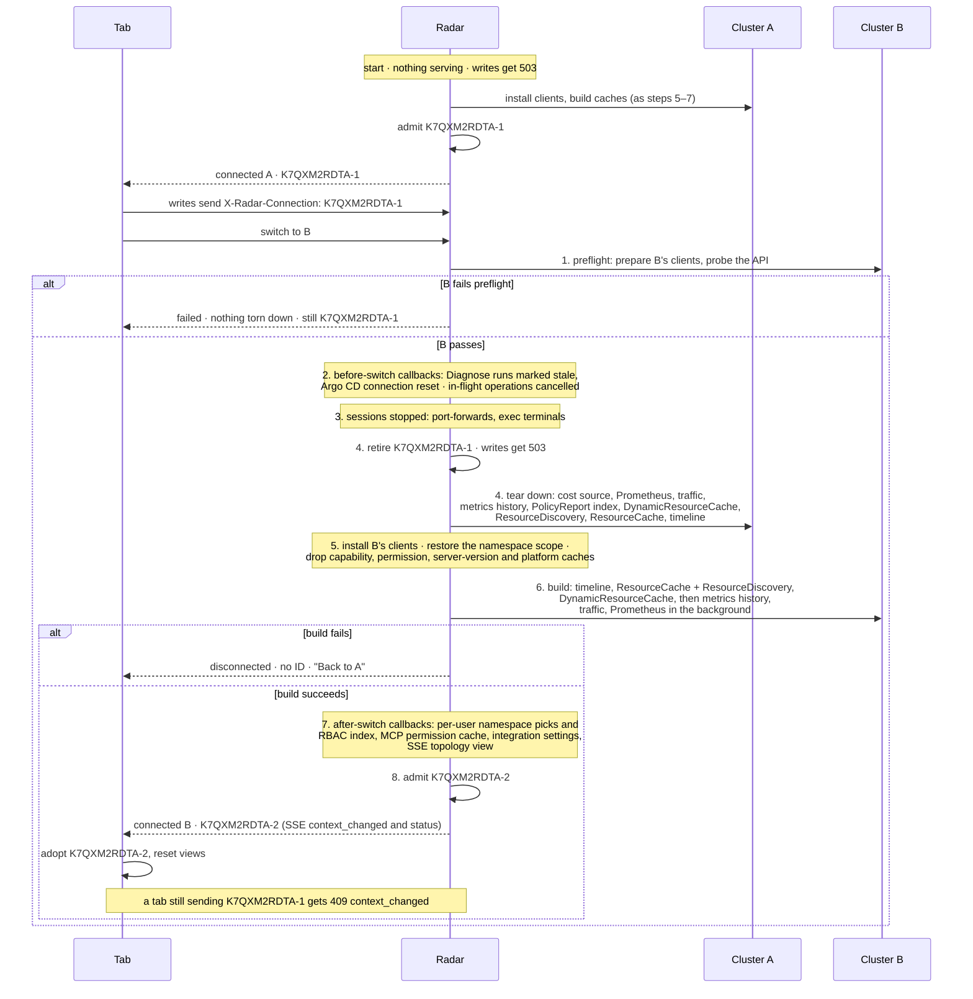

# Connection lifecycle

How Radar names the cluster connection it serves, and how a write is bound to the connection the browser tab is on.

## The guarantee

A bound write from a Radar tab runs against the connection the tab is on, or is refused before any Kubernetes work. In particular, a tab still showing cluster A after another tab switched Radar to B can't restart or scale B's same-named workload.

Bound writes are the routes wrapped with `bindWrite` in `internal/server/server.go`; `TestBoundWriteRoutesRefuseStaleConnection` walks every one. They are the workload, CronJob, Argo Workflow, resource (apply, update, delete), node, GitOps, Velero, CloudNativePG, Helm and CAPI connect actions, plus exec, file upload, debug containers and debug pods, port-forward start and the reachability probe test. Beyond the header check:
- **Drain** keeps running on the connection it was admitted to, even if Radar switches meanwhile. Exec and port-forward sessions end when Radar switches.
- **Code that only has a context** (MCP tools, reachability) gets its clients from `k8s.ClientFromContext` / `DynamicClientFromContext`, which return the bound connection's clients when the request was admitted with one.
- **CloudNativePG** captures its clients and caches in one step and checks there that the connection is still the bound one (`k8s.StillBound`).
- **Helm** captures one connection for a release read or write. Namespace authorization, release Secrets, discovery, Flux ownership and live resource health come from that connection. Install, upgrade, rollback, uninstall and source association (including streaming requests) use the REST config captured at write admission. Editing a kubeconfig file while Radar runs takes effect for Helm on the next connection. Exec credentials and token files still refresh through client-go.
- **CAPI connect** takes its client snapshot, then checks that the admitted connection is still serving: a switch before the check is refused, and one after it can't change the snapshot.
- **Velero** checks the Velero server's state in the shared cache, which a switch completing mid-request could replace; the write itself stays on the admitted connection.
- **Diagnose** (the in-product agent) is fenced by its runs: every switch marks all runs stale (`RunManager.OnContextSwitch`), and a stale run takes no further turns, so an investigation of one cluster can't continue, or apply a fix, on another.

External MCP callers name no connection. Each Helm write or preview uses the connection serving when the call starts. An uninstall confirmation also requires the admission that issued its preview, even after a reconnect under the same context name. Velero's download requests (run messages, contents, logs) aren't bound. An interrupted Helm action is not recovered.

**Only when Radar serves from a kubeconfig.** An in-cluster Radar can't change clusters (no kubeconfig contexts; CAPI connect is refused in-cluster), and during a rolling update two of its pods, each with its own IDs, answer the same browser. It publishes no ID and ignores one a request names; its writes still run on one captured set of clients.

## Connection identity

- **Admission.** When Radar starts serving a cluster (startup, a switch, Retry, auth recovery, a namespace rescope) it admits a connection with an ID `<bootNonce>-<n>`. IDs never repeat within a process, and the boot nonce keeps them distinct across restarts.
- **Retirement.** The point of no return of a switch, rescope, rebuild, auth demotion or shutdown clears the serving ID and closes that admission’s Done signal. Traffic flow streams end when that signal closes. Between retirement and the next admission nothing is serving. Shutdown closes admissions and cancels ongoing connection operations.
- **Not health.** A disconnect without teardown (a failed liveness check, a Helm transport error) keeps the ID: it says which connection was admitted, not whether it is healthy.
- **Publication.** The ID is published as `connectionId` on `/api/connection`, the Retry result, SSE `connection_state` frames and the SSE initial snapshot.

A first load, then a switch from A to B (`performContextSwitch` in `internal/k8s/context_manager.go`). IDs are a 10-character boot nonce and a counter that every admission in the process increments; the IDs below are examples. A first load runs the same build as a switch's steps 5–7.

Switching back to A admits `K7QXM2RDTA-3`, never `-1` again. After a restart the nonce changes (say `P4WNB7ZHQE-1`), so an ID from the previous process also gets 409. The client bundle, REST config and API discovery belong to one connection. A subsystem rebuild on the same clients installs a fresh connection with its own discovery slot. The Helm uninstall memo is available as soon as the connection is admitted. Reads already using the retired connection keep their captured memo.

Code: `internal/k8s/connection_state.go` (admission, retirement, publication), `internal/k8s/connection_binding.go` (capture).

## Binding

**Server** (`internal/server/connection_binding.go`):
- A bound write takes a pointer to the serving connection under the context-operation gate. It reads the ID, clients and discovery from that connection throughout the request, including discovery that finishes after admission.
- The request header `X-Radar-Connection` names the connection the caller is on. A different ID gets **409 `context_changed`**. No serving connection, or a context operation holding the lock, gets **503 `cluster_unavailable`** (retryable). No header: admitted against the current connection (API and MCP callers, older UIs). Both refusals say nothing was changed.

**Browser** (`web/src/api/connectionBinding.ts`):
- The tab keeps the latest connection ID it heard (status poll, SSE frame, Retry result) and `apiFetch` sends it on every request. Writes that can't use `apiFetch` send it themselves: the file upload's XHR sets the header, and the terminal adds `?connection=` to its WebSocket URL (`withConnectionParam`). A status with no ID (mid-switch) keeps the last one; the server refuses writes then anyway.
- Views reset whenever the tab finds itself connected to a different context, however it learns that: a `context_changed` refusal, an SSE frame, a Retry result, or the status poll (every 30s while connected, in background tabs too, and on focus).
- After a refusal, the toast says nothing was changed; the tab catches up on its next status poll or when it regains focus.
- A server without connection IDs (older or in-cluster Radar) publishes none, and the browser sends no header.

### Accepted gaps

The browser doesn't try to keep the ID in lockstep with what each view displays. That leaves short windows where a view still shows A while the tab already sends B's ID, for example a drawer's 300ms exit animation after a reset, or a status reply that arrives out of order. A write sent from such a view in that window runs on B. These windows are well under a second and need a click inside them, so Radar accepts them rather than ordering responses and tagging each view with the connection it shows. A tab that has been stale for longer (background, SSE dropped) still sends A's ID and is refused.

Also accepted:
- **A write arriving during shutdown** still runs on the connection the tab is on; admissions are closed first so nothing new is admitted.
- **Reads aren't bound.** A stale tab can display data from the new cluster before it resets; it can't write with it, since it still sends the old ID.
- **A context repointed to another cluster in the kubeconfig, then Retry,** keeps the same context name, so views refetch rather than reset; writes name the new connection from then on.
- **A host QueryClient that retries mutations** (Radar's own doesn't) could resend a refused restart after the tab adopted the new ID.

## Scenario checklist

Run these on major changes to connection, switching or binding code. **Live** scenarios use `scripts/connection-lifecycle-check.sh` against any two clusters you can write to, named by `CONTEXT_A` and `CONTEXT_B` (the radar-test EKS clusters by default; see the script's header for setup); **browser** scenarios use `scripts/connection-lifecycle-ui-check.mjs` against a Radar started on the same fixtures. Unit coverage is named where it exists.

| ID | Scenario | Expected | Live | Unit |
|----|----------|----------|------|------|
| L1 | Restart sent mid-switch by a tab still showing the old cluster | 503 `cluster_unavailable`, no write on either cluster | ✓ | `TestBoundWriteRefusedWhileNothingServes` |
| L1b | Same, with no connection header (API caller) | 503, no write | ✓ | same |
| L2 | Stale tab after the switch completed | 409 `context_changed`, no write | ✓ | `TestBoundWriteRefusesStaleConnection` |
| L2b | Current tab after the switch | 200, write on the new cluster only | ✓ | |
| L3 | A→B→A: the first A's ID after returning to A | 409, no write; IDs never repeat | ✓ | `TestBoundWriteRefusesStaleConnection`, `TestConnectionIdentityAdmitAndRetire` |
| L11 | Stale tab deletes a ConfigMap that exists, same-named, on both clusters | 409; kept on both | ✓ | `TestBoundWriteRoutesRefuseStaleConnection` |
| R1 | Each bound write route, through the router, with a stale ID | 409, no write on either cluster | | `TestBoundWriteRoutesRefuseStaleConnection` |
| — | Switch lands between admission and execution of a write | Write runs on the admitted cluster; the new one gets nothing | | `TestBoundRestartStaysOnAdmittedConnectionAcrossSwitch` (+ control `TestUnboundRestartFollowsTheSwitch`) |
| L4 | Status names the serving connection | `connectionId` set | ✓ | `TestConnectionIdentityAdmitAndRetire` |
| L5 | Status mid-switch | No serving ID, state `connecting` | ✓ | `TestConnectionIdentityAdmitAndRetire` |
| L6 | Unreachable target, failing exec plugin, stuck exec plugin | Refused before leaving; serving ID unchanged; old cluster still writable | ✓ | |
| L7 | Tracked switch with the first Pod list held 40s | Succeeds | ✓ | |
| L8 | ID from a previous Radar process | 409 | ✓ | |
| L9 | Same context name repointed to another cluster, then Retry | New ID; old ID 409; new ID writes to the new cluster | ✓ | |
| L10 | Stop during warm-up | Nothing serving; writes 503 | ✓ | |
| C1 | Work started on one connection (API discovery, a permission probe, a typed-cache build) finishes after a switch or rescope | Kept on its own connection, never served for the new one; `/api/capabilities` leaves `resources` unset rather than report it | | `TestLateDiscoveryStaysOnItsConnection`, `TestResetAllSubsystemsIsolatesInFlightPermissionProbe`, `TestNamespaceRescopeRetiresInFlightProbe`, `TestResetResourceCache_InvalidatesInFlightConstruction`, `TestCapabilitiesOmitsProbeResultAfterConnectionReplaced` |
| A1 | Credentials stop working while serving, then work again | 503 while demoted; serving again under a new ID; a write admitted before the demotion is refused | | `TestRuntimeAuthRecoveryReconnectsWhenCredentialsReturn`, `TestReadmissionKeepsTheSameConnection`, `TestAdmissionKeepsTheIDItWasCapturedUnder` |
| U1 | Browser: a tab with SSE and status frozen restarts from a stale drawer after another tab switched | Refused, message says nothing changed, no write on either cluster; the tab resets to the new cluster on its next status poll; the switching tab's restart writes the new cluster only | `connection-lifecycle-ui-check.mjs` | |
| I1 | In-cluster Radar | No ID published, a named connection ignored | | `TestInClusterRadarBindsNoConnections` |
| B1 | Statuses naming IDs, then one with none (mid-switch); another API base | Sends the latest ID; keeps it through the gap; each base its own | | `connectionBinding.test.tsx` |
| B2 | Server publishes no ID (older or in-cluster Radar) | No header sent | | `connectionBinding.test.tsx` |
| B3 | Server refuses a stale restart | The server's "Nothing was changed" message reaches the user | U1 | `connectionBinding.test.tsx` |
| S1 | Rescope (`--namespace-scope`) rebuild or rollback | New ID after the rebuild; Disconnected if the rollback fails | | `PerformNamespaceRescope` (manual) |
| S2 | Shutdown | No admission after shutdown begins | | `TestConnectionAdmissionsClosedAtShutdown` |

Not covered: a lost `context_changed` with no later status, stalls beyond a switch's time budget, and the unbound writes listed above.

