# Ecosystem Integrations

Radar automatically discovers and displays **any** Custom Resource Definition (CRD) in your cluster — no configuration needed. For popular tools, Radar adds dedicated capabilities described below, including detail views, topology edges, smart table columns, and AI-optimized summaries. Coverage varies by integration.

Operational Issues in an open resource detail view refresh after observed root
resource changes, coalesced to limit expensive checks. A once-per-minute visible-tab
refresh covers Pod-only changes and findings that depend on elapsed time. Returning
to a stale view refreshes it without requiring the detail view to be reopened.

Cluster-scoped drawers retain refresh-on-reopen/focus instead of automatic polling: their Issues request scans the whole cluster.

## OpenTelemetry Operator

Radar provides native resource details for `opentelemetry.io` **OpenTelemetryCollector**
and **Instrumentation**. Native list columns add reconciliation/configuration status
while retaining mode, version, image, management and instrumentation settings.

Collector details show deployment mode, management state, the reported Pod-count
snapshot, version/image and configured pipelines. Each pipeline lists receiver,
processor and exporter component names; components declared as connectors are
marked explicitly. Five pipelines are shown initially, with a control to show all.
Collector `v1beta1` structured configuration and served `v1alpha1` YAML configuration
are supported. An unreadable preview directs you to YAML rather than claiming the
configuration has no pipelines.

**Reconciliation is separate from runtime health.** The operator writes `Ready=True`
when reconciliation succeeds, even if collector Pods are unready. Radar labels
this **Reconciled**, with a neutral status. Earlier-generation observations are
**Status stale**. Inspect the generated Deployment, DaemonSet or StatefulSet through
existing ownership/Related Resources for current workload readiness. Reported Pod
counts are a reconciliation-time snapshot: ready/observed total for Deployment
and StatefulSet, or ready/desired scheduled Pods for DaemonSet.
Neither readiness nor configuration proves telemetry delivery.

Instrumentation details show the declared OTLP endpoint, propagators, sampler and
runtime images. The configuration is **Configured**, not healthy; blocked automatic
image upgrades are highlighted. This does not attribute injected Pods or infer
collector relationships from endpoint strings.

**REST and MCP:** existing resource list/get tools gain concise native summaries.
Collector summaries include reconciliation state, mode, version and image.
The optional `openTelemetryCollector.reportedPodReadiness` is the operator's Pod-count snapshot,
not current readiness; read failures or a switch to sidecar mode can retain an
earlier value. `openTelemetryCollector.declaredPipelines` gives the declared count and
up to five sorted names, with truncation reported. That block is omitted when
configuration cannot be previewed; omission does not mean zero pipelines. Alpha
YAML previews are limited to 64 KiB. Instrumentation summaries name up to ten
languages under `openTelemetryInstrumentation.recordedUpgradeBlocks`, using the
same `{count,names,namesTruncated}` preview as declared pipelines,
without copying arbitrary status messages. These are additive summary fields;
no new MCP tool is introduced. Existing generic ownership remains;
no endpoint-derived topology edges, telemetry queries, or new Issues source are added.
Existing condition Issues surface managed reconciliation failures and status-read
errors with the operator's message; unmanaged and stale observations are suppressed.
A status-read warning does not establish a Collector Pod failure.

| Resource | Group | Topology | Detail View | AI Summary |
|---|---|---|---|---|
| OpenTelemetryCollector | opentelemetry.io | No dedicated nodes or edges; owned-workload navigation is in Related Resources | Reconciliation, reported Pods and pipeline components | Reconciliation, mode, version and image |
| Instrumentation | opentelemetry.io | No inferred injected-workload edges | Injection settings and blocked upgrades | Configuration and upgrade state |

**Permissions:** the Helm chart already collects `opentelemetry.io` resources when
`rbac.crdGroups.opentelemetry` is enabled. The Cloud integration-read baseline does
not grant these full objects to default caller tiers: collector configuration and
instrumentation environment values can contain credentials. Supply explicit
customer-managed read permissions for caller-authorized tools when needed. This
baseline exception is not a full-object UI/REST confidentiality guarantee; runtime
response authorization remains separate. It does not revoke
permissions already granted by other roles.

### Instrumentation upgrade history

The neutral “Upgrade block recorded” status describes `status.upgradeBlockedVersions`, written during an operator startup upgrade pass. A record can remain after a manual image change; it is not a current compatibility or runtime-health verdict. The drawer shows at most ten recorded languages, with shortened labels and a link to full YAML for remaining entries. Compact agent summaries retain their bounded language preview; detail reads retain native status without a duplicate context block.

## Flagger

Radar provides native details and concise REST/MCP summaries for `flagger.app`
**Canary** and **MetricTemplate** resources, with native list columns for recorded state, strategy, canary target, reported
weight and requested suspension. The unstable top-level transition timestamp is
not used as a failure-onset column.

Canary details distinguish recorded rollout phase from a requested suspension.
The recorded phase stays visible while suspension is requested. Normal analysis,
confirmation waits and promotion are neutral states; a failed last
rollout remains visible even when suspension is requested. Flagger does not publish
an observed generation, so its recorded phase is not proof that the latest spec
has been reconciled. `Promoted=False` alone is not treated as a failure.

The drawer links to the canary-side target, optional HPA/KEDA scaler and metric
templates, including template namespace overrides. Links follow the controller's
native clients: templates always resolve as `flagger.app` MetricTemplates; target
kind determines the apps/core/Knative identity. Built-in metrics and inline queries
are labeled without inventing template links. Blue/green, A/B and mirrored analysis
are identified; reported canary weight is shown for weighted canaries, not as a
live traffic measurement. MetricTemplate details show provider configuration and
query text without rendering provider headers or fetching external metrics.

A Deployment target is normally scaled to zero between analyses while its primary
continues serving. Generated primary resources appear through existing ownership
in Related Resources; Radar does not manufacture primary links from naming guesses.
DaemonSet targets are parked using a node selector rather than zero replicas.

**Issues:** collected Canaries in the caller-visible namespace scope with `status.phase=Failed` produce a warning
for the last recorded rollout. The onset comes from the matching failed `Promoted` condition’s last-transition
time when valid; the top-level timestamp is rewritten on scheduler ticks and is
not used. Without that condition the onset remains unknown. Inspect the Canary's events for the
cause. A failed new rollout does not imply the primary is down. Suspended failed
rollouts remain visible; ordinary waiting/progress and `Promoted=False` remain quiet.
No new workflow actions, topology edge types, traffic queries or MCP tools are added.

Compact REST/MCP summaries also identify the configured strategy and carry the
reported counters under `flaggerCanary`: weight percentage for weighted analysis, iteration
for iteration-based analysis, and failed checks when reported. A reported zero
is retained; an absent counter means unreported, not zero. These counters are
controller snapshots, with the same freshness limits as the recorded phase.

| Resource | Group | Topology | Detail View | AI Summary |
|---|---|---|---|---|
| Canary | flagger.app | No dedicated nodes or edges; primary navigation is in Related Resources | Recorded rollout, analysis and explicit refs | Recorded outcome, suspension and target |
| MetricTemplate | flagger.app | No new edges | Provider and query configuration | Provider type and configuration state |

**Access limitation:** existing namespace-authorized REST, YAML and MCP paths can
return full Canary and MetricTemplate objects, including credential-bearing
webhook metadata and provider headers, to callers with namespace visibility.
Native summaries omit those fields; this integration does not add a per-kind
response-authorization or redaction boundary.

**In-cluster collection is opt-in:** set `rbac.crdGroups.flagger=true` in the Radar
Helm chart to grant its collector `get/list/watch` on Canaries and MetricTemplates.
Without collection access, in-cluster browsing and failed-rollout Issues for these
kinds are unavailable. Locally, Radar uses the current Kubernetes identity's access.
The Cloud integration-read baseline does not add these resources to generated
caller-role grants. That baseline is not a deny rule for the response paths above.
Default collector/caller access for existing integrations is unchanged.

### Flagger dependency checks

Issues reports missing declared Flagger targets, analysis MetricTemplates and provider Secrets used by those templates. These are warnings about release reconciliation/evaluation, not proof the stable primary is down. Suspended/deleting Canaries produce no reference warnings; skipped analysis suppresses only analysis-reference warnings; zero target replicas are valid.

Absence is reported only from an already watched, synced inventory covering the referenced namespace. Unwatched, unsynced or unreadable dependencies produce no missing-reference finding; the scan starts no watches and makes no provider requests. Secret checks use metadata existence, never values. Findings depending on another namespace or Secret inventory are withheld unless the caller may read that evidence. Generated primary workloads and Services are not declared prerequisites.

## System Upgrade Controller

Rancher, k3s and RKE2 upgrade nodes with [system-upgrade-controller](https://github.com/rancher/system-upgrade-controller): a `Plan` (`upgrade.cattle.io/v1`) selects Nodes with `spec.nodeSelector` and runs one upgrade Job per Node, `spec.concurrency` at a time.

**Plan drawer.** Status reads `Not valid` when the controller rejected the Plan (`Validated=False`); `Failed` when it reports a failed upgrade Job, a node selection or job validation error (`Complete=False` with `JobFailed`, `SelectNodesFailed` or `ValidationFailed`); `Version not resolved` when `LatestResolved=False` (the controller sets it when the Plan has neither `spec.version` nor `spec.channel`, which passes `Validated`, so Radar raises no Issue for it; a channel it fails to poll leaves the condition as it was); `Waiting for window` outside `spec.window`; `Not ready` when the controller holds the Plan back with neither of those conditions False (`Complete=False` with `NotReady`: it could not poll the channel before it ever resolved a version); `In progress` while it is applying to a Node or otherwise `Complete=False`; `Complete` when `Complete=True`; and `Not reported` otherwise. Target shows the version (or channel), the upgrade image, concurrency, service account, cordon and drain settings, the Secret names it mounts, and how many env variables and env sources the upgrade and prepare containers get (never their values). Progress lists the Nodes the controller would select (it also requires a `kubernetes.io/hostname` label and skips Nodes whose `plan.upgrade.cattle.io/<plan>` label is `disabled`), each **upgraded** (that label equals the Plan's `status.latestHash`), **upgrading** (its hostname is in `status.applying`, which holds hostnames, not Node names) or **pending**, with an "N of M nodes upgraded" bar, capped at 50 rows. Progress needs the Node list: when Radar can't read every Node it says progress is unknown instead of showing "0 of 0", and a selector with an operator Radar doesn't evaluate is named rather than guessed. A null `nodeSelector` selects no Node, an empty one every Node, as the controller reads it.

**Issues.** A Plan the controller rejected raises a warning Issue (`UpgradePlanInvalid`) with the controller's message. A failed upgrade Job is already reported by the Job checks.

**Upgrade impact.** When Plans that upgrade the distribution itself exist (an upgrade image ending in `k3s-upgrade` or `rke2-upgrade`), the Upgrade impact page lists them with their version and state, linking to each, even when its own scan fails; when the caller could list Plans in only some namespaces the count reads "at least". Other Plans, such as Rancher's system-agent upgrader, appear only in their own list.

**Values.** Env values (`spec.upgrade.envs`, `spec.prepare.envs`) are shown in no drawer section and are redacted from AI context. The YAML tab shows the object as stored to whoever can read it.

**In-cluster.** The chart toggle `rbac.crdGroups.systemUpgrade` is **off by default** (read-baseline decision `withhold`: Plan env can carry values, and `spec.secrets` names Secrets mounted into upgrade Jobs). Local runs use your own kubeconfig.

| Resource | Group | Topology | Detail View | AI Summary |
|----------|-------|----------|-------------|------------|
| Plan | `upgrade.cattle.io/v1` | — | Yes | Env values redacted |

---

## ConfigMap and Secret reflection (Reflector)

[EmberStack Reflector](https://github.com/emberstack/kubernetes-reflector) copies
core Secrets and ConfigMaps between namespaces using annotations. It needs no CRDs.

**Resource details:** ordinary Secrets and ConfigMaps are unchanged. Mirrors show compact source navigation and edit guidance before their data, after Secret identity and certificate-expiry alerts. Detailed settings follow the data in a collapsible **Reflector** section
showing source/mirror role, automatic versus manual mirrors, reflection permission,
and configured namespace name patterns and label selectors. Visible sources and
mirrors are linked directly. Source section titles show the visible mirror count; expanding shows five mirrors initially, with a control to show all. Automatic creation requires reflection permission;
name patterns and selectors are alternatives within each rule on controller versions
that support selectors. Radar displays these rules without predicting a destination
set or evaluating the controller's regular expressions.

**Recorded copy evidence:** mirrors show `reflected-version` and `reflected-at` when
present. When the source is visible, Radar compares its observed resource version
with the mirror's recorded version. These cached observations can lag reconciliation.
This is metadata evidence, not a content or
health check: metadata-only changes advance source versions, and editing a mirror
can leave its recorded version unchanged. Mirror details and Secret edit confirmation
explain that local changes may persist until a source update overwrites them.

**Configuration checks:** local warnings identify malformed or self-referencing
source declarations, invalid boolean settings, automatic creation without reflection
permission, sources with visible mirrors but disabled reflection, and mirror chains that do not propagate updates as ordinary sources.
These appear in resource details, not as cluster-wide health findings.

**Topology:** when both objects are visible, the mirror's `reflects` annotation
creates a **Reflects to** configuration edge from source to mirror, including mirrors
with a different name. It represents a declaration, not Kubernetes ownership or
successful synchronization. Namespace filters apply. Secret nodes are hidden by
default and require Secret list access when included. The REST resource-detail relationship response also
identifies reflection sources and mirrors explicitly.

**Unused resource checks:** observed consumption of a mirror also counts as use of
its visible same-kind source, including declared chains. Automatic mirrors with
visible sources are exempt when unused, but their existence alone does not prove
source use. Without adequate consumer inventory, a source is unknown rather than
unused; see [audit evidence under partial access](configuration.md#audit-evidence-under-partial-access).

**Agent context (MCP and REST):** `get_resource` and the REST AI resource context expose an optional `resourceContext.reflection` block. It separates `declaredSource` from an authorized observed `source`, includes recorded copy metadata and the authorized source resource version, and lists up to 20 `visibleMirrors` with `truncated` when more authorized mirrors were observed. This lookup spans namespaces in the available cache independently of the resource-context graph. Unreadable endpoints and their versions are withheld; omitted-field reasons describe unavailable cache evidence or denied access. These observations do not prove complete distribution or synchronization health.

**Partial visibility:** unavailable sources are not called missing, and visible mirror
counts are not expected totals. Radar does not diagnose absent mirrors, name conflicts,
controller availability, or synchronization lag. Controller configuration and version
can further restrict eligible namespaces. Inspect controller logs when a declared
relationship is not being reconciled.

| Resource | Group | Topology | Detail View |
|----------|-------|----------|-------------|
| ConfigMap | Core | Source → mirror configuration edge | Reflection settings, visible mirrors, source navigation, copy-version evidence, local configuration warnings |
| Secret | Core | Source → mirror configuration edge when included and authorized | Same metadata-only reflection details; values remain behind existing reveal controls |

---

## Karpenter

[Karpenter](https://karpenter.sh/) is the standard node autoscaler for Kubernetes, replacing Cluster Autoscaler on AWS (EKS), Azure (AKS NAP), and generic clusters.

### What Radar Shows

**Capacity view:** When Radar discovers Karpenter NodePools (and the current identity can list them), a cluster-wide **Capacity** view appears in navigation — a read-only diagnosis surface across four screens:
- **Overview** — fleet KPIs with claim lifecycle detail, a cluster scheduling-capacity bar (scheduled requests vs allocatable, in-flight claim capacity beyond the allocatable edge, pending demand as a not-to-scale count), prioritized operational signals, and the NodePool inventory
- **NodePool detail** — the capacity ledger (configured limit, provisioned, headroom, allocatable, scheduled requests, unallocated, actual usage) plus claim lifecycle, fleet composition, and workload attribution
- **Demand** — pending pods grouped by scheduling signature, each group evaluated against every NodePool's declared constraints with per-predicate evidence
- **Activity** — provisioning, disruption, interruption, and termination episodes classified from Karpenter's exact event vocabulary

Every quantity carries per-value certainty (`= ≥ ≤ ?`): unavailable is never rendered as zero, partial is never rendered as exact, and **scheduling capacity is kept structurally distinct from actual usage** — Karpenter schedules on pod requests, so usage is an efficiency signal, never scheduler headroom. Issues, Pending-pod drawers, and the Home posture card deep-link into the right diagnosis. Full reference: [Capacity documentation](capacity.md).

**Node removal:** Nodes marked for removal show an operational lifecycle status while keeping readiness and independent failures visible. The drawer shows current pods and a read-only drain/PDB estimate. See [Node status and removal](nodes.md) for the shared UI/API/MCP contract.

**Topology:** Full provisioning chain — NodePool → NodeClaim → Node → Pod. See which NodePool owns which NodeClaims, which Nodes they provisioned, and what Pods are running on them. NodePool → NodeClass edges show the provider-specific configuration each pool uses.

  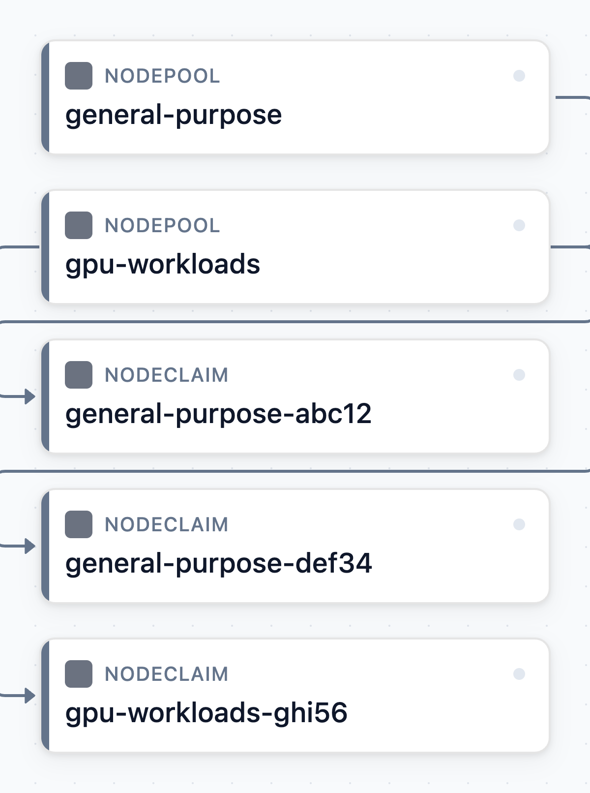
   <em>Karpenter in Topology View — NodePool → NodeClaim provisioning chain</em>

**NodePool Detail View:**
- Status conditions (Ready)
- Clickable NodeClass reference (EC2NodeClass, AKSNodeClass, or generic)
- Resource limits (CPU, memory)
- Disruption policy and consolidation settings
- Disruption budget reasons, termination grace period, and requirement `minValues`
- Instance requirements (types, zones, architectures)
- Template labels applied to provisioned nodes

  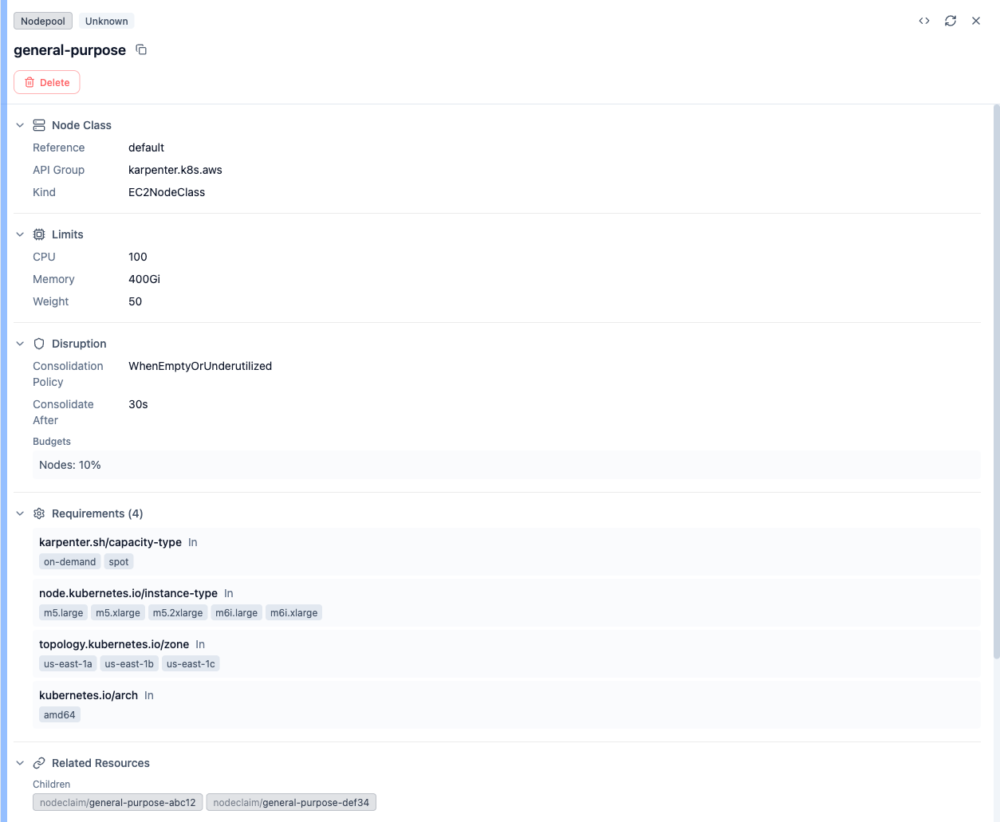
   <em>NodePool Detail View — Status, related NodeClaims, and full specification</em>

**NodeClaim Detail View:**
- Provisioning timeline with timestamps
- Status conditions (Initialized, Launched, Registered, Ready)
- Instance type, capacity, and zone
- Requirements (instance types, architectures, OS)
- Clickable Node and NodeClass references

**NodeClass Detail View** (EC2NodeClass, AKSNodeClass, etc.):
- AMI selector terms and aliases
- Block device mappings (volume type, size, encryption)
- IAM role configuration
- Subnet and security group discovery tags
- Instance metadata options (IMDS configuration)

**Resource Browser:** Smart columns show status, NodeClass reference, limits, and disruption policy at a glance.

  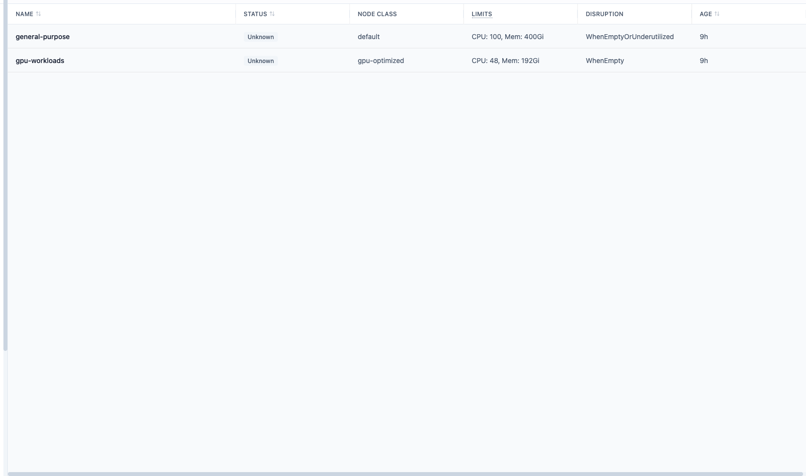
   <em>NodePool Resource Browser — Status, NodeClass, limits, and disruption policy at a glance</em>

### Supported CRDs

| CRD | Group | Topology | Detail View | AI Summary |
|-----|-------|----------|-------------|------------|
| NodePool | `karpenter.sh/v1` | Yes | Yes | Yes |
| NodeClaim | `karpenter.sh/v1` | Yes | Yes | Yes |
| EC2NodeClass | `karpenter.k8s.aws/v1` | Yes | Yes | Yes |
| AKSNodeClass | `karpenter.azure.com/v1alpha2` | Yes | Generic | Yes |
| GCENodeClass | `karpenter.k8s.gcp/v1alpha1` | Yes | Generic | Yes |

All provider-specific NodeClass variants are automatically detected and supported.

---

## Cluster API (CAPI)

[Cluster API](https://cluster-api.sigs.k8s.io/) is the Kubernetes sub-project for declarative cluster lifecycle management. Used by platform teams to provision and manage workload clusters.

### What Radar Shows

**Topology:** Full CAPI ownership chain — ClusterClass → Cluster → KubeadmControlPlane → Machine → Node, and Cluster → MachineDeployment → MachineSet → Machine → Node. MachineHealthCheck → Cluster protection edges. Machine → Node edges use status.nodeRef (semantic, not owner-ref).

ClusterClass links use the namespace declared by the Cluster, defaulting to the Cluster’s namespace when omitted. Both `spec.topology.classRef` and the older supported `class`/`classNamespace` API fields are read. Owner links require the declared API group as well as kind and name; same-named resources from unrelated groups remain distinct.

**Cluster Detail View:**
- Phase, version, cluster class, control plane endpoint
- Control plane and worker replica counts (v1beta2-aware)
- Control plane and infrastructure references (clickable)
- ClusterClass topology section (worker MachineDeployments table)
- "Connect to Cluster" button — auto-connects Radar to the workload cluster
- "Download Kubeconfig" button
- Conditions

**Machine Detail View:**
- Phase, role (Control Plane / Worker), version, provider ID
- Clickable Node reference (via status.nodeRef)
- Addresses table, node info (OS, architecture, kernel, kubelet)
- Bootstrap and infrastructure references

**MachineDeployment Detail View:**
- Phase, replicas (desired/ready/available/up-to-date), strategy
- Version, cluster name
- Machine template references
- Owned machines label hint (copyable)

**KubeadmControlPlane Detail View:**
- Replicas, version, initialized status (v1beta2-aware)
- Machine template with drain/volume detach/deletion timeouts
- Kubeadm config highlights (cert SANs)
- Last remediation info
- Owned machines label hint

**ClusterClass Detail View:**
- Infrastructure, control plane, worker topology tables
- Variables with schema types
- Patches with definitions and enabledIf expressions

**MachineHealthCheck Detail View:**
- Expected/healthy machine counts, remediations allowed
- Label selector display
- Unhealthy conditions tables (v1beta1 + v1beta2 formats)
- Remediation template

**Additional renderers:** MachineSet, MachinePool, MachineDrainRule, KubeadmConfig/Template

**Resource Browser:** Smart columns for all CAPI kinds — phase badges, replica counts, cluster names, roles, versions.

**Machine conditions:** A modern `status.v1beta2.conditions` True resolves the same-named deprecated failure in a v1beta1 Machine response. Expected progress stays selected so this cleanup cannot reveal a new warning behind it. Unknown, including aggregate Ready, does not establish recovery, so it does not suppress the deprecated failure; this preserves diagnostics for provisioned Machines whose nodes never join. Failed/stuck phase detections retain priority; their condition detail uses this selection rule, including the expected-progress exception. Legacy-only and direct v1beta2 responses keep their existing interpretation. Other CAPI kinds, renamed condition types, progress rules and timers are unchanged.

**Topology-controlled badge:** Resources managed by ClusterClass (label `topology.cluster.x-k8s.io/owned`) show a warning banner.

**Fleet topology mode:** Dedicated "Fleet" view filters to CAPI and infrastructure provider resources only, giving a clean cluster-management view without application workload noise. Groups start expanded by default.

**Resource browser** with smart columns per CAPI kind — Provider detection, phase badges, replica counts:

**Cluster detail view** with Connect to Cluster and Download Kubeconfig actions, provider detection, and clickable references to infrastructure resources:

### Infrastructure Provider Renderers

Radar has first-class renderers for **AWS (CAPA)**, **GCP (CAPG)**, and **Azure (CAPZ)** infrastructure provider resources. These surface provider-specific operational data — instance types, scaling config, VPC/subnet topology, managed service addons — that would otherwise be buried in raw YAML.

**AWS EKS control plane** — VPC topology with subnets (Public/Private badges), security groups, EKS addons, IAM roles:

**GCP GKE control plane** — project, location, release channel, and conditions timeline with left-aligned timestamps:

**Managed machine pools**: Instance/VM types, scaling config (autoscaling min/max), capacity type badges (On-Demand/Spot), node management (auto-repair/upgrade), labels and taints.

**Azure AKS**: Location, resource group, SKU tier, network plugin/policy, System/User mode badges, Regular/Spot priority, availability zones.

**Individual machines**: Instance type/state badges, provider IDs, addresses, conditions.

**Templates and cluster stubs**: Lightweight renderers for instance templates (with resolved capacity) and cluster infrastructure stubs (endpoint + failure domains).

### Supported CRDs

| CRD | Group | Topology | Detail View | AI Summary |
|-----|-------|----------|-------------|------------|
| Cluster | `cluster.x-k8s.io` | Yes | Yes | Yes |
| ClusterClass | `cluster.x-k8s.io` | Yes | Yes | Yes |
| Machine | `cluster.x-k8s.io` | Yes | Yes | Yes |
| MachineSet | `cluster.x-k8s.io` | Yes | Yes | Yes |
| MachineDeployment | `cluster.x-k8s.io` | Yes | Yes | Yes |
| MachinePool | `cluster.x-k8s.io` | Yes | Yes | Yes |
| MachineHealthCheck | `cluster.x-k8s.io` | Yes | Yes | Yes |
| MachineDrainRule | `cluster.x-k8s.io` | No | Yes | No |
| KubeadmControlPlane | `controlplane.cluster.x-k8s.io` | Yes | Yes | Yes |
| KubeadmControlPlaneTemplate | `controlplane.cluster.x-k8s.io` | No | Generic | No |
| KubeadmConfig | `bootstrap.cluster.x-k8s.io` | No | Yes | No |
| KubeadmConfigTemplate | `bootstrap.cluster.x-k8s.io` | No | Generic | No |
| AWSManagedControlPlane | `controlplane.cluster.x-k8s.io` | Yes | Yes | No |
| AWSManagedMachinePool | `infrastructure.cluster.x-k8s.io` | Yes | Yes | No |
| AWSMachine | `infrastructure.cluster.x-k8s.io` | Yes | Yes | No |
| AWSMachineTemplate | `infrastructure.cluster.x-k8s.io` | No | Yes | No |
| AWSManagedCluster | `infrastructure.cluster.x-k8s.io` | No | Yes | No |

---

## KEDA

[KEDA](https://keda.sh/) (Kubernetes Event-Driven Autoscaling) is a CNCF graduated project that scales workloads based on external event sources — queues, streams, cron schedules, Prometheus metrics, and 60+ other triggers.

### What Radar Shows

**Topology:** ScaledObject → target workload (Deployment, StatefulSet, or Rollout). ScaledObject and ScaledJob triggers also link to observed TriggerAuthentication or ClusterTriggerAuthentication resources. Authentication is a dependency, not an autoscaler target; omitted kind defaults to a same-namespace TriggerAuthentication. Cluster-scoped targets retain per-kind read gating. These declarations do not prove credential validity or trigger readiness. Applications configuration references and counts exclude authentication objects the caller cannot read.

  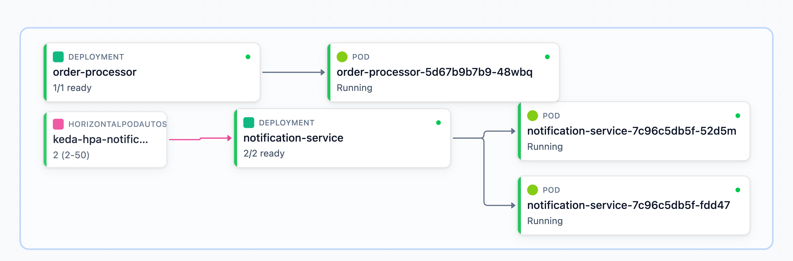
   <em>KEDA in Topology View — ScaledObject → Deployment → Pod scaling chain</em>

**ScaledObject Detail View:**
- Status conditions (Ready, Active, Paused, Fallback)
- Target workload reference
- Min/Max/Idle replica configuration
- Polling interval and cooldown period
- Trigger list with type and metadata
- Generated HPA name
- Pause state detection (supports all 3 annotation variants)

  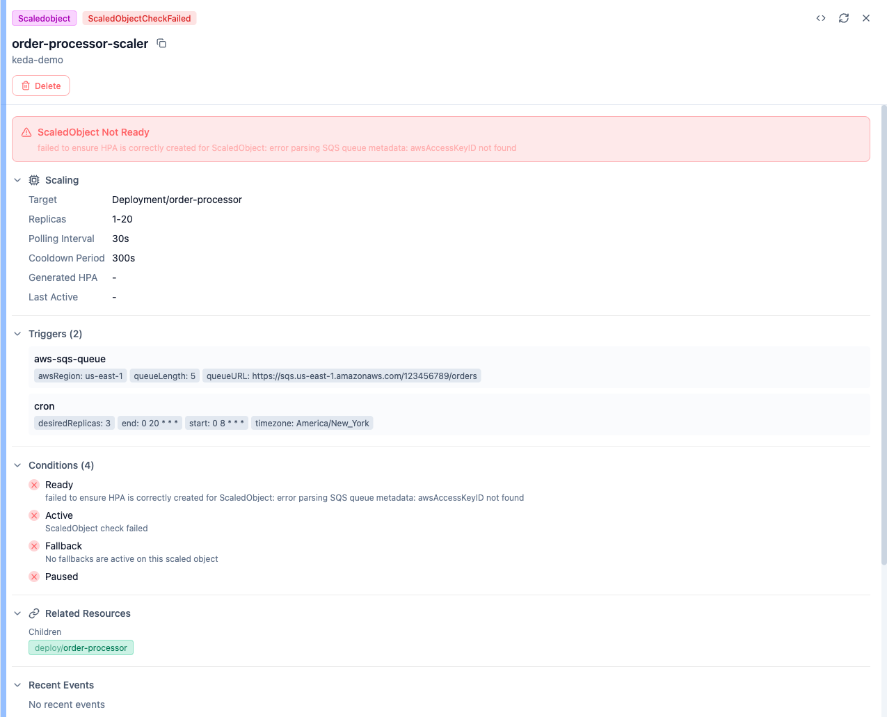
   <em>ScaledObject Detail View — Status conditions, target workload, triggers, and replica configuration</em>

**ScaledJob Detail View:**
- Status conditions
- Job target reference
- Scaling strategy (default, custom, accurate, eager)
- Success/failure limits
- Trigger list

**TriggerAuthentication Detail View:**
- Pod identity provider and configuration
- Secret references with linked Secret navigation
- Environment variable mappings
- External secret providers (HashiCorp Vault, Azure Key Vault, AWS Secrets Manager)

**Resource Browser:** Smart columns show status, target workload, trigger count, and replica range at a glance.

  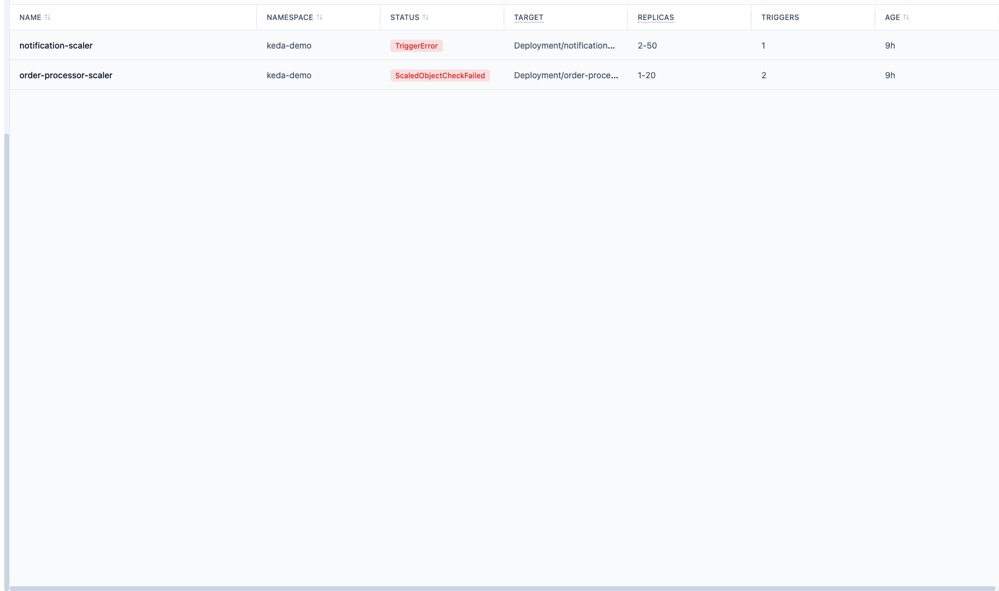
   <em>ScaledObject Resource Browser — Status, target workload, trigger count, and replica range</em>

### Supported CRDs

| CRD | Group | Topology | Detail View | AI Summary |
|-----|-------|----------|-------------|------------|
| ScaledObject | `keda.sh/v1alpha1` | Yes | Yes | Yes |
| ScaledJob | `keda.sh/v1alpha1` | Yes | Yes | Yes |
| TriggerAuthentication | `keda.sh/v1alpha1` | When referenced | Yes | Yes |
| ClusterTriggerAuthentication | `keda.sh/v1alpha1` | When referenced | Yes | Yes |

---

## Vertical Pod Autoscaler (VPA)

[VPA](https://github.com/kubernetes/autoscaler/tree/master/vertical-pod-autoscaler) automatically adjusts CPU and memory requests/limits for pods based on observed usage.

### What Radar Shows

**Topology:** VPA nodes appear in the Resources view with `EdgeUses` edges to target workloads, grouped in the Scalers section alongside HPA and KEDA.

**Detail View:** Target workload, update mode, per-container resource recommendations (target, lower bound, upper bound, uncapped), resource policy, and conditions.

Target links use the API group in `targetRef.apiVersion`. Built-in targets without an API version use their standard group.

**Problem Detection:** Alerts for unsupported configurations, missing recommendations, and low confidence scores.

### Supported CRDs

| CRD | Group | Topology | Detail View | AI Summary |
|-----|-------|----------|-------------|------------|
| VerticalPodAutoscaler | `autoscaling.k8s.io/v1` | Yes | Yes | — |

---

## Gateway API

[Gateway API](https://gateway-api.sigs.k8s.io/) is the next-generation Kubernetes networking API, replacing Ingress with more expressive routing, traffic splitting, and multi-tenant support.

### What Radar Shows

**Topology:** Full network path — GatewayClass → Gateway → HTTPRoute/GRPCRoute/TCPRoute/TLSRoute/UDPRoute → Service → Pod. Visualize how traffic flows from the gateway controller through routes to your backend services.

  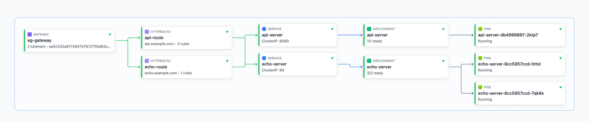
   <em>Gateway API in Topology View — GatewayClass → Gateway → HTTPRoute → Service traffic path</em>

**Gateway Detail View:** Listeners, addresses, attached routes, and status conditions.

**GatewayClass Detail View:** Controller name, description, parameters reference, and status conditions.

**HTTPRoute Detail View:** Rules with path/header matching, backend references, filters, and weights.

**GRPCRoute Detail View:** Service/method matching, backend references, and filters.

### Supported CRDs

| CRD | Group | Topology | Detail View | AI Summary |
|-----|-------|----------|-------------|------------|
| GatewayClass | `gateway.networking.k8s.io/v1` | Yes | Yes | Yes |
| Gateway | `gateway.networking.k8s.io/v1` | Yes | Yes | Yes |
| HTTPRoute | `gateway.networking.k8s.io/v1` | Yes | Yes | Yes |
| GRPCRoute | `gateway.networking.k8s.io/v1` | Yes | Yes | Yes |
| TCPRoute | `gateway.networking.k8s.io/v1alpha2` | Yes | Yes | Yes |
| TLSRoute | `gateway.networking.k8s.io/v1alpha2` | Yes | Yes | Yes |
| UDPRoute | `gateway.networking.k8s.io/v1alpha2` | Yes | Yes | Yes |

---

## Traefik

[Traefik](https://traefik.io/) is a modern reverse proxy and ingress controller for Kubernetes, with dynamic configuration, middleware chains, and advanced traffic management via CRDs.

### What Radar Shows

**Topology:** Full Traefik routing path — IngressRoute → Middleware → Service (or TraefikService → Service) with TLS and transport configuration edges. See how traffic flows from entrypoints through middleware chains and weighted/mirroring TraefikServices to backend Kubernetes Services. Both **Resources** and **Traffic** view modes are supported.

**IngressRoute / IngressRouteTCP / IngressRouteUDP Detail View:**
- Entry points and TLS configuration (secret, cert resolver, TLS options/stores)
- Route match expressions with priority and kind badges
- Per-route services with port, weight, and ServersTransport links
- Per-route middleware references with cross-namespace indicators
- Aggregated middleware chain with numbered ordering
- Alert banners for no-route or no-service configurations

**Resource Browser:** Smart columns show entry points, hosts (extracted from match expressions), route summaries, TLS status, and middleware counts. All 10 Traefik kinds have dedicated table columns — Middleware shows type, TraefikService shows type and targets, ServersTransport shows insecure/serverName, TLSOption shows min TLS version.

**Middleware / MiddlewareTCP Detail View:** type-aware rendering — `chain` links its member middlewares, auth middlewares (basicAuth/digestAuth/forwardAuth) show **secret references only, never values**, `errors` shows its service and status mapping, and unknown/plugin types fall back to a key/value view with nested credential keys redacted.

**TraefikService Detail View:** weighted backends with weight bars, mirroring (primary plus mirrors with percentages), and the load-balancing strategy.

**TLSOption Detail View:** minimum/maximum TLS versions, cipher suites, and client-auth configuration.

**ServersTransport / ServersTransportTCP Detail View:** SNI, an `insecureSkipVerify` warning banner, CA/client-cert secret references, and timeouts.

**Secret safety:** inline credentials in a Traefik CRD spec are redacted in the AI/MCP context (`get_resource`) — credential keys and high-confidence secret patterns are masked — and the Middleware detail renderer shows secret *references* only, never values. Reference names (`secretName`, `basicAuth.secret`, `rootCAsSecrets`) are preserved so you can still diagnose a bad reference. The raw YAML view still shows the object as stored in the cluster.

### Cluster Audit checks

Traefik ships no admission webhook or linter, so a typo'd reference is accepted, and Traefik then does not load any router that needs it: the route serves nothing (a 404 unless another router matches) and the error shows only in Traefik's log and dashboard. When a running Traefik loads the IngressRoute, `issues` reports it as a live failure on the IngressRoute (see [MCP](mcp.md)). Radar's Cluster Audit catches the common dangling-reference cases as **Reliability** checks:

| Check | What it catches |
|-------|-----------------|
| `traefikRouteMissingService` | An IngressRoute referencing a Service or TraefikService that doesn't exist |
| `traefikRouteMissingMiddleware` | An IngressRoute referencing a Middleware that doesn't exist |
| `traefikChainMissingMiddleware` | A `chain` Middleware listing a member Middleware that doesn't exist |
| `traefikErrorsMissingService` | An `errors` Middleware whose `errors.service` references a Service that doesn't exist |

These checks are **inventory-authoritative**: a "missing X" finding is asserted only when that target kind is served by a cluster-wide synced informer, so a namespace-scoped (RBAC-limited) cache skips the check rather than fabricating a false positive. Matching is group-aware — a `traefik.io` reference is not satisfied by a `traefik.containo.us` object — and cross-namespace references resolve correctly.

### Supported CRDs

| CRD | Group | Topology | Detail View | AI Summary |
|-----|-------|----------|-------------|------------|
| IngressRoute | `traefik.io/v1alpha1` | Yes | Yes | — |
| IngressRouteTCP | `traefik.io/v1alpha1` | Yes | Yes | — |
| IngressRouteUDP | `traefik.io/v1alpha1` | Yes | Yes | — |
| Middleware | `traefik.io/v1alpha1` | Yes | Yes | — |
| MiddlewareTCP | `traefik.io/v1alpha1` | Yes | Yes | — |
| TraefikService | `traefik.io/v1alpha1` | Yes | Yes | — |
| ServersTransport | `traefik.io/v1alpha1` | Yes | Yes | — |
| ServersTransportTCP | `traefik.io/v1alpha1` | Yes | Yes | — |
| TLSOption | `traefik.io/v1alpha1` | Yes | Yes | — |
| TLSStore | `traefik.io/v1alpha1` | Yes | Generic | — |

The legacy `traefik.containo.us` API group (pre-v2.11) is warm-listed alongside `traefik.io` so older clusters don't pay first-list latency.

---

## Contour

[Contour](https://projectcontour.io/) is a Kubernetes ingress controller using Envoy proxy, providing a powerful HTTPProxy CRD with route delegation, weighted routing, TLS termination, and TCP proxying.

### What Radar Shows

**Topology:** Full Contour routing path — HTTPProxy (root) → HTTPProxy (child, via delegation) → Service, with TLS secret configuration edges. Root proxies with `spec.virtualhost` appear as entry points; child proxies referenced via `spec.includes` are connected via delegation edges. Both **Resources** and **Traffic** view modes are supported.

TLS references resolve local Secret names and delegated `namespace/name` names consistently, including client CA/CRL and upstream validation bundles. Configuration graphs reuse cached Secret metadata even when general Secret display is disabled; unavailable metadata remains unknown. Declared references do not establish that Contour has accepted or authorized TLS delegation, and topology does not serialize Secret values.

  
   <em>Contour in Topology View — HTTPProxy → Service routing with delegation</em>

**HTTPProxy Detail View:**
- Status banner for invalid or orphaned proxies
- Virtual host FQDN and TLS configuration with clickable Secret links
- Routes with prefix/header conditions and backend services (name, port, weight)
- Delegation includes with cross-namespace indicators and condition prefixes
- TCP proxy services for passthrough configurations
- Status conditions (Valid/Invalid/Orphaned)

**Resource Browser:** Smart columns show FQDN, route count, include count, TLS status (shield icon), and validity status at a glance.

### Supported CRDs

| CRD | Group | Topology | Detail View | AI Summary |
|-----|-------|----------|-------------|------------|
| HTTPProxy | `projectcontour.io/v1` | Yes | Yes | Yes |

---

## cert-manager

[cert-manager](https://cert-manager.io/) automates TLS certificate management — issuing, renewing, and revoking certificates from Let's Encrypt, Vault, Venafi, and other issuers.

### What Radar Shows

**Topology:** Certificates, CertificateRequests, Orders and Challenges in the graph link to the observed Issuer or ClusterIssuer named by `spec.issuerRef`. Only issuers in `cert-manager.io` are linked; omitted kind and group default to `Issuer` and `cert-manager.io`. A ClusterIssuer appears only to callers allowed to read ClusterIssuers. Owner references connect the provisioning chain. Issuer links show dependencies, not issuance success.

  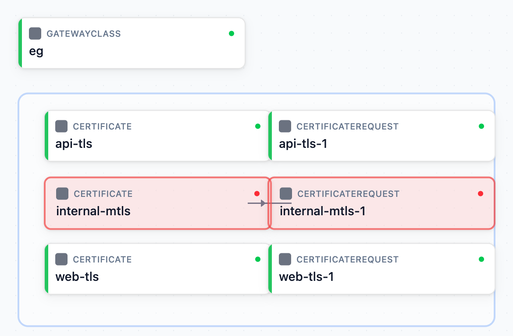
   <em>cert-manager in Topology View — Certificate → CertificateRequest provisioning chain</em>

**Certificate Detail View:**
- Status conditions (Ready) with color-coded expiry warnings
- Validity period with progress bar (green → yellow → red as expiry approaches)
- Subject, DNS names, issuer reference
- Renewal time and last failure

**Renewal failures:** Issues and AI issue context warn when cert-manager reports a failed issuance after the scheduled renewal time while the existing certificate is still reported Ready. The finding includes the latest failure time and controller error, expiration and whether a retry is in progress; successful issuance clears it. It remains visible and becomes critical if the recorded validity expires before the Ready condition changes; it does not establish a live TLS outage. Detection uses current-generation Certificate status only, without reading Secret values. Disabled renewal, early reissuance failures, stale or incomplete status, and stalled attempts without a reported failure are not covered.

**Dashboard:** Certificate health card showing healthy/warning/critical/expired certificate counts across all namespaces.

**TLS Secret Parsing:** Click any TLS Secret to see the X.509 certificate details — subject, issuer, validity dates, SANs — parsed directly from the secret data.

  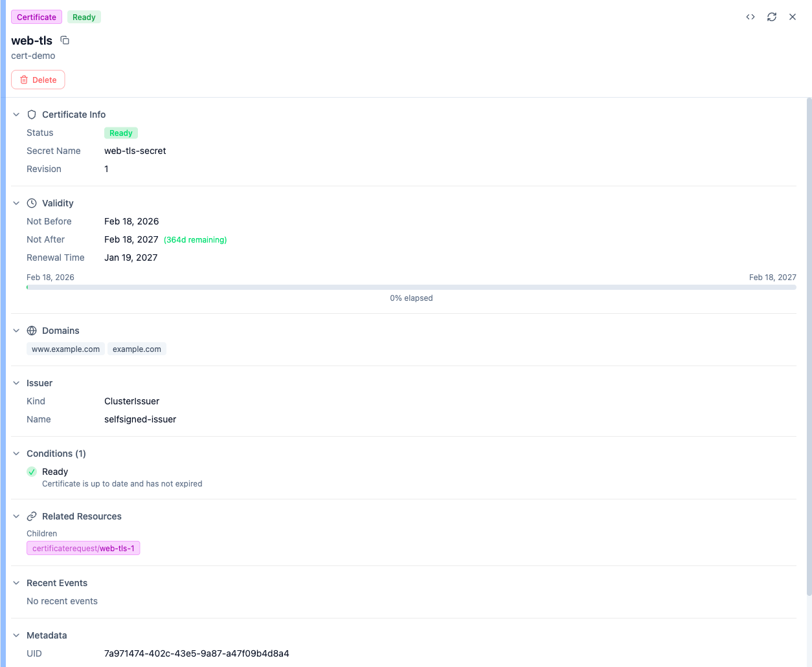
   <em>Certificate Detail View — Validity progress bar, DNS names, issuer reference, and status conditions</em>

  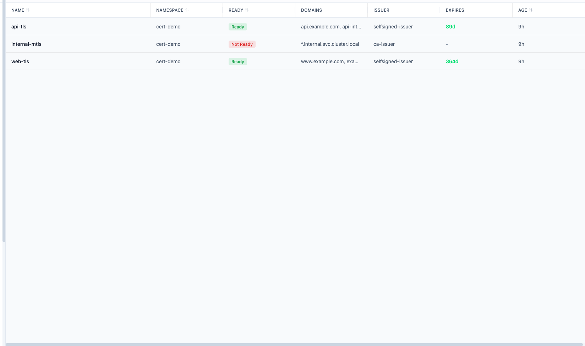
   <em>Certificate Resource Browser — Ready status, domains, issuer, and expiry date at a glance</em>

### Supported CRDs

| CRD | Group | Topology | Detail View | AI Summary |
|-----|-------|----------|-------------|------------|
| Certificate | `cert-manager.io/v1` | Yes | Yes | — |
| CertificateRequest | `cert-manager.io/v1` | Yes | Yes | — |
| Issuer | `cert-manager.io/v1` | Yes | Yes | — |
| ClusterIssuer | `cert-manager.io/v1` | Yes | Yes | — |
| Order | `acme.cert-manager.io/v1` | Yes | Yes | — |
| Challenge | `acme.cert-manager.io/v1` | Yes | Yes | — |

---

## Prometheus Operator

[Prometheus Operator](https://prometheus-operator.dev/) simplifies Prometheus setup on Kubernetes, providing CRDs for defining monitoring targets, alerting rules, and scrape configurations declaratively.

Looking for CPU, memory, throttling or HTTP request charts? See
[Workload metrics](workload-metrics.md). Those charts read a Prometheus-compatible
backend and do not require Prometheus Operator. This integration page describes
inspection of the Operator's Kubernetes resources and scrape configuration.

### What Radar Shows

**ServiceMonitor Detail View:**
- Status conditions
- Job label and scrape endpoint configuration (port, path, interval, scheme)
- Service selector (matchLabels)
- Namespace selector scope

**PrometheusRule Detail View:**
- Rule group breakdown with per-group rule counts
- Alert rules vs recording rules summary
- Group evaluation intervals

**PodMonitor Detail View:**
- Pod metrics endpoint configuration (port, path, interval, scheme)
- Pod selector (matchLabels)
- Namespace selector scope

**Resource Browser:** Smart columns show status, endpoint count, selectors, and job labels at a glance.

### Supported CRDs

| CRD | Group | Topology | Detail View | AI Summary |
|-----|-------|----------|-------------|------------|
| ServiceMonitor | `monitoring.coreos.com/v1` | Service selection and scrape configuration | Yes | — |
| PodMonitor | `monitoring.coreos.com/v1` | Pod selection and scrape configuration | Yes | — |
| PrometheusRule | `monitoring.coreos.com/v1` | — | Yes | — |
| Alertmanager | `monitoring.coreos.com/v1` | — | Generic | — |

---

## VictoriaMetrics chart reads

The Helm chart grants Radar cluster-wide `get/list/watch` on VMAgent, VMCluster
and VMSingle (`vmagents`, `vmclusters`, `vmsingles` in
`operator.victoriametrics.com`) whenever it grants cluster-wide Secrets reads:
`rbac.secrets: true`, `rbac.helm: true`, auth enabled (`auth.mode != none`), or
cloud mode. These objects can carry inline credentials, so they share the same
grant decision as Secrets. There is no separate VictoriaMetrics setting.

This rule excludes VMUser/VMAuth, alerting and scrape/probe resources, and the
Logs, Traces, Distributed and Anomaly families. The wildcard
`rbac.crdGroups.all: true` still grants `get/list/watch` on every API group and
resource, including core Secrets and these excluded kinds. See the
[chart reference](../deploy/helm/radar/README.md#crd-access).

---

## Loki

Kubernetes keeps a container's logs only while the pod exists. When the cluster ships logs to Loki, Radar reads a pod's past logs from there: the pod logs viewer gets a **Live | History** switch, and History reads the same pod and container over the last 1 hour, 6 hours, 24 hours or 7 days. A pod that is gone (a finished CronJob run, a pod replaced by a rollout) opens on History from **Logs (Loki)** on its Timeline card.

Connect Loki in **Settings → Logs (Loki)**, or with `--loki-url`; see [configuration](configuration.md#loki) for discovery, headers and stream labels.

The viewer reads `GET /api/loki/pods/{namespace}/{name}/logs?container=&since=1h|6h|24h|7d` (or `start`/`end`, at most 7 days; `limit` up to 5,000 lines).
- **Gate:** namespace access plus `get pods/log`, the same as live logs, checked before Loki is contacted. The pod need not exist any more.
- **Without authentication** there is no caller to check and Loki never asks Kubernetes, so Radar's own identity must be able to `get pods/log` in the namespace (Radar remembers its own answer per namespace for 30 seconds); `--namespace-scope` applies too.
- **Matched by pod name:** a pod recreated under the same name (a StatefulSet's `db-0`) returns lines from every pod with that name in the window, and History's banner says so.
- **A Loki shared by several clusters:** Loki matches by namespace and pod name, which other clusters reuse (a StatefulSet's `-0` pod). Radar adds a cluster matcher only when `--loki-cluster` names this cluster's value (shared installations, see [configuration](configuration.md#loki)); with authentication it refuses History while Loki has a `cluster`, `k8s_cluster_name` or `cluster_name` label and no value is set. Otherwise — locally, without authentication and no value, or with a cluster label Radar doesn't detect — a read returns the same namespace and pod name from every cluster in that Loki, so a user who may read pod logs in a namespace here can read that namespace's pods elsewhere.
- **Multi-line entries:** a stack trace that Loki keeps as one entry shows as its lines, each with the entry's time.
- **Fixed queries:** Radar writes the LogQL from the namespace, pod and container (plus the `--loki-cluster` value) only, with values escaped; no other parameter reaches Loki and there is no free-form query, search or live tail.
- **Limits:** Radar shows the newest lines in the window; when Loki returns the limit, the answer says older lines may be missing. An answer over 8 MiB reads as a 502 asking for a shorter window, and keeps the connection. At most four History reads run at once across Radar, and one per user (without authentication, one for everyone); another gets a 429 asking to try again. The viewer cancels a read it replaces (a new container or window) or closes, which frees that read's place at once.
- **Errors:** 429 when too many reads are running, 503 when Loki is not connected, has no namespace or pod stream label, or the cluster rule above refuses the read; 502 with Loki's own message (redacted) when it answers an error, such as its per-query line limit.
- An empty answer means Loki returned nothing for that namespace and pod name in the window, read through the stream labels Settings shows: the pod's logs may not have been shipped, or were shipped under other labels. With a container chosen, the read also filters on the container: Radar first asks Loki which streams the pod has in the window, and matches the container in Loki only when every one of them carries the same container label (`container`, `kubernetes_container_name`, `container_name` or `k8s_container_name`); otherwise it reads the whole pod and keeps the chosen container's lines and the lines with no container label, and the banner says so.

**Finished Job runs.** Where a Job's or CronJob run's logs say its pods are no longer present, Radar reads that run from Loki and says so ("From Loki, <start>–<end>"). It reads `GET /api/loki/jobs/{namespace}/{name}/logs`:
- **Only Jobs Kubernetes still holds:** the run's own time bounds the window, from its start to its completion or last failure (or now) with a minute on each side, at most 7 days; `start`/`end` override it. A Job that is gone returns 404; one that never started (no start time) returns 409 unless `start`/`end` are given. The viewer shows the run's whole window (still at most 5,000 Loki entries); its line count and time range don't apply to it, so that control is disabled while the run is read from Loki and the notice says so.
- **Gate:** the workload logs gate (namespace access, `get jobs`, `list pods`, `get pods/log`), plus the same limits without authentication and under `--namespace-scope` as pod History, before Loki is contacted. A Job run read counts toward the same read limits as pod History (four at once, one per user).
- **Selecting the run's pods:** first Radar asks Loki which streams belong to the run in its window (Loki's series endpoint, matched by the Job labels and by the pods' names, without a container), so what it decides comes from the run's own streams, not from other workloads or from what Loki carried when Radar connected. When any of them carry a Job stream label (`job_name`, `batch_kubernetes_io_job_name`), the run is selected by it; else by the names Kubernetes gives the Job's pods: `<job>-<random>`, or for an Indexed Job `<job>-<index>-<random>`. So a Job doesn't read the pods of a Job whose name extends it with more than a completion index, such as a CronJob's runs. A name match is not ownership: a DaemonSet or bare pods named `<job>-<random>` match too, and an Indexed Job's `<job>-<index>-<random>` pods share names with those of a Job named `<job>-<index>`; the Indexed Job's answer notes this, the other Job's answer doesn't. Kubernetes shortens a long Job name in its pods' names; then lines from another Job with the same prefix may be included, and the answer says so. When selecting by name, streams whose Job label names another Job are left out (a Loki shared by several pipelines). A run with Job-labelled streams is never read by name, even when the chosen container has no lines. Each stream's container comes from whichever container label it carries (`container`, `kubernetes_container_name`, `container_name`, `k8s_container_name`); a stream with none is whole-pod. A chosen container is matched in Loki when every stream of the run carries the same container label, so the line limit counts only that container's lines; otherwise the run is read whole (still at most 5,000 entries, and a container with no lines among them says so) and only the chosen container's lines and those of pods Loki can't split are kept. This cluster's `--loki-cluster` value is matched as for pod History. The notice says which selection served the lines: the Job label, or pod names (and why).
- **Containers:** listed in the Job template's run order, with init containers and native sidecars (init containers with `restartPolicy: Always`) marked as they are live, whether or not the answer has lines for them, so the viewer can switch between them. A container the template doesn't name, such as one a webhook injected, follows unmarked when it has lines. A pod whose streams carry no container label in the run is read whole and offers no containers. When Loki has no container label it can't split a pod: the answer holds one whole-pod entry per pod, which the viewer shows as all containers, with a notice that Loki has no container label, rather than as a container to pick.
- If Loki can't answer, the viewer keeps Kubernetes' message and adds why Loki didn't answer.
- If Loki holds nothing for the run, the viewer keeps Kubernetes' message.
- If Loki has no lines for a chosen container, the viewer says so and keeps the run's pods and containers to switch to.
- While a run is shown from Loki, choosing another container reads Loki again rather than opening a Kubernetes stream; the stream button still opens one.

## Trivy Operator

[Trivy Operator](https://aquasecurity.github.io/trivy-operator/) continuously scans your cluster for vulnerabilities, misconfigurations, exposed secrets, and license compliance issues.

### Checks › Vulnerabilities

**Checks → Vulnerabilities** (REST `/api/vulnerabilities`, MCP `list_vulnerabilities`) rolls the VulnerabilityReports up to the images that run now: which images carry Critical and High CVEs, which of those have a fix, and which workloads and namespaces run them. General image scanning requires Trivy Operator. The report views in Checks and workload drawers and the vulnerability summary on Home require the VulnerabilityReport kind. The rollup is not part of Issues or of the Best practices queue and score.

**Check for Java4Shell** runs on demand in the same tab, including in clusters without Trivy Operator. It uses image metadata for the digest of each visible running container to compare its declared `JAVA_VERSION` with the [Java4Shell advisory](https://github.com/advisories/GHSA-6g7j-4xh3-xq2q). An affected version declaration is a reason to confirm the installed JVM and its vendor's fix. The table groups replicas by workload, container and image build, and prioritizes groups with Pods running on nodes that report AVX-512 VBMI via Node Feature Discovery. Missing CPU labels or access to Nodes leave the capability unknown. A flag in the Pod spec is shown as declared, and does not change the priority. Where Trivy serves reports, **Find in Trivy reports** searches what those reports recorded for the same CVE.

The report explains why some containers could not be checked and names the registries that required authentication or throttled the scan. **Show skipped images** lists the affected workloads and running Pod counts. Images that set `JAVA_HOME` without a version declaration appear first with a prompt to verify the installed Java version. Rows link to the workload when Radar can resolve its owner, or to the visible Pod. Results list up to 100 matching and 100 unassessed groups and keep container totals for the full scope Radar checked. **Download JSON** saves the displayed result, its check time, context and namespace coverage.

When a node lacks an observed VBMI label, Radar can infer that VBMI is absent for a small set of documented x86 instance types. It reads the cloud provider and instance type from the Node object. The supported families are [AWS C6a, M6a and R6a](https://aws.amazon.com/blogs/compute/tuning-guide-for-amd-amazon-ec2-instances/), [Google Cloud C2 and C2D](https://docs.cloud.google.com/compute/docs/machine-resource), and [Azure Dav4 and Dasv4](https://learn.microsoft.com/en-us/azure/virtual-machines/sizes/general-purpose/d-family#dav4-and-dasv4-series). The documented processors for those families predate [Intel Xeon VBMI support](https://www.intel.com/content/www/us/en/support/articles/000058341.html) or [AMD EPYC AVX-512 support](https://www.amd.com/en/blogs/2022/amd-ecosystem-poised-and-ready.html). The UI and CLI show the instance type at check time alongside the affected Java declaration. Other x86 instance types without observed CPU evidence stay unknown.

Deployment, StatefulSet and DaemonSet drawers surface reported image vulnerabilities when the workload has findings. Open a finding to see the workload’s reports in **Checks → Vulnerabilities**.

For headless checks, run `radar check java4shell` or `kubectl radar check java4shell`. [Java4Shell CLI flags and exit codes](configuration.md#java4shell-cli)

The check follows the namespace selection, Radar's collection and the caller's list access to Pods and Nodes. It reads image manifests and configs for the registry digests those Pods report. Private lookups follow [Java4Shell registry access](authentication.md#java4shell-registry-access), and images Radar cannot read stay unassessed. Results count assessed versions outside the affected ranges by Java major. Ordinary Java 8 builds can appear here, while Oracle Java 8 Performance Pack `8u511b33-perf` is in the affected range.

The UI and CLI report progress by distinct image, platform and credential group. The UI allows four lookups in flight. The CLI allows eight overall, with at most four for Docker Hub. Both pace lookup starts at eight per second, with an initial burst of four and a five-minute registry budget. Radar waits at least one second between Amazon ECR Public manifest requests, including the requests within a single multi-platform lookup. Other registries continue checking during that wait. Each scan allows 24 uncached Docker Hub groups to protect the shared pull quota. Radar runs one advisory check at a time and shares registry rate-limit backoff with its runtime inventory. The UI can retain the running request as you navigate in Radar. Use **Cancel check** to stop it, or close the browser connection. A repeat check on the same Radar instance can reuse cached public results. Private registry access is checked on each new scan. If the scan stops before reading every image, narrow the namespace selection or use `radar check java4shell -n NAMESPACE`.

- **By image** (default): one row per running image, however many workloads run it, with its findings by severity, how many have a fix, and the workloads that run it.
- **By CVE**: each CVE with the images and workloads that carry it, and how many of its images have a fixed release.
- **By workload**: each workload's containers and what their images carry.
- **By fix**: the fixable findings as a list of package upgrades (below).

Severity and has-a-fix filters apply to every view. A finding Trivy left unrated (common for Go modules) is rated from its CVSS score. A CVE counts once per package version in an image, so totals can be lower than the summaries in Trivy Operator's own reports.

**By fix** groups an image's fixable findings by package and installed version into one upgrade, and says every CVE it clears. The target is the lowest listed release that fixes every one of those CVEs, read with the package's own versioning (Debian, Alpine, RPM, PEP 440, RubyGems, Maven, or semver for npm, Go, Cargo, NuGet and the like), and images needing the same upgrade of the same package share a row. A scanner lists one fix per maintained branch, so for `6.11.4` with `8.0.1, 7.5.5, 6.11.6` the target is `6.11.6`; a release above one CVE's fix that sits on a branch lacking another's (with `7.5.5, 6.11.6` listed, `7.5.4`) moves up to that branch's fix. The ecosystem comes from the finding's package type when Trivy Operator is configured to write it (`trivy.additionalVulnerabilityReportFields`), else from its package URL, which it writes by default. Where Radar can't order the versions (no ecosystem, one it doesn't know, or a version that doesn't parse) the row shows the scanner's listed releases and picks none.

**Which reports count.** A report counts when the object it scanned (a Deployment's ReplicaSet, a CronJob, a StatefulSet, a DaemonSet, a Job, or a Pod whose controller Trivy doesn't scan through) still runs that container and image: Pods that aren't finished, and CronJobs that aren't suspended. Reports about older revisions or removed workloads are left out and counted, unless the build they scanned still runs.

- Images are matched by the digest Kubernetes reports for each running container (by the reference its spec names until it starts), so a tag pushed again, such as `:latest`, doesn't carry the older build's scan, and every workload running a scanned build shares its findings. A started container whose image has no registry digest, such as a locally loaded one, reads as not scanned.
- Of several reports about one image, every finding any of them lists counts once for every workload running it, so an ignore policy scoped to one workload doesn't clear another's CVEs. A CVE the vulnerability database later withdrew stays until the older report is rescanned.
- One multi-platform image digest is credited with the platform Trivy scanned.
- An image without findings reads as having no reported CVEs: Trivy Operator's own filters (`trivy.ignoreUnfixed`, `trivy.severity`, ignore policies) decide what a report lists.

**Unknown is never clean.** A running image with no report is listed as not scanned yet, never as clean. While any running image is unscanned or some reports aren't readable, the totals read as lower bounds (`≥`); with nothing scanned they read as unknown. Reports are read only where the caller may list them, as everywhere else, and withheld namespaces are named.

### What Radar Shows

**VulnerabilityReport Detail View:** Severity breakdown (Critical/High/Medium/Low), affected images, and CVE counts.

**ConfigAuditReport Detail View:** Pass/fail checks with severity levels.

**Resource Browser:** Smart columns show severity counts and scan status at a glance.

**Search (UI, REST `/api/search`, MCP `search`):** reports are searchable by CVE ID, SBOM component name and version, failed check ID and the scanned image, so `CVE-2026-109618` or `image:php kind:VulnerabilityReport` finds every report that lists it. Severity words and titles are not indexed, and a secret finding's matched text is never indexed, never exposed to the CEL `filter`, and redacted from what AI agents receive (MCP `get_resource`, `search` with `include=raw`). The `filter` binds `report` to the findings (vulnerabilities, components, checks, secrets without their match) for single-finding predicates such as `report.vulnerabilities.exists(v, v.vulnerabilityID == "CVE-2026-109618" && v.resource.contains("php"))`. The global search UI identifies the matching report; it does not display package versions or workload attribution in the result row. REST and MCP search summaries include the matched finding, package and installed/fixed versions when available, and the workload behind the scanned object; ReplicaSet summaries also include replica count. With Trivy Operator's default `operator.vulnerabilityScannerScanOnlyCurrentRevisions: true`, an old ReplicaSet's reports are deleted after a rollout. With it set to `false` they stay, and a replica count of 0 usually marks one, though a Deployment scaled to zero also reads 0. A report is evidence about the scanned image at scan time: a CVE published after the last scan is absent until Trivy rescans with an updated database, and runtimes built from source (such as the official `php` images) are not detected by Trivy at all. With auth enabled, search returns a report only where the user may `list` that report kind, not wherever they may list Pods. When a search could not cover every report, the results say why: access to some namespaces' reports couldn't be confirmed in this search, because its limit on access checks was reached or a check failed (searching again checks more), or the search ran out of time before reading every report's findings (narrow with `ns:`).

**Resources table:** on a report kind's table, the search box also matches findings: CVE ID with package and versions, SBOM component, failed check ID, secret rule ID and target, and the scanned image. A row that matched only through its findings is tagged *in findings*, with the finding on hover. Regex mode matches names and namespaces only, and a very large list stops after 200,000 findings and says some weren't searched.

### Supported CRDs

| CRD | Group | Topology | Detail View | AI Summary |
|-----|-------|----------|-------------|------------|
| VulnerabilityReport | `aquasecurity.github.io/v1alpha1` | — | Yes | — |
| ConfigAuditReport | `aquasecurity.github.io/v1alpha1` | — | Yes | — |
| ExposedSecretReport | `aquasecurity.github.io/v1alpha1` | — | Yes | — |
| ClusterComplianceReport | `aquasecurity.github.io/v1alpha1` | — | Yes | — |
| SbomReport | `aquasecurity.github.io/v1alpha1` | — | Yes | — |
| RbacAssessmentReport | `aquasecurity.github.io/v1alpha1` | — | Yes | — |
| ClusterRbacAssessmentReport | `aquasecurity.github.io/v1alpha1` | — | Yes | — |
| InfraAssessmentReport | `aquasecurity.github.io/v1alpha1` | — | Yes | — |
| ClusterInfraAssessmentReport | `aquasecurity.github.io/v1alpha1` | — | Yes | — |
| ClusterSbomReport | `aquasecurity.github.io/v1alpha1` | — | Yes | — |

---

## Bitnami Sealed Secrets

[Sealed Secrets](https://sealed-secrets.netlify.app/) encrypts Kubernetes Secrets so they can be safely stored in Git. The controller decrypts them in-cluster at deploy time.

### What Radar Shows

**Topology:** SealedSecret → Secret → workload when Secret metadata is visible, or SealedSecret → workload when Secret reads are restricted. Only SealedSecrets that configure a visible workload are included.

**SealedSecret Detail View:** Encrypted data keys, template metadata, and the target Secret's scope and namespace.

**Controller and sealing keys** (a section of the SealedSecret drawer): the controller that serves the SealedSecret's namespace and whether it is ready, how many SealedSecrets are synced and not synced (marked as limited to the namespaces you can list when that is not cluster-wide), and that controller's sealing keys with their certificate dates, marking the one that seals new secrets. When the controller reports `Synced=False` for a reason other than an existing Secret it does not manage, it suggests re-sealing as one possible fix: the SealedSecret may have been sealed for another cluster or with a key the controller no longer holds. Radar shows dates only and never calls a key expired or compromised.

**Which controller.** Candidates are Deployments labelled `app.kubernetes.io/name=sealed-secrets` or named `sealed-secrets-controller`. Radar reads each candidate's flags from its Deployment (arguments, or the `SEALED_SECRETS_*` environment variables the controller also accepts) to know which namespaces it serves, as the controller decides: with `--additional-namespaces` its own namespace plus that list, with `--all-namespaces=false` only its own, otherwise every namespace. A controller that names the SealedSecret's namespace (an upstream multi-tenant setup) beats one that serves every namespace. Among controllers serving every namespace, kubeseal's default `kube-system/sealed-secrets-controller` wins, then the only one in `kube-system`, so a look-alike Deployment elsewhere can't blank the section. When no controller serves the namespace the section says so; when several serve it equally, or one's scope can't be read (a flag set from a ConfigMap or Secret, `envFrom`, or a `--label-selector`, which Radar can't check here), the section says Radar can't tell which one unseals it and reads no keys. The only controller on the cluster is used even when its scope can't be read. "Ambiguous" is the same answer for every caller and never names the candidates: like "denied" versus "not found", it only reveals that look-alike controllers exist.

**Which key seals new secrets.** The controller loads the Secrets labelled `sealedsecrets.bitnami.com/sealed-secrets-key: active` plus the Secret named by its `--key-prefix` (default `sealed-secrets-key`) whatever that one's label; other label values read "Not used". It seals with the newest loaded key by its `--key-order-priority`: certificate start date by default, or Secret creation time (common after restoring keys from a backup), ties going to the earliest created. Radar follows the same setting; when it can't be read, no key is marked and the section says why.

**Re-seal command.** The section shows a `kubeseal --fetch-cert` command only where Radar knows it reaches the controller serving the namespace: `kubeseal --controller-namespace <namespace> --controller-name <Deployment name> --fetch-cert` when the caller can see that controller, or a bare `kubeseal --fetch-cert` when the caller can't see it but it sits at kubeseal's default location (`kube-system/sealed-secrets-controller`). The answer's `atKubesealDefault` says so even to a caller denied the controller: upstream installs let every authenticated user `get` that Service by name, so kubeseal already reveals it. Otherwise (ambiguous, not served, not found, loading or failed) it gives the advice in words, since a guessed command could fetch another controller's certificate and a re-seal with it fails without saying why. `kubeseal --controller-name` names a Service; the standard installs (upstream manifest, upstream and Bitnami charts) name it like the Deployment. Where a hand-written install names them differently, kubeseal reports the missing Service.

The section reads `GET /api/sealedsecrets/controller?sealedSecretNamespace=<SealedSecret namespace>` (without it, kubeseal's defaults pick the controller). Each part has its own gate, and a denied part is a state in a 200, never a 403 for the whole answer: the controller needs `get deployments` in its namespace, the keys need `list secrets` there, and the totals cover the SealedSecrets the caller can list. Keys come from Radar's Secret cache and only the public `tls.crt` is read: key names and certificate dates are returned, never `tls.key`, the certificate, labels or annotations. When Radar does not collect Secrets in that namespace, is still loading them (the section refreshes until they arrive) or failed to load them, the section says so instead of showing none; likewise for the controller while Deployments are loading or failed to load, or when Radar watches Deployments in some namespaces only and the controller is not among them. Only the key's first certificate counts. A key whose certificate does not parse is listed without dates and never marked as the one sealing new secrets. On a Radar without the endpoint (Radar Hub against an older cluster) the section is absent, including when that Radar answers before its capabilities have loaded.

### Supported CRDs

| CRD | Group | Topology | Detail View | AI Summary |
|-----|-------|----------|-------------|------------|
| SealedSecret | `bitnami.com/v1alpha1` | Yes | Yes | — |

---

## GitOps

See the main [README](../README.md#gitops) for the user-facing overview. This section covers integration coverage and capabilities.

### FluxCD

| CRD | Group | Topology | Detail View | AI Summary |
|-----|-------|----------|-------------|------------|
| GitRepository | `source.toolkit.fluxcd.io/v1` | Yes | Yes | — |
| OCIRepository | `source.toolkit.fluxcd.io/v1beta2` | Yes | Yes | — |
| HelmRepository | `source.toolkit.fluxcd.io/v1` | Yes | Yes | — |
| Bucket / HelmChart / ExternalArtifact | `source.toolkit.fluxcd.io` | When referenced | Generic | — |
| Kustomization | `kustomize.toolkit.fluxcd.io/v1` | Yes | Yes | Yes |
| HelmRelease | `helm.toolkit.fluxcd.io/v2` | Yes | Yes | Yes |
| Alert | `notification.toolkit.fluxcd.io/v1beta3` | — | Yes | — |

**Workflow operations**: Reconcile, Reconcile-with-source (Kustomization/HelmRelease), Suspend/Resume.

**Source relationships**: Topology, Related Resources and REST/MCP context link
observed Flux sources in both directions within Radar's namespace scope.
Kustomizations use `spec.sourceRef`; HelmReleases use `spec.chart.spec.sourceRef`
or `spec.chartRef`. Inline releases also link the generated HelmChart named by
`status.helmChart`; an observed HelmChart links its source in its own namespace.
`spec.dependsOn` links a Kustomization or HelmRelease to the objects of the same
kind it waits for (an entry without a namespace means its own namespace).
These are dependencies, not owners: topology draws each source upstream, with
the edge pointing into the object that reads it. A link does not prove that Flux
permits the reference or has produced an artifact.

**Diagnosis**: Conditions extracted to issues (Ready=False, Stalled=True, Reconciling=True). Per-resource diff and recent events not yet available for Flux (HelmRelease-installed resources don't carry `last-applied-configuration`; tracked in [#601](https://github.com/skyhook-io/radar/issues/601)).

### Flux Operator

| CRD | Group | Topology | Detail View | AI Summary |
|-----|-------|----------|-------------|------------|
| FluxInstance | `fluxcd.controlplane.io/v1` | — | Yes | — |
| FluxReport | `fluxcd.controlplane.io/v1` | — | Yes | — |
| ResourceSet | `fluxcd.controlplane.io/v1` | — | Yes | — |
| ResourceSetInputProvider | `fluxcd.controlplane.io/v1` | — | Yes | — |

When the cluster serves FluxReport and the caller can read one, the GitOps page
shows a collapsed **Flux** card above the table: the distribution version, the
operator version, controller readiness and per-kind reconciler counts (total,
failing, suspended), all read from the report. The counts are the operator's
own, so the card attributes them to it. No readable report means
no card; Radar never shows zeros for a report it could not read. The status of
all four kinds reads `Suspended` when the object carries
`fluxcd.controlplane.io/reconcile: disabled` (they have no `spec.suspend`).
In a ResourceSetInputProvider URL, user info, every query value and the fragment
are redacted in its column and drawer; the YAML view and MCP show the object as stored.

### ArgoCD

| CRD | Group | Topology | Detail View | AI Summary |
|-----|-------|----------|-------------|------------|
| Application | `argoproj.io/v1alpha1` | Yes | Yes | Yes |
| ApplicationSet | `argoproj.io/v1alpha1` | — | Generic | — |
| AppProject | `argoproj.io/v1alpha1` | — | Generic | — |

**Workflow operations**: Sync (with options dialog: prune, dry-run, apply-only, force, replace, server-side apply, sync-options), Refresh, Hard refresh, Terminate, Suspend/Resume auto-sync, Rollback to historical revision, Selective sync of marked resources.

**Diagnosis**:
- **Per-resource field diff** computed from each resource's `kubectl.kubernetes.io/last-applied-configuration` annotation vs live spec — works for any Argo client-side-applied resource without calling the Argo API
- **Recent events** surfaced inline per managed resource (5 most recent, namespace-RBAC-filtered)
- **Stuck-drift-loop detector** — flags `sync=OutOfSync ∧ opPhase=Succeeded ∧ applied sources/revisions match the desired comparison ∧ auto-sync on ∧ reconciledAt<30min` with the likely cause (mutating webhook, sibling controller, schema migration)
- **Manual-drift detector** — calls out OutOfSync apps with auto-sync disabled
- **Argo Application conditions** extracted to issues (ComparisonError, OrphanedResourceWarning, etc.) with type-aware severity and per-condition action text
- **Operation-failure parser** recognizes 11 patterns: annotation-too-large, label-too-long, hook failure, admission webhook denial, RBAC, conflict, immutable field, schema migration, connectivity, etc.

**Limitations**:
- SSA-applied resources (`ServerSideApply=true` sync-option) lack the `last-applied-configuration` annotation, so the local diff described above is unavailable for those rows. Configuring the [Argo CD API integration](gitops.md#argo-cd-api-integration-deep-diff) covers them: Radar then asks argocd-server for the Git-rendered desired state and diffs against that, which is canonical rather than annotation-derived. An annotation-free local fallback via `metadata.managedFields` is still tracked in [#601](https://github.com/skyhook-io/radar/issues/601).
- Single-cluster only: Application↔resource edges only render when Radar is connected to the cluster where the managed resources live (not necessarily the cluster running the Argo controller).

---

## Argo Rollouts

[Argo Rollouts](https://argoproj.github.io/rollouts/) provides progressive delivery strategies including blue-green and canary deployments.

| CRD | Group | Topology | Detail View | AI Summary |
|-----|-------|----------|-------------|------------|
| Rollout | `argoproj.io/v1alpha1` | Yes | Yes | Yes |
| AnalysisRun | `argoproj.io/v1alpha1` | Yes | Yes | Yes |
| AnalysisTemplate | `argoproj.io/v1alpha1` | — | Yes | — |
| ClusterAnalysisTemplate | `argoproj.io/v1alpha1` | — | Yes | — |
| Experiment | `argoproj.io/v1alpha1` | — | Yes | — |

### What Radar Shows

**Control surface:** Set image updates one or more regular or init-container images on the Rollout's pod template or supported `workloadRef` target. Radar reads the current images before editing, rejects stale changes instead of overwriting them, and lets the Rollout controller start the resulting canary or blue-green rollout. A paused Rollout saves the template change but does not start rolling out until it is resumed. Promote, Promote full, Skip step, Retry, and Abort are also available on the Rollout detail page, each gated on a live capability probe (`patch rollouts` and `patch rollouts/status` are separate grants). Rollback goes through revision history, with an opt-in "skip canary steps" follow-up for hotfixes.

**Rollout visibility:** Radar keeps serving readiness separate from transient rollout activity. Resource tables, drawers, full workload views, and Applications show the active step, progress, pause, or failure without marking capacity served by the stable revision as unavailable.

**Canary/blueGreen progression:** The Rollout detail page renders a connected step timeline — every canary step in declaration order, with the current step highlighted and, for an analysis step, its live AnalysisRun status shown inline alongside a clickable link to the AnalysisTemplate/ClusterAnalysisTemplate it references. A blueGreen Rollout gets an equivalent derived phase list (preview scaled up → pre/post-promotion analysis → awaiting promotion → active cutover), since blueGreen has no `steps[]` array of its own to render directly.

**ReplicaSet progression:** A ReplicaSets section lists every revision the Rollout owns (newest first), each with its Current/Stable/Rolling-out role badge, image, replica count, and — expandable per revision — its live pods with ready/phase status. Read-only; rollback stays on the existing revision-history dialog. Built entirely from the same `useWorkloadRevisions`/`useWorkloadPods` endpoints already used elsewhere for workload rollback, joined client-side by each pod's own pod-template-hash label — no new backend endpoint needed for this part.

**AnalysisRun history:** Beyond the four "currently active" analysis slots (step / background / pre-promotion / post-promotion), an AnalysisRun History section lists the Rollout's full AnalysisRun history — phase, trigger, and metrics passing/total — via a dedicated `GET /api/rollouts/{ns}/{name}/analysisruns` endpoint gated on listing AnalysisRuns directly (a separate RBAC grant from the Rollout's own `patch` capability).

**AnalysisTemplate / ClusterAnalysisTemplate / Experiment:** Full detail renderers — metric definitions (provider, interval, count, success/failure conditions) for the templates; templates, duration, and per-template replica/analysis status for Experiment. Reached both directly and via the step-timeline/Analysis-section links above.

**Why it's stuck:** `InconclusiveAnalysisRun` names nothing on its own, so Radar resolves the AnalysisRun the controller recorded and surfaces the deciding metric — its success/failure condition, latest measured value, and message. The same verdict reaches AI agents through the Rollout's `issue` field.

**Topology:** Rollout → active AnalysisRun (`uses`), labelled by trigger (step / background / pre-promotion / post-promotion). Only the runs the Rollout's status points at are graphed — historical runs would grow the graph without bound. (The full AnalysisRun history above is a detail-page list, not a topology change — the graph's "only active runs" bound is unchanged.)

**Timeline:** Step index, traffic weights, pause conditions, abort/promote-full, and stable-ReplicaSet moves are all recorded as distinct events; a Rollout sits in `Progressing` for the whole canary, so phase alone would show nothing.

---

## Argo Workflows

[Argo Workflows](https://argoproj.github.io/workflows/) is a container-native workflow engine for orchestrating parallel jobs on Kubernetes.

| CRD | Group | Topology | Detail View | AI Summary |
|-----|-------|----------|-------------|------------|
| Workflow | `argoproj.io/v1alpha1` | — | Yes | — |
| WorkflowTemplate | `argoproj.io/v1alpha1` | — | Yes | — |
| CronWorkflow | `argoproj.io/v1alpha1` | — | Generic | — |

---

## Istio

[Istio](https://istio.io/) is the most widely adopted service mesh, providing traffic management, security (mTLS), and observability for microservices.

### What Radar Shows

**Topology:** Full Istio traffic path — IstioGateway → VirtualService → Service, and DestinationRule → Service configuration edges. See how traffic flows through gateway listeners, virtual service routing rules, and into backend services.

Service links accept short names in the rule's namespace or full `name.namespace.svc.<domain>` names. Radar reads a unique registry domain from standard observed Istiod Deployments' `--domain` argument, using Istio's `cluster.local` default when no override is observed. Conflicting or unresolved control-plane arguments leave FQDN links unresolved. External control planes and nonstandard launch configurations may therefore need additional domain discovery; arbitrary dotted hosts are not treated as local Services.

**Live Traffic:** the Traffic view reads Istio's standard Prometheus metrics: `istio_requests_total` (with its 5xx rate and request/response bytes) for HTTP and gRPC edges, and `istio_tcp_received_bytes_total` / `istio_tcp_sent_bytes_total` for TCP edges, as rates over the view's time range (5 minutes when it is under a minute). A rate needs two samples per series, so a range shorter than two scrape intervals shows no traffic; the map then says to choose a longer range. TCP edges appear whenever bytes move in the view's range, including on long-lived connections, and show data volume (byte rates × the window) with no request rate; on the map, an edge with no request rate is labelled with its throughput per protocol (for example `TCP · 2.4 KB/s`); against an older Radar that sends no per-protocol breakdown those labels stay empty. Radar reads the receiving side's report: the destination sidecar (`reporter="destination"`) or, in ambient mode, the destination's waypoint proxy (`reporter="waypoint"`). It never adds the receiving and calling sides' reports together. In ambient mode:
- Workloads behind a waypoint get HTTP and gRPC edges from the waypoint's metrics. ztunnel also reports the hops into and out of the waypoint. Radar recognizes waypoint Deployments by their labels, as Kiali does (`gateway.istio.io/managed=istio.io-mesh-controller`, or, without that label, a `gateway.networking.k8s.io/gateway-name` containing "waypoint"), and leaves those hops out, so the map draws client → server without the proxy in between. If Radar cannot list Deployments, it cannot recognize waypoints and the hops stay on the map.
- A request into an ambient namespace (labeled `istio.io/dataplane-mode=ambient`) that no waypoint reported, such as an ingress gateway or sidecar calling a workload with no waypoint, is read from the calling proxy's report (`reporter="source"`), as Kiali does. Those figures are used only when the receiving side counted none of that client's requests to the same workload, Service and protocol in the view's time range. When it counted some, its figures are used, so requests that skipped the waypoint are not counted. Radar finds ambient namespaces from its Namespace cache; without it, these reports are not read and the ztunnel check below is off. The query names every ambient namespace and is sent in a POST body; when the namespaces are too many to fit Radar's 16 KB query limit (several hundred, depending on name length), Radar skips these reports and the map says so.
- Traffic between ambient workloads without a waypoint has no L7 metrics. It appears as TCP edges from ztunnel. When a call's HTTP figures come from the calling proxy (no waypoint or sidecar received it) and ztunnel reports TCP between the same workloads, Data shows HTTP payload bytes and ztunnel TCP connection bytes side by side by protocol. These measurements can describe the same calls and are never added together.
- Prometheus has to scrape ztunnel and the waypoint proxies. When the view includes ambient traffic but Radar finds no ztunnel metrics (no `istio_build{component="ztunnel"}` series and no ztunnel TCP reports into an ambient namespace), the map says so, because TCP traffic into ambient workloads without a waypoint is then missing rather than idle.

The volume filter uses request rate: setting it above zero hides TCP-only edges. Edge sizing, sorting and the busiest-edge highlight also use request rate. Radar Hub connected to an older Radar retains its connection-open rate behavior until that Radar is upgraded.

**VirtualService Detail View:**
- HTTP/TCP/TLS routing rules with match conditions
- Destinations with weight distribution bars
- Fault injection and traffic mirroring detection (AlertBanner warnings)
- Retry policies, timeouts, and CORS settings
- Gateway references with clickable links

**DestinationRule Detail View:**
- Target service host with clickable link
- Traffic policy: connection pool (TCP/HTTP limits), load balancer algorithm, outlier detection (ejection settings), TLS mode
- Subset definitions with labels and per-subset traffic policy overrides

**Gateway Detail View (networking.istio.io):**
- Server configurations with port, protocol, and hosts
- TLS settings per server (mode, credential references)
- Workload selector labels

**ServiceEntry Detail View:**
- Hosts, location (MESH_EXTERNAL/MESH_INTERNAL), resolution strategy
- Ports with protocol badges
- Endpoint addresses with port mappings and labels

**PeerAuthentication Detail View:**
- mTLS mode with color-coded badges (STRICT/PERMISSIVE/DISABLE)
- Scope indicator (workload-scoped vs namespace-wide)
- Port-level mTLS overrides

**AuthorizationPolicy Detail View:**
- Action badge (ALLOW/DENY/CUSTOM/AUDIT) with rule breakdown
- Source principals, namespaces, IP blocks
- Operation matching (hosts, ports, methods, paths)
- Deny-all and allow-nothing detection (AlertBanner)

**Resource Browser:** Smart columns show status badges, hosts, gateways, route counts, mTLS modes, actions, and load balancer algorithms at a glance.

### Supported CRDs

| CRD | Group | Topology | Detail View | AI Summary |
|-----|-------|----------|-------------|------------|
| VirtualService | `networking.istio.io/v1` | Yes | Yes | — |
| DestinationRule | `networking.istio.io/v1` | Yes | Yes | — |
| Gateway | `networking.istio.io/v1` | Yes | Yes | — |
| ServiceEntry | `networking.istio.io/v1` | — | Yes | — |
| PeerAuthentication | `security.istio.io/v1` | — | Yes | — |
| AuthorizationPolicy | `security.istio.io/v1` | — | Yes | — |

---

## Velero

[Velero](https://velero.io/) provides backup and restore capabilities for Kubernetes cluster resources and persistent volumes.

### What Radar Shows

**Velero views** (the Overview at `/velero`, under the Velero category in the Resources sidebar, and Radar's own lists for the Schedule and BackupStorageLocation kinds): what needs attention, every schedule read against Velero's controller (next run, late or held, newest and newest successful run), and each storage location with the backups targeting it and the schedules writing to it. The Schedule drawer adds a Schedule activity section with recent runs. A Backup's drawer offers **Delete backup**, which asks Velero to delete it through a DeleteBackupRequest; the generic Delete, which would only remove the object, is not offered. Sources, certainty and states: [velero.md](velero.md).

**Backup Detail View:**
- Phase with color-coded badge, start/completion timestamps, duration
- Progress bar during in-progress backups (items backed up percentage)
- Scope filters: included/excluded namespaces and resources, label selectors
- Storage location and volume snapshot locations
- Options: TTL, snapshot volumes, default filesystem backup
- Error/warning detection (AlertBanner for failed or partial backups with validation errors)

**Restore Detail View:**
- Phase badge, source backup reference, duration
- Progress bar during in-progress restores
- Scope filters: included/excluded namespaces and resources
- Restore options: PV restoration, existing resource policy
- Error detection (AlertBanner for failed or partial restores)

**Schedule Detail View:**
- Cron schedule (monospace), last backup timestamp
- Pause state detection (AlertBanner when paused)
- Validation failure detection (AlertBanner)
- Backup template: storage location, TTL, namespace/resource filters, snapshot settings

**BackupStorageLocation Detail View:**
- Phase (Available/Unavailable), last validation and sync times
- Provider configuration: bucket, prefix, region, access mode
- Provider-specific config key-value pairs

**VolumeSnapshotLocation Detail View:**
- Provider name and configuration parameters

**Resource Browser:** Smart columns show phase badges, storage location, namespace counts, duration, expiry (with color-coded warnings), and error/warning counts. VolumeSnapshotLocation shows provider and config — deliberately no status column, since the VSL controller never populates `status.phase`.

### Backup failures on the Problems surface

Velero reports every outcome through `status.phase` and has no `status.conditions` on any of its CRDs, so Radar reads phases directly rather than through the generic CRD-condition fallback. These become Issues (`/api/issues`, the Problems surface, MCP `issues`):

| Detection | Trigger | Severity |
|-----------|---------|----------|
| `BackupFailed` | `Backup.status.phase == Failed` | critical |
| `BackupValidationFailed` | `phase == FailedValidation`; message from `status.validationErrors` | critical |
| `BackupPartiallyFailed` | `PartiallyFailed`, `FinalizingPartiallyFailed`, `WaitingForPluginOperationsPartiallyFailed` | warning |
| `RestoreFailed` / `RestoreValidationFailed` / `RestorePartiallyFailed` | the same phases on `Restore` | critical / critical / warning |
| `ScheduleValidationFailed` | `phase == FailedValidation`, or non-empty `status.validationErrors` | critical |
| `BackupStorageLocationUnavailable` | `BSL.status.phase == Unavailable` | critical |
| `BackupRepositoryNotReady` | `BackupRepository.status.phase == NotReady` | warning |
| `VeleroRunStalled` | a `Backup` or `Restore` still in `InProgress`, `WaitingForPluginOperations` or `Finalizing` whose `status.startTimestamp` is older than its `spec.itemOperationTimeout` (Velero's built-in four hours when it declares none). `Deleting` is excluded — its `startTimestamp` belongs to the original run. The message is worded per phase: see the limitation below | warning |
| `BackupRepositoryMaintenanceFailed` | the newest entry in a usable (not NotReady) `BackupRepository`'s `status.recentMaintenance` has `result: Failed`. Its maintenance Jobs crash-loop in Velero's namespace with nothing else naming the repository | warning |
| `VeleroServerNotRunning` | the Velero server Deployment (the one running `velero server`) is readable and has no pods. Filed on the Deployment | critical |
| `VeleroScheduleLate` | the Velero views' **Late** reading: past the next run by 5 minutes with the zone certain and the namespace's Backups read, while the server runs. Critical from three missed scheduled times | warning / critical |
| `VeleroScheduleCannotRun` | **Cannot run** (name over 63 characters, or its storage location is `ReadOnly`, so Velero rejects every backup; that finding reaches only a caller who may list storage locations there, since namespace access does not authorize them) or **Always due** (a cron with no future time) | critical |
| `VeleroScheduleHeld` | **Held** by a run Velero has not started for 10 minutes, unless the server is down | warning |
| `VeleroScheduleNotValidated` | not validated 5 minutes after creation, unless the server is down | warning |
| `VeleroLocationValidationOverdue` | a location's validation is overdue or never happened, unless the server is down | warning |

The last six are readings, from the same rules as the Velero views (`pkg/velero`), raised only when certain: a schedule is judged only with its namespace's Backups read in full, and "probably late" (zone not confirmed) or "late or held" stay readings on the Velero views. While the server is down its consequences (held runs, overdue validation) are not raised again; late schedules are, since each is a backup that will not exist. Each records the reads it rests on (`RequiredReads`: schedules, backups and the namespace's Deployments). Like the other Velero Issues, they are shown to a caller with access to the namespace; Radar checks namespaced evidence at namespace granularity, and per kind only for the kinds the authentication model lists (Secrets and a few others). The Velero views check each kind exactly.

They roll up under three categories, split by what you'd go and look at: `backup_failed` for runs that already have an outcome, `backup_target_unavailable` for the location/repository kinds, and `backup_stalled` for `VeleroRunStalled`, a stopped server and schedules that are late, held or not validated. A run with no verdict is not a failed run — it has no error to read, only a controller to check — and calling it one puts "Backup failed" above a message saying it is still in progress.

**Supersession.** Velero retains failed `Backup` objects until their TTL expires, so a raw phase-to-issue mapping would keep one bad night red for days. Backups group by the `velero.io/schedule-name` label; only the newest run that already has an outcome raises an issue (the two `*PartiallyFailed` phases count — the partial failure is a fact even though Velero is still finalizing), a later `Completed` clears the series, and an in-progress run neither clears nor raises. Ad-hoc (unlabelled) backups are their own series, so nothing clears them, and a failed or rejected one stays critical. When a `Completed` backup in the same Velero namespace started after it was created, its Cause names that backup as context, without judging whether it saved the same data. The start time is what counts, since backup sync recreates an old backup with a new creation time, and a backup created earlier but queued until after the failure still saved its data later. A schedule's run created with Back up now carries the schedule label, so it supersedes the schedule's failures like any run. Restores get no supersession — they are one-off operator actions, not a recurring series.

**One fault, one issue.** A stopped server stops every schedule, and an unavailable location fails every run that writes to it, so a cluster with a hundred schedules would otherwise raise a hundred and one Issues for one fault. The fault's own Issue names what it covers as affected resources (the Issues page's *Missed runs* and *Rejected runs*), and those raise nothing of their own while it lasts, as a Kueue queue's Issue covers the runs it blocks:

- **Stopped server:** every schedule that is **Late** in that namespace while the Deployment has no pods. Lateness from before the outage is included: the schedule is missing backups and nothing runs it until the server starts. A schedule wrong for another reason (cannot run, rejected, held while the server runs) stays its own Issue, and while the server can't be read lateness is its own Issue too.
- **Unavailable location:** a Backup or Restore in `FailedValidation` whose only validation error is Velero's own statement that this location is unavailable (`backup can't be created because BackupStorageLocation <name> is in Unavailable status.` or `The BSL <name> is unavailable, cannot retrieve the backup`). Any other error, another location, or a run that failed later (`Failed`, `PartiallyFailed`) stays its own Issue: depending on a location is not being failed by it.

When the fault clears, its Issue goes and each covered run that a later run has not superseded is raised again on its own. The covered resources are redacted to what the caller can read, with no count of the rest; they also make the fault's Issue appear on each covered resource, so a schedule's drawer shows the stopped server.

**A paused Schedule is not an issue.** Pausing is operator intent; the Schedule list and detail view show the state without adding queue noise.

**Namespace attribution.** Issues attribute to the Velero object's own namespace (`velero`, or `kommander` on NKP). They are therefore admin-visible, but *not* visible to a user whose namespace view-filter excludes the Velero namespace — including one scoped only to the namespace whose data was lost. Surfacing a failure against the *protected* namespaces needs the protection-coverage model and is not part of this.

**What is not an Issue.** A run's *absence* is raised only when Radar is certain of it: a stopped server, a late schedule with its zone known and its Backups read, a schedule that cannot run, a held run, a schedule never validated (the readings above). Estimates — "probably late" under an unconfirmed zone, "late or held" when Backups were not read — stay readings on the [Velero views](velero.md). Whether a namespace or workload is covered by any schedule at all is not modelled. **Treat "no Velero issues" as "nothing Radar can be sure of looks wrong", not as "every workload is backed up."**

### Supported CRDs

| CRD | Group | Topology | Detail View | Issues | AI Summary |
|-----|-------|----------|-------------|--------|------------|
| Backup | `velero.io/v1` | — | Yes | Yes | — |
| Restore | `velero.io/v1` | — | Yes | Yes | — |
| Schedule | `velero.io/v1` | — | Yes | Yes | — |
| BackupStorageLocation | `velero.io/v1` | — | Yes | Yes | — |
| VolumeSnapshotLocation | `velero.io/v1` | — | Yes | — | — |
| BackupRepository | `velero.io/v1` | — | Yes | Yes | — |

**Limitations**:
- **A backup's phase is not its restorability.** A `Completed` backup can sit on an Unavailable storage location or be past its TTL. The BackupStorageLocation page shows stored and restorable counts. Unavailable means it cannot restore now; expired means Velero intends to delete it, so Radar excludes it even if garbage collection has not run yet. A backup counts against a location by its `spec.storageLocation`, which Velero fills when it first processes the backup; one Velero has not processed yet counts against none.
- **Stalled-run detection depends on the phase.** `WaitingForPluginOperations` is measured against Velero's `spec.itemOperationTimeout`. For `InProgress` and `Finalizing`, that duration is only a yardstick because Velero defines no deadline. Radar reports the distinction and elapsed time without guessing at a cause. If the field is absent, Radar uses Velero's built-in four-hour default; a controller-level override is not visible in the resource.
- **Fetching run messages needs a live controller and reachable storage.** Radar creates a `DownloadRequest` and follows Velero's pre-signed object-storage URL. A stopped controller or a URL unreachable from Radar returns an explicit error; configure the storage location's `publicUrl` when needed. Contents and log tabs use the same mechanism, with explicit size limits and coverage (see [Velero pages](velero.md#contents-and-log)). The Volumes tab adds the durable volume record and UID-matched current PodVolumeBackup/Restore and DataUpload/Download operations, with per-kind coverage and optional node-agent context; see [Volumes](velero.md#volumes).

---

## External Secrets Operator

[External Secrets Operator](https://external-secrets.io/) (ESO) synchronizes secrets from external providers (AWS Secrets Manager, HashiCorp Vault, Azure Key Vault, GCP Secret Manager, and more) into Kubernetes Secrets.

### What Radar Shows

**ExternalSecret Detail View:**
- Sync status badge, last sync time, refresh interval
- Store reference with clickable link and kind indicator
- Secret mappings table (secret key → remote key, property, version)
- Data sources with type badges
- Target secret configuration and creation policies
- Sync failure detection (AlertBanner when Ready condition is False)

**ClusterExternalSecret Detail View:**
- Overview: provisioned vs failed namespace counts
- Namespace selection: explicit list or label selector
- Provisioned namespaces (green badges)
- Failed namespaces with per-namespace error details (AlertBanner)
- ExternalSecret spec: refresh interval, store reference, data/source counts

**SecretStore / ClusterSecretStore Detail View:**
- Provider with color-coded badge (AWS orange, Azure/GCP blue, Vault purple, etc.)
- Provider-specific details: region, vault URL, project ID, authentication method
- Connection status with reason and last transition
- Retry settings
- Readiness detection (AlertBanner when not Ready)

**Resource Browser:** Smart columns show sync status, store reference, provider type, refresh interval, and last sync time.

### Supported CRDs

| CRD | Group | Topology | Detail View | AI Summary |
|-----|-------|----------|-------------|------------|
| ExternalSecret | `external-secrets.io/v1beta1` | — | Yes | — |
| ClusterExternalSecret | `external-secrets.io/v1beta1` | — | Yes | — |
| SecretStore | `external-secrets.io/v1beta1` | — | Yes | — |
| ClusterSecretStore | `external-secrets.io/v1beta1` | — | Yes | — |

---

## Secrets Store CSI Driver

The [Secrets Store CSI Driver](https://secrets-store-csi-driver.sigs.k8s.io/) mounts secrets from an external store (Vault, AWS, Azure, GCP and others) into Pods as a CSI volume. A volume with `csi.driver: secrets-store.csi.k8s.io` names a SecretProviderClass in the Pod's namespace; after a successful mount the driver writes a SecretProviderClassPodStatus owned by that Pod.

### What Radar Shows

**Pod Detail View — Secrets Store CSI section** (only for Pods with such a volume):
- Each volume, the containers and paths that mount it, and a link to its SecretProviderClass
- The class's provider and synced Kubernetes Secrets (names, types and keys)
- Mount state from the driver status matched by the Pod's UID and class, with object IDs and versions
- The kubelet's latest `FailedMount` message for that volume while the Pod waits

| State | Source |
|---|---|
| Mounted | SecretProviderClassPodStatus with `mounted: true`, owned by this Pod |
| Mount failed | Warning `FailedMount` event naming the volume, while the Pod has not started |
| Not mounted yet | Pod pending, no status and no failure event |
| Mount not recorded | Pod started but the driver wrote no status for it |
| Status shared | Another volume of this Pod uses the same class. The driver keeps one status per Pod and class, naming only the volume mounted last, so this volume has none of its own |
| Class not found | A complete read of the namespace's classes has no class with that name |
| No permission / could not read all / unavailable | The class or status read was denied, partial, or the API is not served |

The driver never writes a status for a failed or pending mount, so a missing status is never shown as success. A status left by an earlier Pod with the same name is ignored.

**SecretProviderClass Detail View:**
- Provider and synced Secrets (names, types and keys)
- Pods in the namespace whose volumes name the class, with each Pod's mount state

Provider `parameters` are not summarized. This is presentation only, not a redaction boundary: the YAML view and REST/MCP reads return the full object to callers who can read it.

### Supported CRDs

| CRD | Group | Topology | Detail View | AI Summary |
|-----|-------|----------|-------------|------------|
| SecretProviderClass | `secrets-store.csi.x-k8s.io/v1` | — | Yes | — |
| SecretProviderClassPodStatus | `secrets-store.csi.x-k8s.io/v1` | — | Pod drawer | — |

Collection is on by default in the Helm chart (`rbac.crdGroups.secretsStoreCsi`) and reads only these two kinds. For Radar Cloud callers, SecretProviderClass is withheld from the default integration-read grants (its `parameters` are free-form) and SecretProviderClassPodStatus is granted; see [the default read policy](cloud-rbac-baseline.md).

Tested with driver 1.6.1 and the HashiCorp Vault provider (chart 0.34.1) on kind.

---

## CSI Volume Snapshots

[CSI volume snapshots](https://kubernetes.io/docs/concepts/storage/volume-snapshots/) (`snapshot.storage.k8s.io`) are served by the external-snapshotter CRDs and its snapshot controller, and taken by each CSI driver's `csi-snapshotter` sidecar. A VolumeSnapshot (namespaced) is bound to a VolumeSnapshotContent (cluster-scoped), which records the snapshot on the storage system; a VolumeSnapshotClass (cluster-scoped) names the driver and deletion policy.

### What Radar Shows

**VolumeSnapshot:** status, ready to use, the source PVC or, for a pre-provisioned snapshot, the content it names, the snapshot class, the bound content (`status.boundVolumeSnapshotContentName`, the observed binding rather than the requested source), restore size, when the snapshot was taken, and the controller's error. Source PVC, class and content are links.

**VolumeSnapshotContent:** status, the VolumeSnapshot it names (marked "not bound yet" until the controller records the snapshot's UID), driver, deletion policy and what it means, class, the source volume handle or pre-provisioned snapshot handle, the reported snapshot handle, restore size (reported in bytes), creation time (reported in nanoseconds) and the error.

**VolumeSnapshotClass:** driver, deletion policy, whether it is the default class for its driver (`snapshot.storage.kubernetes.io/is-default-class`) and its parameters. CSI parameters name credential Secrets; they do not hold their values.

All three kinds have curated table columns. Status reads:

| Status | Source |
|---|---|
| Ready | `status.readyToUse: true` |
| Error | `status.error` while not ready. The snapshot controller keeps retrying and clears the error once the snapshot is ready, so an error never outranks `readyToUse` |
| Not ready | `status.readyToUse: false` with no error, for example while the driver uploads the snapshot |
| Pending | A VolumeSnapshot not yet bound to a content, or a content with no status (its driver's sidecar has not processed it) |
| Readiness unknown | Bound, but no `readyToUse` reported |
| Terminating | `metadata.deletionTimestamp` is set |

A missing restore size or creation time reads "Not reported", never zero. Ready means the CSI driver can restore a volume from the snapshot; it does not establish application consistency or that a restore was ever tested. Not every snapshot has a source PVC: a pre-provisioned snapshot names an existing content instead.

A VolumeSnapshot with `status.error` that is not ready to use produces one warning in Issues (including the API and MCP), `VolumeSnapshotError`, quoting the controller's message, which the API says should not contain sensitive information. Its onset is the error's own time. A VolumeSnapshotContent produces no separate Issue: the controller copies its error onto the bound snapshot, and the content drawer shows it. MCP list summaries carry the same status, readiness, source, driver, deletion policy and restore size.

### Supported CRDs

| CRD | Group | Topology | Detail View | AI Summary |
|-----|-------|----------|-------------|------------|
| VolumeSnapshot | `snapshot.storage.k8s.io/v1` | — | Yes | Yes |
| VolumeSnapshotContent | `snapshot.storage.k8s.io/v1` | — | Yes | Yes |
| VolumeSnapshotClass | `snapshot.storage.k8s.io/v1` | — | Yes | Yes |

Collection is on by default in the Helm chart (`rbac.crdGroups.volumeSnapshots`) and reads only these three kinds. Radar Cloud's default integration-read role grants all three, as the cluster read already grants PersistentVolumes and StorageClasses; see [the default read policy](cloud-rbac-baseline.md).

Checked against snapshot-controller v8.6.0 and the csi-hostpath driver on kind: ready dynamic snapshots with Delete and Retain classes, a missing class, a missing PVC, an unbound PVC, and pre-provisioned contents with a valid and an unknown snapshot handle.

Not covered: topology and Related Resources edges, VolumeGroupSnapshots, PVCs restored from a snapshot (`dataSource`), and snapshot creation, deletion or restore actions.

---

## Strimzi Kafka connectors

Connector details separate desired settings from the operator-reported connector and task states, show worker addresses and optional automatic-restart history, and link to KafkaConnect. Failed tasks override an otherwise Ready badge; stale, paused or incomplete observations never establish health. The view reads the existing custom resource without contacting Kafka Connect or requiring application credentials.

Radar surfaces failure evidence from `KafkaConnector` resources in `kafka.strimzi.io` through Issues, including the API and MCP. A connector can remain `RUNNING` while an individual task is `FAILED`; Radar checks both. Explicit connector/task failures and `NotReady=True` produce one warning per connector, attributed to Strimzi's operator snapshot. Task IDs are bounded; configurations, exception messages and stack traces are not included in the issue.

Radar's collector needs Kubernetes read access to the connector CRs, with no Kafka credentials or additional settings. Connectors managed only through the Connect REST API are outside this coverage. Radar does not connect to Connect or Kafka directly. Radar Cloud's default integration-read role does not add `kafkaconnectors` access because full connector objects can contain credentials. Radar's resource views and curated findings follow its [namespace-level read policy](authentication.md#read-granularity-namespace-level); withholding a full-object Kubernetes grant does not independently restrict those views.

Missing or malformed observations do not establish health. Radar suppresses these warnings when the observed generation is absent or differs from the resource generation, reconciliation is paused, or the resource is terminating. Matching generations only establishes that Strimzi processed that specification; runtime state can change before the next reconciliation. Intentional `PAUSED`/`STOPPED` states and task-count differences are not treated as failures. Failure onset is unknown because operator condition timestamps do not reliably establish when a task failed.

The source contract is Strimzi's [KafkaConnector status schema](https://strimzi.io/docs/operators/1.2.0/configuring.html#type-KafkaConnectorStatus-reference) and [connector management documentation](https://strimzi.io/docs/operators/1.2.0/deploying.html#con-switching-api-to-kafka-connector-str). Discovery uses the served preferred version; partial-discovery recovery probes `v1` and `v1beta2`.

`diagnose` supports `KafkaConnector` and `KafkaConnect` using cached operator status. KafkaConnect and related resource details can show up to five connector findings, linked by connector labels and a verified ownership chain. Findings keep the connector as their subject and do not change the viewed resource’s health. Missing findings do not establish recovery.

Unreadable owner links omit this context. MCP requires exact owner-object read permissions; the UI follows namespace-level Related Resources access, so their coverage may differ. Modern worker attribution also requires StrimziPodSet collection. See [MCP semantics and access requirements](mcp.md#strimzi-connector-evidence).

## Strimzi Kafka clusters and node pools

`Kafka` and `KafkaNodePool` resources in `kafka.strimzi.io` have curated tables and drawers. The Kafka drawer shows the reported Kafka and metadata versions, with the declared version alongside when they differ (Strimzi keeps the old reported version while an upgrade has not succeeded), the metadata mode Strimzi reports, the cluster ID, the node pools Strimzi lists in `status.kafkaNodePools` (each links to its pool), and a listener table that joins declared listeners (`spec.kafka.listeners`) with the addresses Strimzi reports. The node pool drawer shows the owning Kafka (from the `strimzi.io/cluster` label), roles, assigned and desired replicas, node IDs, declared storage volumes and resource requests/limits. Listener certificates and authentication secrets are never read, and free-form condition messages stay in YAML because they can echo configuration.

Strimzi marks a failed Kafka reconciliation with `NotReady=True`, never `Ready=False`, so Radar reads that condition. A Kafka's status badge reads **Ready** only when the operator has processed the current generation and reports `Ready=True`; it reads **Not ready** for `NotReady=True`, **Creating** while a new cluster's first reconciliation is still running, and **Reconciliation paused**, **Status stale** or **Status unknown** (never healthy) for a paused, outdated or unreported status. A `Warning` condition is shown as a warning, not a failure: the Kafka table's **Warnings** column lists their reasons, as Strimzi's own printer columns do, and the drawer of a Ready Kafka shows them in a banner, because some (such as `KafkaStorage` on a single node with ephemeral storage) mean data loss on restart. Ready means Strimzi reconciled the resource; it does not establish that clients can reach the brokers.

Strimzi never writes `Ready` or `NotReady` on a KafkaNodePool. It writes the pool's status (node IDs, roles, replicas and any `Warning` conditions) partway through reconciling the owning Kafka, before brokers roll. A pool therefore reads **Accepted** when that status matches its current generation, **Not applied** when its current status reports different replicas or roles than its spec (Strimzi refuses a scale-down or role removal while those brokers hold partitions, and records the reason as a `ScaleDownPreventionCheck` warning on the Kafka only), **Warnings** when it carries a `Warning` condition (for example `KafkaStorage`, meaning a storage change was ignored), **Status stale** when it is outdated, and **Not reconciled** when Strimzi has never written it (such as a pool whose `strimzi.io/cluster` label names no Kafka). None of these say whether the brokers are healthy; that is the owning Kafka's status. Strimzi honours `strimzi.io/pause-reconciliation` only on the Kafka, so Radar ignores it on a pool. A pool's assigned replica count is the number of node IDs Strimzi allocated, not the number of running broker Pods.

A `NotReady=True` Kafka whose status matches its current generation produces one warning in Issues (including the API and MCP). Paused, stale, missing, creating or terminating status produces none, the condition message is left out of the issue, and KafkaNodePools produce none. Radar Cloud's default integration-read role does not grant `kafkas` or `kafkanodepools` because their specs can carry credentials. Both kinds are watched at startup when installed, so no extra Helm setting is needed beyond the existing `rbac.crdGroups.strimzi`.

Checked against a running Strimzi 1.3.1 operator, which serves only `kafka.strimzi.io/v1`. Earlier releases serving `v1beta2` are read with the same field paths but were not run.

Not covered: relationships beyond the exact references above (for example Pods managed through `StrimziPodSet`), `KafkaTopic`, `KafkaUser`, and any connection to Kafka itself.

## CloudNativePG

[CloudNativePG](https://cloudnative-pg.io/) (CNPG) is the Kubernetes operator for PostgreSQL, covering the full lifecycle from bootstrapping to monitoring, with high availability, automated failover, and backup management.

Beyond the per-kind views below, CloudNativePG gets its own views under Resources (`/cnpg`): the fleet, backups and recovery evidence, declarations, pooling and the operator. Each Cluster has a page organized by task (what needs attention, replication, storage, performance, backups) and guarded actions such as switchover, fencing, backup setup and restore, each followed until Radar observes the outcome. Radar does not provision object storage or credentials. Design detail is in [cnpg.md](cnpg.md).

**Fleet:** every Cluster ordered by urgency, each with its top problem.

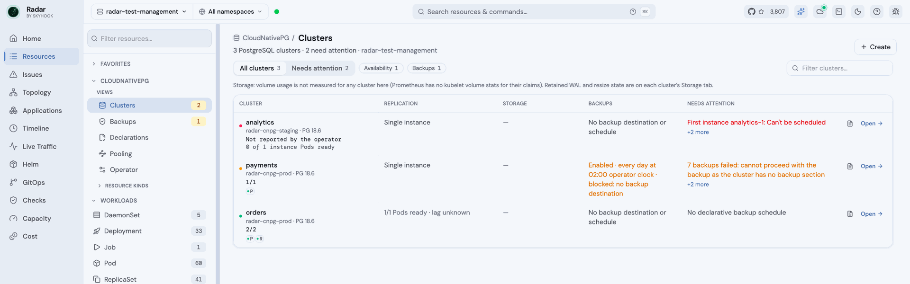

**Cluster page:** the cause first, then one line per health dimension.

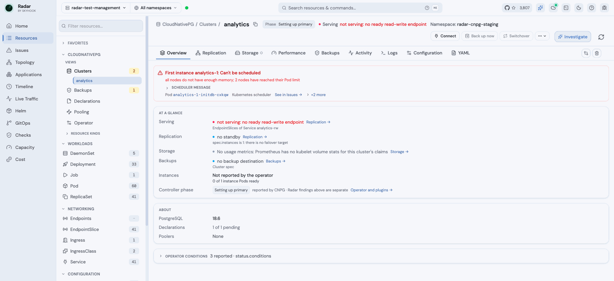

### What Radar Shows

**Cluster Detail View:**
- Phase, instances ready/desired, primary instance, image version
- Instance node distribution (which K8s nodes run each PostgreSQL instance)
- Storage configuration: data size, storage class, WAL storage
- Backup configuration: destination, retention policy, last successful backup, recovery point
- Monitoring: PodMonitor integration, custom query ConfigMaps
- Replication settings (for replica clusters), with per-instance role and timeline ID
- PostgreSQL parameters
- Health detection (AlertBanner for degraded clusters, failover/switchover in progress)
- **WAL archiving failure** — a first-class AlertBanner driven by the `ContinuousArchiving` condition. This is the classic silent CNPG incident: the cluster keeps serving traffic normally while the recovery point stops advancing. The condition proves the last archive attempt failed, so Radar reports "archiving failing since &lt;time&gt; — the recovery point may not be advancing" and deliberately does not claim an exact RPO
- **Last-backup failure** — driven by the `LastBackupSucceeded` condition. CNPG also sets this condition False with reason `BackupStarted` while a backup is merely in flight; Radar ignores that state rather than alerting on every backup run

**Backup Detail View:**
- Phase, backup method, duration, start/stop timestamps
- Cluster reference with clickable link
- Destination path and server name
- Backup target
- Failure detection (AlertBanner with error message)

**ScheduledBackup Detail View:**
- Cron schedule, last/next schedule timestamps
- Suspension detection (AlertBanner when paused)
- Backup configuration: cluster reference, method, owner reference settings

**Pooler Detail View:**
- Type (read-write/read-only) with colored badge, pool mode
- Instances scheduled/desired (not readiness — see below)
- Cluster reference with clickable link
- PgBouncer parameters
- Degraded state detection (AlertBanner when not all instances are scheduled)

Note `Pooler.status.instances` counts pods *trying to be scheduled*, not ready pods — a Pooler whose PgBouncer pods are all Pending still reports the full count. Radar labels the declared `spec.instances` count neutrally as **N instances requested**; actual readiness lives on the Deployment CNPG generates for the Pooler (same name, same namespace).

**Resource Browser:** Smart columns show status, instance counts (with degraded highlighting), primary instance, image tag, storage size, cluster reference, and schedule expressions.

### Phase classification

Cluster phases are full English sentences (`Cluster is unrecoverable and needs manual intervention`), not enum tokens, and are matched on equality. They are bucketed as healthy / transient / failing / terminal / attention; terminal phases outrank instance counts, so an unrecoverable cluster whose pods happen to still be Ready is still rendered red. "Terminal" means reconciliation is blocked, not that the operator gave up: it retries every one of them, the plugin phases clear on their own once the plugin loads and answers, and the banner quotes the operator's `status.phaseReason`. An unrecognized phase from a newer CNPG minor surfaces verbatim as unknown rather than being guessed at.

Backup phases are lowercase tokens. `walArchivingFailing` is treated as a cluster-level signal, not an ordinary backup failure — archiving is broken upstream of that Backup, so the whole recovery window is affected.

The taxonomy is defined twice — TypeScript for the badge, Go for the issue detector — and pinned by `TestCNPGPhaseTaxonomyMatchesFrontend`, which fails if the two drift.

### Backup: in-tree vs the barman-cloud plugin

In-tree `spec.backup.barmanObjectStore` is deprecated as of CNPG 1.26. Clusters migrated to the [barman-cloud plugin](https://github.com/cloudnative-pg/plugin-barman-cloud) keep their config in an `ObjectStore` CR (`barmancloud.cnpg.io/v1`), and CNPG stops populating `status.lastSuccessfulBackup` / `firstRecoverabilityPoint` by design. Radar detects the plugin from `spec.plugins[]`, names the ObjectStore and resolved server key, and says so explicitly — rather than rendering an empty backup section that reads identically to "no backups configured".

The `ObjectStore` itself is rendered: destination and credential provider (never the credentials), retention, and `status.serverRecoveryWindow` per PostgreSQL server — `firstRecoverabilityPoint`, `lastSuccessfulBackupTime`, `lastFailedBackupTime`. Note the field names differ from the Cluster's (`lastSuccessfulBackupTime`, not `lastSuccessfulBackup`); reading the Cluster's spelling off an ObjectStore silently yields nothing.

Two states carry the weight. A failure newer than the last success means the window has stopped advancing while its oldest point still ages out under retention — shrinking from both ends, so it is called out rather than left to be inferred from two timestamps. An ObjectStore with an empty `serverRecoveryWindow` is reported as holding nothing restorable rather than as healthy: on the plugin path the Cluster publishes no recovery point of its own, so a green badge here would be the only claim on screen and it would be wrong.

`Backup` and `ScheduledBackup` with `spec.method: plugin` name the plugin and suppress the in-tree `destinationPath` / `serverName` rows, which are never populated on that path. For barman-cloud, their destination comes from the Cluster’s plugin entry; their own plugin parameters are ignored. The standalone renderers explain this without presenting a parameter as a destination link. Workspace destination links are inferred from the current Cluster configuration. Radar does not model third-party plugin destinations.

### Declarative objects: Database, Publication, Subscription

CNPG can manage PostgreSQL-side objects from Kubernetes. All three report through `status.applied`, and it has **three** values, not two: `true`, `false` with the operator's message, and absent — meaning not reconciled yet. Absent is rendered as pending rather than failed; treating it as failure condemns every object in its first seconds.

The names in these specs are PostgreSQL names, not Kubernetes names: a Publication `demo-app-pub` declares `dbname: demo_app`, and the Database CR that owns `demo_app` is called `demo-app`. Radar resolves them back to the CRs so the reference is a link rather than a dead string, and falls back to plain text when nothing matches. The Database detail runs the lookup in the other direction, listing what publishes from and subscribes into it — a link the API only models one way.

`databaseReclaimPolicy` (and its publication/subscription twins) decides whether deleting the manifest drops the real object. `delete` is called out as destructive; CNPG defaults to `retain`, and defaulting the other way in the UI would warn about data loss that is not going to happen.

A declared object the operator could not apply raises an **Issue** (`CNPGDeclarativeNotApplied`, warning) carrying the operator's own message. This is the one CNPG failure with no other signal: the CR exists, the cluster is healthy, every count is green, and the database simply is not there. Only `applied: false` raises it — an absent `applied` means not yet reconciled, and reporting that would flag every declarative object for the first seconds of its life.

### Image catalogs

`ImageCatalog` and `ClusterImageCatalog` pin one PostgreSQL image per major version. A Cluster that references one carries **no `spec.imageName` at all**; the resolved image lives in `status.image`, so anything reading spec alone shows a dash where an image is running.

A cluster asking for a major the catalog does not list reports "incomplete or invalid image catalog" and stops — and that is invisible from the cluster side, where the reference looks fine. The catalog page lists the clusters pinned to it and separates out those asking for a version it does not carry.

### Cluster Audit checks

| Check | What it catches |
|-------|-----------------|
| `cnpgNoDeclarativeBackup` | A CNPG Cluster with a backup destination and no ScheduledBackup targeting it |
| `cnpgNoBackupDestination` | A CNPG Cluster that declares no backup destination: no barman-cloud plugin with an ObjectStore, no in-tree `barmanObjectStore` with a `destinationPath`, no `volumeSnapshot` (any other enabled CNPG-I plugin counts as a destination) |
| `cnpgNoWALArchiving` | A CNPG Cluster with a destination but no WAL archiving path, for example volume snapshots only: no in-tree `destinationPath`, no barman-cloud plugin with an ObjectStore (it archives WAL whether or not it is marked `isWALArchiver`, because CNPG hands every WAL file to each enabled archive-capable plugin), and no other plugin marked `isWALArchiver`. A Cluster whose only other plugin is a third-party one not marked `isWALArchiver` is not evaluated, since it may archive. CNPG may still report ContinuousArchiving as working: with no archiver at all it accepts each WAL file without keeping it |
| `cnpgSingleInstance` | A CNPG Cluster with `spec.instances` 1 or unset, so there is no standby to fail over to |
| `cnpgInTreeBackupDeprecated` | A CNPG Cluster configured with the in-tree `barmanObjectStore` and a `destinationPath` (deprecated since CNPG 1.26), even beside an enabled barman-cloud plugin: CNPG accepts the plugin there only as a non-archiver |

All five are posture findings (warning, default severity Medium, not badge-worthy) that state what the Cluster declares to CNPG. A dump job or storage snapshots outside CNPG are invisible to them, so none says a database has no backups. One cause gives one finding: a Cluster with no destination gets `cnpgNoBackupDestination` only, and neither the WAL rule nor the schedule rule evaluates it.

The schedule rule is deliberately narrow: the absence of a ScheduledBackup does not prove a cluster is unprotected (on-demand Backups and external schedulers exist), so the finding asserts only that no schedule is *declared*. All three `spec.method` values — `barmanObjectStore`, `volumeSnapshot` and `plugin` — count as a declared schedule. Suspended schedules count as present, since suspension is deliberate operator intent. It does not run at all unless a synced cluster-wide ScheduledBackup informer backs the inventory, because absence would otherwise be unprovable. The other four read only the Cluster object and need no other inventory. All five obey `radarhq.io/ignore-checks` on the Cluster.

### Supported CRDs

| CRD | Group | Topology | Detail View | AI Summary |
|-----|-------|----------|-------------|------------|
| Cluster | `postgresql.cnpg.io/v1` | — | Yes | — |
| Backup | `postgresql.cnpg.io/v1` | — | Yes | — |
| ScheduledBackup | `postgresql.cnpg.io/v1` | — | Yes | — |
| Pooler | `postgresql.cnpg.io/v1` | — | Yes | — |
| ObjectStore | `barmancloud.cnpg.io/v1` | — | Yes | — |
| Database | `postgresql.cnpg.io/v1` | — | Yes | — |
| Publication | `postgresql.cnpg.io/v1` | — | Yes | — |
| Subscription | `postgresql.cnpg.io/v1` | — | Yes | — |
| DatabaseRole | `postgresql.cnpg.io/v1` | — | Yes | — |
| ImageCatalog | `postgresql.cnpg.io/v1` | — | Yes | — |
| ClusterImageCatalog | `postgresql.cnpg.io/v1` | — | Yes | — |

**Limitations**:
- The image-catalog and backup views describe what the cluster reports. A `ScheduledBackup`'s cron is CloudNativePG's six-field form (seconds first) and is shown verbatim rather than translated, because reading it as a five-field expression would state the wrong time.

---

## Crossplane

[Crossplane](https://crossplane.io/) extends Kubernetes with declarative cloud-resource management. Operators define platform APIs (`CompositeResourceDefinition`s + `Composition`s), and provider packages reconcile real cloud resources from `Managed Resource` CRs in any cloud or SaaS. Radar treats every provider as a first-class integration without needing per-provider code — detection is heuristic, based on spec shape.

### What Radar Shows

**Sidebar:** All Crossplane resources land under a single "Crossplane" group, including provider-shipped MR groups (`*.upbound.io`, `*.crossplane.io` subgroups). Provider-Kubernetes and Provider-Helm config groups are first-class.

**Managed Resource Detail View** (the generic MR renderer — works for every provider, including Upbound AWS/GCP/Azure, provider-kubernetes, provider-helm, and any community provider):
- Kind, API group, external-name annotation, deletion + management policies
- Neutral pause chip plus visible reconciliation context when `crossplane.io/paused` is exactly `"true"`; distinguishes a request from recorded `Synced=False/ReconcilePaused` acknowledgement. Acknowledged pause shows readiness as last reported, and the expected pause condition adds no failing-condition count. Independent failures stay visible.
- Alert banner when `Synced=False` or `Ready=False` with the upstream cloud error verbatim
- Linked `ProviderConfig` and (when this MR is composed) linked parent Composite via owner-ref walk
- Collapsed `spec.forProvider` and `status.atProvider` JSON for deep diagnosis

**Composite / Claim Detail View** — the killer feature:
- Linked Composition and CompositionRevision (when pinned)
- **Composed Resources list** — every entry in `spec.crossplane.resourceRefs` (v2) or `spec.resourceRefs` (v1) rendered as a clickable row with **its own live status badge**, fetched per-row via React Query. Clicking opens the composed resource's drawer.
- The same neutral pause context as managed resources, scoped to this resource’s reconciler; it does not assert that composed resources or the bound XR are paused.
- For v1 Claims: linked bound XR

**Composition Detail View:**
- Mode badge (`Pipeline` violet vs `Resources` neutral)
- Backed by linked XRD
- Pipeline mode: numbered step cards, each with linked Function package, input kind, and expandable raw input
- Resources mode: list of composed-resource templates with patch counts

**XRD Detail View:**
- Generated CR section: kind, plural, group, scope (v2 only — `Cluster` vs `Namespaced` badge)
- Claim names (v1)
- Versions table with `served` / `referenceable` / `deprecated` badges
- Default + enforced Composition links
- Connection-secret keys
- `Established` / `Offered` conditions

**Provider / Function / Configuration Detail View** (shared renderer):
- Package OCI image, pull policy, revision activation policy
- Current revision + identifier
- Linked DeploymentRuntimeConfig (when set)
- Linked package dependencies
- For Configurations: list of installed XRDs/Compositions/Functions from `status.objectRefs`
- Alert banners for `Installed=False` (install failed) or `Healthy=False` (controller unhealthy)

**ProviderConfig Detail View:**
- API group, credentials source (`InjectedIdentity`, `Secret`, etc.)
- "N in use" status badge from `status.users`
- Linked credentials Secret when applicable

**Resource Browser:** MR list shows kind / external name / provider config / status; Provider list shows package, revision, status; Composition list shows mode, composite kind, function count; XRD list shows generated kind and claim kind.

**Topology:** Radar connects a v1 Claim to its bound XR, and an XR to its composed Managed Resources. Edges follow Crossplane's v1 and v2 spec references; only resources Radar already watches and can read are shown.

**Pause display:** Exact annotation intent plus recorded `Synced=False/ReconcilePaused` also qualifies pause context before an XR or Claim has resource references; this does not infer its resource type or enable composite-specific features. An annotation-only request without a recognized Crossplane shape remains unclassified. A neutral chip stays beside the row name, including XR/Claim tables using CRD printer columns. Condition-derived printer values retain their raw text; only exact condition-source metadata plus corroborated pause changes the expected Synced=False or recorded Ready=True tone. Older Radar servers omit that source metadata, so their printer cells keep generic tones alongside the neutral pause chip. Deletion requested while pause intent is set gets an inline warning that reconciliation may defer this resource’s controller cleanup. No pause age or freshness is inferred from condition transition times. Without exact annotation intent, `ReconcilePaused` remains an alert with its raw reason. A newer UI against a server predating the pause Issue rule can still show that server’s warning Issue.

For shape-detected XRs and Claims without printer columns, the primary table status, filter and sort share the Crossplane status helper even when unpaused, matching the detail header.

The topology graph retains its recorded readiness color and does not add this pause chip; opening the resource shows the reconciliation context.

**Issues:** `Synced=False/ReconcilePaused` does not add a warning when `crossplane.io/paused` is exactly `"true"`. Other failure conditions remain eligible under the usual condition and generation filters; unlike Cluster Audit, the pause annotation does not exclude the whole resource from Issues. Pausing through empty `managementPolicies` is not covered by this rule.

**Agent context:** AI resource summaries, per-row `summaryContext` (REST/MCP list and search), resource detail `resourceContext`, and the Diagnose kickoff health frame expose optional `crossplanePause`. `requested` means `crossplane.io/paused` is exactly `"true"`; `acknowledged` additionally has a recorded `Synced=False/ReconcilePaused` condition. This is annotation intent and stored controller evidence, independent of readiness and Issues. It does not establish freshness, matching generation, a pause start time, or the state of any child/provider controller. Omission makes no claim about management-policy pause or a prior resume. Summary rows retain the fact with `context=none`; generic CRD rows carrying `crossplanePause` retain an independent Synced failure in `issue` even when Ready is True. Compact retains the exact pause annotation and raw conditions; other Crossplane annotation keys are not broadly allowed through.

**Operation context:** Delete confirmations identify annotated paused MR/XR/Claim resources holding a known Crossplane finalizer, whose controller cleanup is deferred; force delete can bypass that cleanup and leave external or related resources behind. YAML apply review and direct-save confirmations distinguish Kubernetes accepting edits from the resource controller acting on them. Review states whether the server preview keeps or clears a pause request; unavailable previews label unverified pause state. Direct editor saves also explain that omitting the annotation from server-side apply YAML does not guarantee removal. Removing `crossplane.io/paused` requests resumption; it does not prove the controller resumed or that related controllers paused. Generic Apply without a live preview labels existing pause state as unknown and explains that omitting the annotation from server-side apply YAML does not guarantee removal. A known pause uses the exact annotation value `"true"`; empty `managementPolicies` alone is outside this annotation-only context.

Resources without a known Crossplane spec shape qualify for operation context only when the exact pause annotation is corroborated by `Synced=False/ReconcilePaused`. A single-target editor retains that raw evidence when review YAML omits status; generic Apply with no such evidence does not infer controller identity from the annotation alone.

**Cluster Audit:** New `crossplaneStuck` check flags MRs/XRs/Claims reporting `Ready=False` or `Synced=False` for more than 5 minutes (Medium) or 30 minutes (High). Synced=False takes priority over Ready=False because it usually indicates the actionable problem (bad ProviderConfig, malformed spec, missing IAM). Same severity ramp as `stuckTerminating` for cross-surface consistency. Paused resources are deliberately suppressed.

### v1 vs v2 Path Handling

Crossplane v2 moved several fields under `spec.crossplane.*`. Radar's renderers and detectors check the v2 path first, fall back to v1 — no version detection needed. Fields handled this way:

- `spec.crossplane.providerConfigRef` ↔ `spec.providerConfigRef`
- `spec.crossplane.resourceRefs` ↔ `spec.resourceRefs`
- `spec.crossplane.compositionRef` ↔ `spec.compositionRef`
- `spec.crossplane.compositionRevisionRef` ↔ `spec.compositionRevisionRef`
- `spec.crossplane.managementPolicies` ↔ `spec.managementPolicies`
- `spec.crossplane.deletionPolicy` ↔ `spec.deletionPolicy`

### Detection Heuristic (How Generic Renderers Match)

- **Managed Resource**: presence of `spec.providerConfigRef` (v1 or v2 path)
- **Composite / Claim**: presence of `spec.resourceRefs` (v1 or v2 path) AND not an MR
- **v1 Claim**: also has `spec.resourceRef` (singular, pointing at the bound XR) + `spec.compositionRef`

The set of MR CRD kinds is unbounded — every provider ships its own. Detection by spec shape lets Radar handle providers it has never seen without per-provider code.

### RBAC

The Helm chart's `rbac.crdGroups.crossplane: true` toggle grants read access to:
- `crossplane.io`, `pkg.crossplane.io`, `apiextensions.crossplane.io` (Crossplane core)
- `kubernetes.crossplane.io`, `helm.crossplane.io` (provider-kubernetes + provider-helm — useful in non-cloud installs)

For Upbound provider CRDs (`s3.aws.upbound.io`, `compute.gcp.upbound.io`, etc.), list them in `rbac.additionalCrdGroups` — Kubernetes RBAC has no `apiGroups` wildcards. Alternative: set `rbac.crdGroups.all: true`, which grants `get/list/watch` on every API group and resource, core Secrets included (simpler, much broader).

### Supported CRDs

| CRD | Group | Topology | Detail View | AI Summary |
|-----|-------|----------|-------------|------------|
| Managed Resources (any provider) | `*.upbound.io`, `kubernetes.crossplane.io`, `helm.crossplane.io`, `*.crossplane.io` | Yes | Yes | — |
| Composite Resources (XRs) | user-defined groups | Yes | Yes | — |
| Claims (v1) | user-defined groups | Yes | Yes | — |
| CompositeResourceDefinition | `apiextensions.crossplane.io/v1`, `v2` | — | Yes | — |
| Composition | `apiextensions.crossplane.io/v1` | — | Yes | — |
| CompositionRevision | `apiextensions.crossplane.io/v1` | — | Yes | — |
| Provider | `pkg.crossplane.io/v1` | — | Yes | — |
| Function | `pkg.crossplane.io/v1` | — | Yes | — |
| Configuration | `pkg.crossplane.io/v1` | — | Yes | — |
| ProviderConfig | per-provider group | — | Yes | — |

### Out of Scope

Deferred to a future "full Crossplane" pass:

- `Usage` / `ClusterUsage` rendering (delete-protection visualization)
- Cloud-console deep links from `external-name`
- Provider controller pod link with one-click log access
- Connection-secret link on XRs
- Mutating actions (force-reconcile, pause/unpause via `crossplane.io/paused`, manual sync)
- Composition revision diff view (compare adjacent `CompositionRevision`s)
- Per-XR insights pipeline (drift / events / plan / history surface — same shape as the GitOps detail page)
- Per-provider specialized renderers (e.g. an S3-specific section that calls out bucket policy / versioning) — generic MR renderer covers the daily need; specialize on user demand

---

## Kyverno

[Kyverno](https://kyverno.io/) is a Kubernetes-native policy engine for validation, mutation, generation, and image verification — no new language required, policies are written as Kubernetes resources.

### What Radar Shows

**Policy / ClusterPolicy Detail View:**
- Enforcement badge: what the policy does at admission, not just what `validationFailureAction` reads. Enforce in red, Audit in yellow, and **Background only** (or **Inactive**, when background scanning is off too) in orange for a policy that declares Enforce but is kept out of the admission webhook by `spec.admission: false`
- Configuration: admission and background scanning, webhook timeout, failure policy, schema validation
- Rule type summary (validate/mutate/generate/verifyImages counts)
- Individual rules with type badges and match/exclude indicators
- Auto-generated rules list

**PolicyReport / ClusterPolicyReport Detail View:**
- Visual result bar chart (pass/fail/warn/error/skip proportions)
- Scope and source information
- Individual results with status badges, severity levels, policy/rule names
- Expandable details: message, category, source, affected resources
- Problem detection (AlertBanner for failures or errors)

**Resource Browser:** Smart columns show status (colored by worst outcome), enforcement at admission, rule counts, and pass/fail/warn/error/skip breakdowns.

### The per-policy resource view

A resource page answers "which policies does this break". The policy page answers the other direction: **which resources does this policy cover, and what happens to them**, grouped by rule.

Keep these semantics in mind when reading the results:

- **Report producers share the same fields.** Trivy and Falco can write their own identifiers into `results[].policy`; Radar labels those results by producer instead of presenting them as Kyverno policy outcomes.
- **Status wording follows the rule type.** For example, a mutating rule's `fail` means the mutation was not applied, while a generate rule's `pass` means the resource was generated.
- **Enforcement follows declared operations.** A CREATE-only policy rejects new resources, not updates to existing ones. A resource already failing that rule is grandfathered until it is recreated.

Passing resources are available behind an **all N passing** disclosure. Large subject lists are initially bounded, with a **Load the rest** control when more results are available.

**GlobalContextEntry** gets its own view because a policy referencing an entry that never resolves fails at evaluation time with no obvious cause. Kyverno records success as `status.lastRefreshTime` and records failure as *nothing at all* — no message, no condition, no reason. So the page reports "has refreshed" versus "has never refreshed" (with the entry's age turning the second into a diagnosis) and says outright that Kyverno records no reason, rather than inventing one.

The count of queued work appears **on the policy itself**, above its configuration. The section is silent when a policy has nothing queued, so it stays out of the way for policies that only validate.

**UpdateRequest** is where a generation or mutate-existing operation that silently stopped is diagnosed: the policy may report Ready while the target never appears, with a request sitting in `Pending` as the remaining evidence. Radar handles both Kyverno request shapes and links each request to the trigger resources it records.

**EphemeralReport** holds a background scan's findings before they are folded into a PolicyReport. Kyverno deletes these reports quickly after processing, so an empty list normally means the work completed rather than that reporting is unavailable.

### Supported CRDs

| CRD | Group | Topology | Detail View | AI Summary |
|-----|-------|----------|-------------|------------|
| Policy | `kyverno.io/v1` | — | Yes | — |
| ClusterPolicy | `kyverno.io/v1` | — | Yes | — |
| PolicyReport | `wgpolicyk8s.io/v1alpha2` | — | Yes | Yes |
| ClusterPolicyReport | `wgpolicyk8s.io/v1alpha2` | — | Yes | Yes |
| UpdateRequest | `kyverno.io/v2` | — | Yes | — |
| GlobalContextEntry | `kyverno.io/v2` | — | Yes | — |
| EphemeralReport | `reports.kyverno.io/v1` | — | Yes | — |
| ClusterEphemeralReport | `reports.kyverno.io/v1` | — | Yes | — |

PolicyReport findings are policy posture, not live operational failure, so they are **not** part of the `/api/issues` stream. They surface per-resource: the PolicyReport detail view (above) and the `resourceContext` policy rollup on a resource fetched via `get_resource`. (The cluster audit — `/api/audit` + MCP `get_cluster_audit` — is radar's own static best-practice scanner and does **not** include PolicyReport results.)

**Limitations**:
- Queued work (`UpdateRequest`) is only shown for policies that generate or mutate existing resources, and only while it is in flight — Kyverno deletes these seconds after the work completes, so an empty section is the normal resting state rather than evidence that nothing ran.
- Coverage counts describe the whole cluster within what the caller is authorized to read; per-rule subject lists are capped by the server and additionally follow the namespace view filter. The screen states which number it is showing, but the two are not interchangeable.
- Radar authorizes the `wgpolicyk8s.io` and `openreports.io` report families separately at each subject scope. A grant to read `policyreports` does not imply `clusterpolicyreports`, while a namespace-restricted caller can still see findings for namespaces they may read. Findings from an unreadable family are withheld from both lists and counts, and the number withheld is reported.

---

## Knative

[Knative](https://knative.dev/) extends Kubernetes with serverless capabilities: scale-to-zero, request-driven autoscaling, event-driven architectures, and simplified service deployment.

### What Radar Shows

**Topology:** Full Knative Serving chain — Route → KnativeService → Configuration → Revision → Deployment → Pod. Eventing flow — PingSource → Broker → Trigger → subscriber target. See how traffic is split across revisions, which configurations are active, and how events flow from sources through brokers to triggers.

Event destinations retain the reference’s API group, kind, namespace and name. Missing or conflicting identity remains unresolved rather than borrowing a same-named core Service. `Trigger.spec.brokerRef` uses its explicit Broker namespace and name; the older `spec.broker` field remains local to the Trigger. Channel objects and their observed backing channels are separate resources, and cached owner references establish their management links.

  
   <em>Knative in Topology View — Serving chain and Eventing flow</em>

**KnativeService Detail View:**
- Status with URL and ingress readiness
- Latest ready and latest created revision links
- Scaling configuration (min/max scale, concurrency, timeout)
- Traffic split across revisions with percentage bars
- Container template (image, ports, env, resources)
- Conditions (Ready, RoutesReady, ConfigurationsReady)

  
   <em>KnativeService Detail View — URL, scaling, traffic splits, and conditions</em>

**Revision Detail View:**
- Container image with tag
- Concurrency model and container concurrency limit
- Timeout and scaling bounds (min/max)
- Traffic percentage (active vs inactive)
- Conditions (Ready, ContainerHealthy, ResourcesAvailable, Active)

**Route Detail View:**
- URL and domain
- Traffic targets with revision names and percentage distribution
- Conditions (Ready, AllTrafficAssigned, IngressReady)

**Configuration Detail View:**
- Latest created and latest ready revision references
- Generation tracking
- Conditions (Ready)

**Broker Detail View:**
- Address (internal URL for event delivery)
- Delivery configuration (dead letter sink, retry, backoff)
- Conditions (Ready, Addressable, FilterReady, IngressReady, TriggerChannelReady)

**Trigger Detail View:**
- Broker reference
- Subscriber target (service, URI, or Kubernetes reference)
- Event filter attributes
- Delivery configuration (dead letter sink)
- Conditions (Ready, BrokerReady, SubscriberResolved, DependencyReady)

**Source Detail Views (PingSource, ApiServerSource, ContainerSource, SinkBinding):**
- Sink target reference
- Source-specific configuration:
  - PingSource: cron schedule, data payload, content type
  - ApiServerSource: API resources watched, event mode, service account
  - ContainerSource: container image and arguments
  - SinkBinding: subject reference (Deployment, Job, etc.)
- Conditions (Ready, Deployed, SinkProvided)

**Networking Detail Views (Ingress, Certificate, ServerlessService):**
- KnativeIngress: ingress class, visibility, TLS hosts, rules with path/host routing
- KnativeCertificate: domain names, DNS names, not-after expiry
- ServerlessService: mode (Proxy/Serve), network status

**Flow Detail Views (Sequence, Parallel):**
- Sequence: ordered list of steps with subscriber references
- Parallel: branches with filter and subscriber configurations
- Reply/channel template settings

**Resource Browser:** Smart columns show status, URLs, latest revisions, traffic splits, schedules, sinks, brokers, subscribers, and filters at a glance.

### Supported CRDs

| CRD | Group | Topology | Detail View | AI Summary |
|-----|-------|----------|-------------|------------|
| Service | `serving.knative.dev/v1` | Yes | Yes | — |
| Configuration | `serving.knative.dev/v1` | Yes | Yes | — |
| Revision | `serving.knative.dev/v1` | Yes | Yes | — |
| Route | `serving.knative.dev/v1` | Yes | Yes | — |
| DomainMapping | `serving.knative.dev/v1beta1` | — | Yes | — |
| Broker | `eventing.knative.dev/v1` | Yes | Yes | — |
| Trigger | `eventing.knative.dev/v1` | Yes | Yes | — |
| EventType | `eventing.knative.dev/v1beta2` | — | Yes | — |
| Channel | `messaging.knative.dev/v1` | — | Yes | — |
| InMemoryChannel | `messaging.knative.dev/v1` | — | Yes | — |
| Subscription | `messaging.knative.dev/v1` | — | Yes | — |
| PingSource | `sources.knative.dev/v1` | Yes | Yes | — |
| ApiServerSource | `sources.knative.dev/v1` | Yes | Yes | — |
| ContainerSource | `sources.knative.dev/v1` | Yes | Yes | — |
| SinkBinding | `sources.knative.dev/v1` | Yes | Yes | — |
| Sequence | `flows.knative.dev/v1` | — | Yes | — |
| Parallel | `flows.knative.dev/v1` | — | Yes | — |
| Ingress | `networking.internal.knative.dev/v1alpha1` | — | Yes | — |
| Certificate | `networking.internal.knative.dev/v1alpha1` | — | Yes | — |
| ServerlessService | `networking.internal.knative.dev/v1alpha1` | — | Yes | — |

## OpenCost and Kubecost

[OpenCost](https://www.opencost.io/) is a CNCF tool for Kubernetes cost monitoring, exposing cloud provider pricing and workload resource allocation as Prometheus metrics.

Radar supports two read-only cost sources. **Automatic** prefers usable OpenCost
metrics from Prometheus, then tries a Kubecost 3 Aggregator when those metrics
are absent. If neither source is found, Cost reports that state and retries
discovery.

If discovered Prometheus candidates are unreachable or detection times out,
Automatic can use a working Kubecost temporarily. The next Cost request after
one minute rechecks Prometheus and switches back when OpenCost metrics are usable.
If Kubecost cannot be discovered either, Cost remains unavailable and retries.
Settings → Metrics shows the Prometheus connection failure, including any
NetworkPolicy diagnosis. Other Prometheus configuration or query failures do
not start a new source switch; Cost shows the failure when it has no working
fallback.

Pin a source in Settings → Cost or Helm to prevent Automatic selection.
Local CLI/Desktop saves the choice per context in `clusters.json`; shared
installations use operator configuration.

Local Settings tests Kubecost mode, and Automatic with any Kubecost override
(URL, API key or cluster ID), before saving; a failed test blocks the save.
Automatic without Kubecost overrides, or Prometheus mode, saves a preference
without asserting that the backend is reachable.

For Kubecost, Radar auto-discovers only an active Aggregator StatefulSet and its matching Service.
It tries the official named `tcp-api` port 9004 first. When that port rejects unauthenticated access
and no API key is configured, Radar falls back only to the same Service's exact `tcp-api-rbac` port
9008, which Kubecost exposes for internal clients when SAML or OIDC is enabled. An explicitly
configured key is never bypassed this way: a rejected key remains an authentication error.
In-cluster Radar connects through Service DNS; local Radar uses a scoped port-forward to the selected
port. An explicit URL is required for federated agent-only clusters, which have a FinOps Agent but no
local Aggregator. A Service exposing only port 9008 is not auto-discovered; configure that endpoint
explicitly. Radar accepts either a root API URL or one ending in `/model`, can send an optional
service-account key as `X-API-KEY`, and requires an exact cluster ID
to filter a central Aggregator. It detects one literal `CLUSTER_ID` from an active FinOps Agent or
Aggregator; indirect, missing, or conflicting values require an override. Local CLI/Desktop stores
Kubecost settings per kubeconfig context, and binds every saved URL, API key and cluster-ID override
to that context's cluster identity. Switching contexts restores that context's own settings; changing
its underlying cluster identity pauses them until you confirm. An explicit central Aggregator URL and
key can be copied through **Copy settings from…**. Later edits are independent, and cluster IDs
are not copied. See [local integration connections](configuration.md#local-integration-connections).
Shared installations bind a cluster-ID override saved in `config.json` to the active kubeconfig
context, and also bind a saved API key when the URL is blank and Radar auto-discovers a local
Aggregator.

OpenCost-compatible Prometheus data powers current cost and historical charts. Kubecost REST powers
the current namespace summary, workload/application compute allocation, node costs, and the cluster
namespace trend from the allocation history retained by its Aggregator. Workload and application
history remain unavailable for Kubecost. Radar never mixes current data from one source with history
from another.

Cost values contain no reliable per-response currency metadata. When the selected source is tied to
the connected cluster, Radar looks for `currencyCode` in the pricing ConfigMap referenced by an
active OpenCost/Kubecost workload, or literal `DISPLAY_CURRENCY` on an active Kubecost Deployment or
StatefulSet. `DISPLAY_CURRENCY` takes precedence; conflicting or indirect values are treated as
ambiguous. A manually configured Prometheus URL skips cluster inference because it may serve another
cluster, while a selected Kubecost source still uses its connected-cluster workload evidence. If
evidence is unavailable, Radar uses USD. Override the label in Settings → Cost or
`opencostCurrency` (CLI: `--opencost-currency`; Helm: `cost.currency`). Radar labels values but does
not convert them. The Settings currency preference saves independently of the live source action,
so changing its label never requires the source probe to succeed.

### What Radar Shows

**Resource Costs** 

**Dashboard Cost Card:** Cluster hourly cost and projected monthly cost, top 5 most expensive namespaces with a horizontal bar chart. Clicking navigates to the full Cost Insights view.

**Cost Insights View (`/cost`):**
- Header: cluster hourly/monthly cost, efficiency %, idle cost projection
- Resource cost split bar: CPU / Memory / Storage percentage breakdown
- Cost trend chart with 6h/24h/7d range selector and per-namespace hover tooltips for OpenCost or retained Kubecost allocation history
- Namespace breakdown table (sortable by cost, efficiency, CPU/memory split) — click any row to expand per-workload costs on demand
- Node costs table: instance type, region, and hourly/monthly pricing per machine
- Efficiency color coding: green (50%+), amber (25–50%), red (below 25%)

### Prerequisites

One of:

1. OpenCost-compatible cost metrics scraped into Prometheus; or
2. A Kubecost 3 Aggregator in the connected cluster; or
3. An explicit central Kubecost Aggregator URL and cluster ID for a federated agent-only cluster.

Cost data is not CRD-based — no custom resources are required. Cost views appear when either path
returns usable current allocation data. Configure declarative Kubecost access with
`cost.source`, `cost.kubecost.url`, `cost.kubecost.clusterId`, and an optional Secret in the Helm
chart.

---

## Dynamic Resource Allocation (DRA)

[Dynamic Resource Allocation](https://kubernetes.io/docs/concepts/scheduling-eviction/dynamic-resource-allocation/) is Kubernetes' structured device-allocation API (GA in 1.34), replacing opaque extended-resource integers for GPUs and other accelerators. These are built-in `resource.k8s.io` APIs, not CRDs — Radar discovers them automatically when the cluster serves the group.

### What Radar Shows

**ResourceClaim Detail View:** Allocation lifecycle status (Pending → Allocated → reserved), device requests with their DeviceClass (handles v1 `exactly`/`firstAvailable` and v1beta1 request shapes), allocated driver/pool/device results, reserved-for consumers with Pod links, and per-device health conditions when drivers report them. An allocated-but-unreserved claim is flagged — long-lived, it leaks a device.

**Related Resources:** Pods show their ResourceClaims (direct and template-generated); ResourceClaims link back to their DeviceClasses and the Pods holding the reservation.

**Resource Browser:** Claims list with allocation status, device class, allocated driver, and reservation columns. ResourceSlices list the per-node device inventory each driver publishes (driver, pool, node, device count).

### Supported Kinds

| Kind | Group | Topology | Detail View | AI Summary |
|------|-------|----------|-------------|------------|
| ResourceClaim | `resource.k8s.io` (v1, v1beta2) | Relationships | Yes | Yes |
| ResourceClaimTemplate | `resource.k8s.io` (v1, v1beta2) | — | Yes | Yes |
| DeviceClass | `resource.k8s.io` (v1, v1beta2) | Relationships | Yes | Yes |
| ResourceSlice | `resource.k8s.io` (v1, v1beta2) | — | Yes | Yes |

---

## Certificate Signing Requests

[CertificateSigningRequests](https://kubernetes.io/docs/reference/access-authn-authz/certificate-signing-requests/) are how kubelets and other clients ask a signer for an X.509 certificate. This is the built-in, cluster-scoped `certificates.k8s.io/v1` API, not a CRD; Radar lists it under **Other Kubernetes APIs**. Support is read-only: Radar does not approve, deny or sign requests.

### What Radar Shows

**Status:** The table, the detail header, MCP and AI context share one reading, the one `kubectl` and client-go's `WaitForCertificate` use: **Pending approval**, **Approved, not issued** (approved, but the signer has not returned a certificate), **Issued**, **Denied** and **Failed**. Denied and Failed are final, and a certificate counts as issued only once the request is Approved. Waiting for an approver or a signer does not raise an Issue.

**Detail View:** The deciding condition's reason, message and time; the signer, usages and requested duration; the requester (username, UID, groups and extra) as the API server recorded it; the identity decoded from the PKCS#10 request (subject, organizations, DNS/IP/email/URI SANs, key and signature algorithm), labelled as what was asked for rather than what was authorized or issued; and each returned certificate (subject, SANs, issuer, serial and validity) in the same view TLS Secrets use. Missing, malformed or partly unreadable data is reported as such, never as "no certificate".

**Resource Browser:** Status, signer and requester columns.

**AI Summary:** `list_resources` reports the state with the signer as `type`; `get_resource` replaces the base64 PEM payloads with what they decode to. See [MCP](mcp.md#certificatesigningrequests).

**RBAC:** The Helm chart grants read-only `get/list/watch` on `certificatesigningrequests` together with RBAC objects: with authentication on or in cloud mode, or with `rbac.viewRBAC: true` on a no-auth install. Without it, the CertificateSigningRequest list is not shown. Radar Cloud's default tier bindings withhold it because a request records its requester's identity; see [the default read policy](cloud-rbac-baseline.md).

### Supported Kinds

| Kind | Group | Topology | Detail View | AI Summary |
|------|-------|----------|-------------|------------|
| CertificateSigningRequest | `certificates.k8s.io` (v1) | — | Yes | Yes |

---

## NVIDIA GPU Operator

The [NVIDIA GPU Operator](https://docs.nvidia.com/datacenter/cloud-native/gpu-operator/latest/) manages the GPU software stack (driver, container toolkit, device plugin, DCGM) on Kubernetes.

### What Radar Shows

**ClusterPolicy Detail View:** Operator state (ready / notReady / disabled), enabled components (driver, toolkit, device plugin, DCGM exporter, GFD, MIG manager, …), and MIG strategy. NVIDIA's ClusterPolicy shares its kind name with Kyverno's — Radar disambiguates by API group everywhere.

**NVIDIADriver Detail View:** Driver rollout state, type, version, image/repository, precompiled flag, and node selector.

### Supported CRDs

| CRD | Group | Topology | Detail View | AI Summary |
|-----|-------|----------|-------------|------------|
| ClusterPolicy | `nvidia.com/v1` | — | Yes | Yes |
| NVIDIADriver | `nvidia.com/v1alpha1` | — | Yes | Yes |

---

## Network Policies

[Network Policies](https://kubernetes.io/docs/concepts/services-networking/network-policies/) control pod-to-pod and pod-to-external traffic at the network level. Radar supports standard Kubernetes NetworkPolicy, Cilium policies, and [Calico policies](https://docs.tigera.io/calico/latest/network-policy/), showing which policies exist and which workloads they select, which workloads no policy selects, and - when Hubble reports a policy drop - what the plugin recorded and what Radar can determine from the current Kubernetes NetworkPolicies. Applicable Cilium policies are listed, but their rules are not evaluated.

### Why was this flow dropped?

With Hubble as the traffic source, expand a dropped flow in the Traffic view to see the reason the network plugin reported. For policy drops, Radar also shows the deny policy the plugin named, if any, and checks the current Kubernetes NetworkPolicies against that connection. The panel answers in that order: what the plugin recorded, what current policies say, and what Radar could not check.

Radar reads policies as they are now and says so. The plugin's deny attribution and Radar's current-policy check are separate things, and the panel keeps them apart. When missing information — the pod is gone, the flow record has no direction, you cannot read the peer's namespace — keeps Radar from completing the check, the panel explains why instead of guessing. Applicable Cilium policies are listed, but their rules are not evaluated.

The common case is a default-deny policy with nothing that allows the client. Cilium reports the drop as a policy drop but names no policy, because no rule matched. Radar's own check names the policy that isolates the pod and explains what it does.

  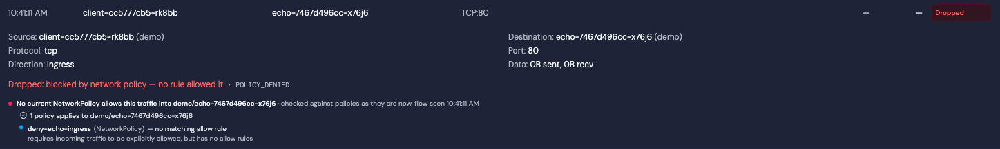
   <em>Hubble reports POLICY_DENIED without naming a policy. The current check lists deny-echo-ingress and explains that it has no allow rules</em>

When the plugin does name the policy — an explicit Cilium deny rule — that is the headline, shown if you have permission to read that policy. The current Kubernetes NetworkPolicy check appears under it as a note; it may find an allow, no matching allow, or an incomplete result.

  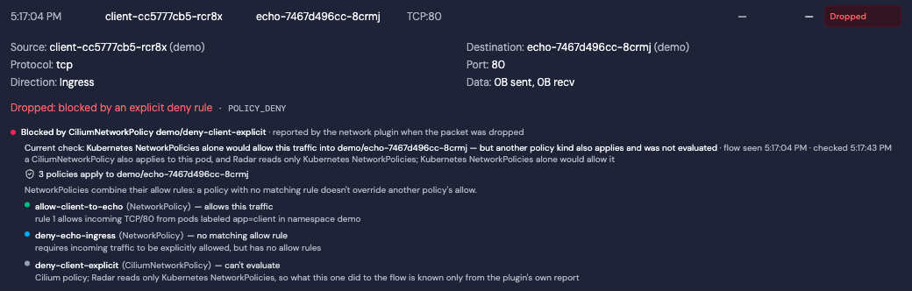
   <em>Hubble names a Cilium deny policy as the reason for the drop. The current Kubernetes NetworkPolicy check appears below it</em>

Cilium policies can allow or deny traffic on their own terms, alongside Kubernetes ones, and Radar does not evaluate their rules. So when a Cilium policy governs the pod in the flow's direction, Radar states the Kubernetes-only result as a result, lists the Cilium policy as *can't evaluate*, and does not call the connection allowed or denied.

  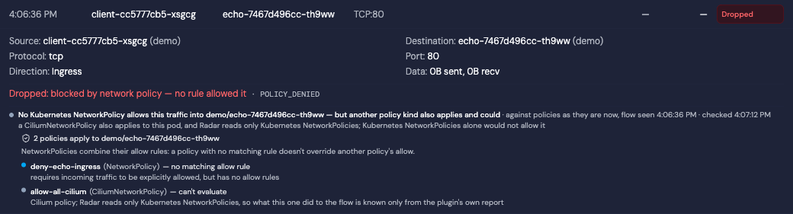
   <em>A Cilium policy also applies. Radar shows the Kubernetes-only result and cannot determine the combined result</em>

Each policy row says what it does to this connection in plain words: *allows this traffic*, *no matching allow rule*, or *can't evaluate*. NetworkPolicies combine their allow rules, so a policy with no matching rule does not override another policy's allow; the panel shows this reminder when several policies apply and at least one has no matching allow rule.

Radar runs the current-policy check only when the plugin reports a policy drop. For other drops (an unroutable address, a malformed packet) the panel shows the reported reason and says that Radar checks NetworkPolicies only for policy drops. If the plugin reported no reason, the panel says Radar cannot tell whether a policy was involved. A policy drop over a protocol other than TCP, UDP or SCTP cannot be checked against port rules, and the panel says so.

The panel shows when the flow was seen and when the policies were checked, and refreshes every 30 seconds while the row is open. Policies may have changed since the drop: a current allow does not confirm that a new connection will succeed. What the panel does not do yet: propose the rule that would allow the traffic, or tell you whether a policy changed after the drop.

The panel shows only what you could read yourself: listing policies and reading the pod in that namespace are required, a peer pod or Namespace you cannot read is left unresolved, and a policy name reported by the plugin is withheld when you cannot list policies of that kind. In the Helm chart, the Cloud cluster-read role grants Cilium policy reads under `rbac.crdGroups.cilium` so Radar can identify the Cilium policies that apply; it still does not evaluate their rules.

### What Radar Shows

**Topology:** Kubernetes, Cilium, and Calico policy nodes appear in the topology graph with edges connecting them to the Deployments, StatefulSets, and DaemonSets they protect. Calico matching evaluates workload, namespace, and service-account selectors. Staged Calico policies use dashed edges and preview styling so they are not mistaken for enforced protection; a staged policy whose `stagedAction` is `Delete` or `Ignore` draws no edge at all, because promoting it would remove protection rather than add it.

  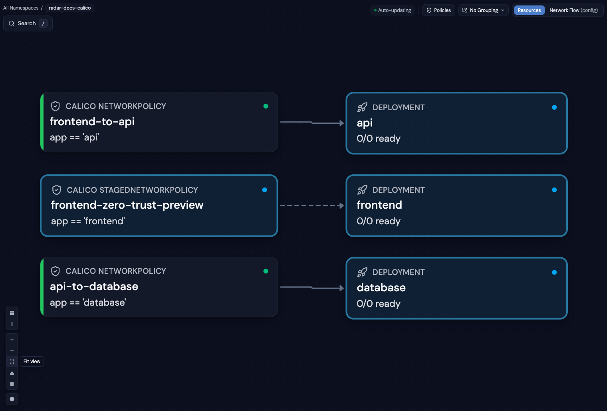
   <em>Calico policy topology — enforced relationships use solid edges; staged previews use dashed edges</em>

**Dashboard Coverage Card:** The home dashboard includes a Network Policy Coverage card showing total policy count, the percentage of workloads covered by at least one enforced policy, and a count of uncovered workloads. When staged Calico policies exist, it separately shows projected coverage if those policies were applied. That projection can be **lower** than today's coverage — a staged deletion removes the protection of the policy it names — and the bar marks the part that would be lost.

  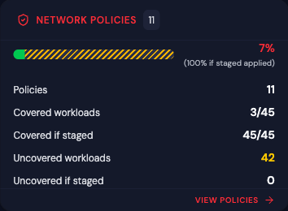
   <em>Dashboard coverage separates enforced protection from the projected result of applying staged policies</em>

**Policy Flow Diagram:** Each NetworkPolicy detail drawer includes a visual flow diagram showing ingress and egress rules as a directional graph — sources on the left, targets on the right, with ports and protocols labeled. Quickly understand what a policy allows without reading YAML.

  
   <em>Policy Flow Diagram — visual representation of ingress and egress rules</em>

**Standard NetworkPolicy Detail View:**
- Pod selector and namespace selector rules, shown the way Kubernetes applies them: a peer with both selectors is one condition (pods matching X in namespaces matching Y), not two
- Ingress and egress rules with CIDR blocks, ports, port ranges, and protocols
- Policy types as the API server applies them: a policy with no `policyTypes` isolates ingress, and egress only when it has egress rules
- Related resources showing protected workloads

**Cilium Policy Detail View:**
- Endpoint selector targeting
- Ingress/egress rules with allow and deny semantics
- Cilium-specific entity selectors (world, cluster, host)
- CIDR rules, port/protocol specifications
- Related workloads with clickable links

  
   <em>CiliumNetworkPolicy Detail — endpoint selector, ingress deny from world, egress allow to cluster</em>

**Calico Policy Detail View:**
- Flow diagram for ordered ingress and egress rules, including Allow, Deny, Log, and Pass actions
- Workload, namespace, and service-account selectors
- Tier, order, policy types, pre-DNAT, apply-on-forward, and do-not-track settings
- Calico entities, CIDRs, ports, protocols, HTTP matches, and ICMP matches
- Staged action and preview styling for staged policy variants

  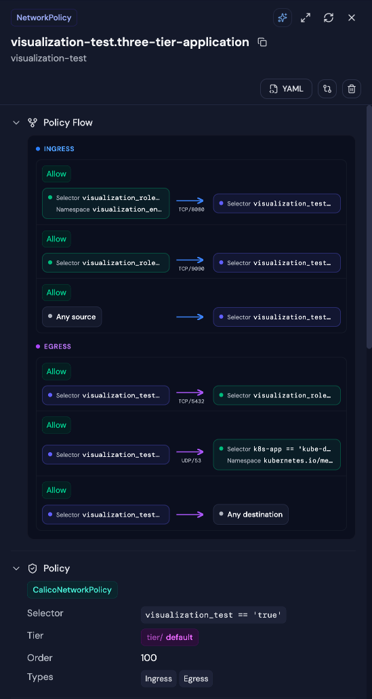
  &nbsp;&nbsp;
  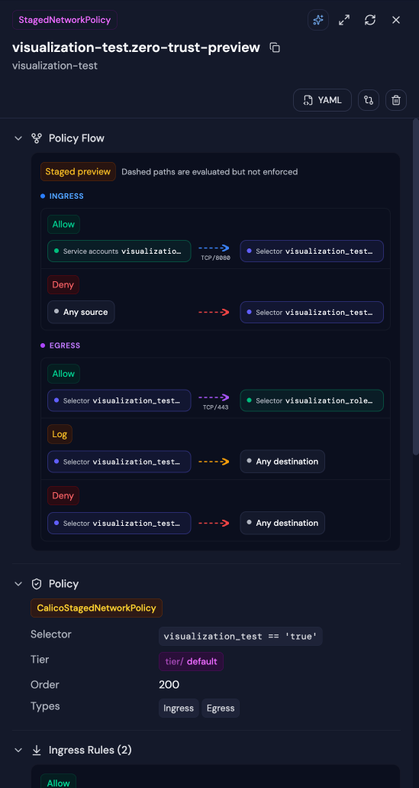
   <em>Enforced and staged policy flows — staged rules are explicitly marked as evaluated but not enforced</em>

**Calico Infrastructure Detail Views:** IPPool details show CIDR, encapsulation, NAT, block size, assignment mode, and node selectors. HostEndpoints show interface, expected IP addresses, profiles, and a link to the owning Node. Tier details show order and default action, and policies link back to their Tier.

Radar recognizes both `projectcalico.org` and `crd.projectcalico.org`. A cluster
running the Calico API server serves the same stored policies under both, so each
policy appears once, identified by kind, namespace and name. The API group stays
part of resource navigation and authorization — it is what keeps Calico
`NetworkPolicy` distinct from Kubernetes `networking.k8s.io` NetworkPolicy — and
a policy is shown to anyone authorized to list it under **either** group, since
either grant is enough to read it.

### Supported Resources

| Resource | Group | Topology | Detail View | AI Summary |
|----------|-------|----------|-------------|------------|
| NetworkPolicy | `networking.k8s.io/v1` | Yes | Yes | Yes |
| CiliumNetworkPolicy | `cilium.io/v2` | Yes | Yes | Yes |
| CiliumClusterwideNetworkPolicy | `cilium.io/v2` | Yes | Yes | Yes |
| NetworkPolicy | `projectcalico.org/v3`, `crd.projectcalico.org/v1` | Yes | Yes | Yes |
| GlobalNetworkPolicy | `projectcalico.org/v3`, `crd.projectcalico.org/v1` | Yes | Yes | Yes |
| StagedNetworkPolicy | `projectcalico.org/v3`, `crd.projectcalico.org/v1` | Yes (preview) | Yes | Yes |
| StagedGlobalNetworkPolicy | `projectcalico.org/v3`, `crd.projectcalico.org/v1` | Yes (preview) | Yes | Yes |
| StagedKubernetesNetworkPolicy | `projectcalico.org/v3`, `crd.projectcalico.org/v1` | Yes (preview) | Yes | Yes |
| IPPool | `projectcalico.org/v3`, `crd.projectcalico.org/v1` | No | Yes | Yes |
| HostEndpoint | `projectcalico.org/v3`, `crd.projectcalico.org/v1` | No | Yes | Yes |
| Tier | `projectcalico.org/v3`, `crd.projectcalico.org/v1` | No | Yes | Yes |

### Calico Coverage Limits

Radar statically evaluates Calico selectors against workload pod templates and the Namespace and ServiceAccount objects it can read. The result describes declared policy coverage, not live CNI enforcement or packet-level behavior. Missing labels or RBAC-restricted resources can prevent a relationship from being inferred, and staged policies are never included in enforced coverage. The projected "if staged" figure assumes every staged policy is promoted at once; it is a projection of the declared rules, not a simulation of what the data plane would do.

---

## Multus (secondary networks)

[Multus](https://github.com/k8snetworkplumbingwg/multus-cni) attaches extra network interfaces to a Pod. The Pod records what it asked for in the `k8s.v1.cni.cncf.io/networks` annotation and what Multus attached in `k8s.v1.cni.cncf.io/network-status`. OpenShift uses the same annotations for its secondary networks.

### What Radar Shows

**Detail View:** A Pod's **Secondary Networks** section lists each attachment with its interface, every IP address (so a dual-stack attachment shows both), MAC address and a default-network marker. Each row is labelled **Reported** when the `network-status` annotation lists it, **Requested only** when it does not, and a reported attachment that nothing requested says so. A definition name links to its `NetworkAttachmentDefinition` when Radar can read it; otherwise the row says the definition was not found, that you lack permission to read it, or that it could not be checked.

The `networks` annotation may be a comma-separated list (`name`, `namespace/name`, `name@interface`) or a JSON list. A definition attached more than once appears once per attachment. A name without a namespace is read as the Pod's namespace. An annotation Radar cannot read is shown with the reason and its raw value, never as "no networks". The section does not appear for a Pod that only has its default network, which is every Pod on some clusters.

Requested is not attached, and a reported interface does not show that the Pod can reach anything on that network.

**Helm:** `rbac.crdGroups.multus` (default on) grants read on `network-attachment-definitions` in `k8s.cni.cncf.io`, and nothing else in that group.

Topology, Issues, MCP summaries and `MultiNetworkPolicy` are not covered.

### Supported CRDs

| CRD | Group | Topology | Detail View | AI Summary |
|-----|-------|----------|-------------|------------|
| NetworkAttachmentDefinition | `k8s.cni.cncf.io/v1` | No | Generic, linked from the Pod | — |

---

## GPU & Batch Ecosystem (basic support)

The baseline for the GPU scheduling, batch, and inference-serving ecosystem is **status badges, smart table columns, status filters, and sidebar grouping** for every kind below. Kueue Workloads, LocalQueues and ClusterQueues also have native detail views for admission evidence, quota accounting and policy. JobSet `v1alpha2` has typed definition and lifecycle detail plus contextual execution drilldown through controller-owned member Jobs, their Pods, logs, and activity, and is drawn in Topology as the root of its member Jobs and Pods. Other kinds use the standard spec/status renderer; selected resources also provide structured REST/MCP context as described below.

These integrations expose resource state and selected admission/execution relationships, not physical GPU accounting. They do not inventory physical devices, distinguish virtual or fractional GPUs such as HAMi, measure GPU utilization, or provide a complete scheduling simulation. JobSet's current CPU/memory observations and Kueue's request-based quota accounting have different meanings and are described separately below.

### Kueue + Cluster Autoscaler

| Resource | Group | Status source |
|----------|-------|---------------|
| ClusterQueue | `kueue.x-k8s.io` (v1beta2, v1beta1) | `Active` condition |
| LocalQueue | `kueue.x-k8s.io` | `Active` condition |
| Workload | `kueue.x-k8s.io` | Admitted / Evicted / Preempted / Finished conditions |
| ResourceFlavor | `kueue.x-k8s.io` | — |
| AdmissionCheck | `kueue.x-k8s.io` | `Active` condition |
| ProvisioningRequest | `autoscaling.x-k8s.io` (v1, v1beta1) | Provisioned / Failed / CapacityRevoked / BookingExpired conditions |

Workload detail shows PodSet counts and controller-evaluated resource requests,
quota reservations and assigned flavors, admission-check states and messages,
and conditions. Reservation is distinguished from admission; resource totals are
requests, not measured usage.

Its **admission path** connects the owner, submission LocalQueue, its current
ClusterQueue, reservation ClusterQueue and assigned ResourceFlavors. Missing,
replaced and unreadable objects are distinguished. Per-flavor rejection reasons
are one controller report, not attempt order or history; unrecognized text stays
verbatim. Remote cluster names are reported without following them.

LocalQueue and ClusterQueue detail separate Active state and freshness from
configured stop policy. Pending/reserving/admitted counts are not additive;
quota is requested capacity, not utilization or available hardware. Per-flavor
rows compare reservations, admitted usage, nominal quota and borrowing/lending
limits. Both v1beta1 and v1beta2 queue shapes are supported. Related flavors, AdmissionChecks and
cohort peers are read as the viewer; Cohort objects are not read. A LocalQueue
also shows namespace eligibility. Denied or incomplete reads never prove an
object missing. An intentionally stopped parent softens a LocalQueue's alert
only when fresh evidence establishes that the stop is its sole cause; table
status retains the LocalQueue's own report.

#### Workloads in a queue

Queue detail lists and filters member Workloads by admission state. A
ClusterQueue row distinguishes submission through a LocalQueue's **current**
target from the Workload's recorded reservation; these can name different queues.
Finished and deleting Workloads remain listed while retained, so Radar's member
counts can differ from Kueue's live counts. List order is not admission order.

Workloads and LocalQueues require exact per-kind list access in each namespace.
Unread namespaces and unresolved submission membership are disclosed, with
counts shown as lower bounds. A denied Workload read can still leave readable
LocalQueues and their controller counts. Empty means confirmed empty only with
complete, unnarrowed coverage and no unresolved submission membership.

AdmissionCheck detail distinguishes controller readiness from a Workload's check
result and links the built-in provisioning configuration. ProvisioningRequest
detail shows native outcomes, reasons, requested Pod counts and PodTemplate
references, without treating provisioning as proof of running Pods. Both supported
AdmissionCheck versions and ProvisioningRequest v1/v1beta1 have native detail.
Workloads with admission checks also list currently retained, controller-owned
ProvisioningRequests from the same namespace and cluster, with explicit lookup
errors and bounded results. Requests may be cleaned up after completion or
eviction; an empty list is not evidence that no request was made. The Workload's
check message remains the primary explanation, and requests are not assigned to
individual checks by parsing their names.

#### Admission state classification

Job, JobSet and RayJob admission cards distinguish lifecycle, waiting blockers,
withdrawal and disruption using the Workload's own status. The Workload table
and detail retain native condition headlines, which can differ from the card.
REST AI detail and MCP `get_resource` include the same bounded admission context
for v1beta2 and v1beta1 Workloads, with explicit truncation markers.

This is a controller report, not a causal diagnosis: named queues and checks
are not independently verified by the classification. Flavor fit describes only
Kueue's last attempt. Stale evidence is marked; an absent stale marker does not
confirm freshness, and transition times do not date scheduling attempts.
Older Kueue wording is best-effort; unrecognized reasons remain visible.
Radar does not infer fairness, Pod placement, physical capacity or runtime health.

#### Kueue in Issues

Issues surfaces actionable admission blockers, Kueue-stopped runs and broken
queue configuration. Waiting for quota, preemption, checks or backoff, deliberate
pauses, stale reports and uncertain flavor fit remain admission context.
Pending or having no Pods alone is never an Issue. New configuration gets a
short grace period; recovered queues suppress outdated blocked reports.

Findings follow the run's controller chain; queue incidents group affected runs.
Links follow the viewer's access. Broken-queue checks require
ClusterQueue list permission; missing access or collection appears as unchecked
coverage on affected resource pages and counts, rather than a healthy answer.
ClusterQueue findings appear only in views not narrowed to namespaces.

`diagnose` on Job, JobSet, RayJob or Kueue Workload returns cached context,
related Issues and resource events, with relationships answered as
`get_resource` answers them. It collects no Pods, runtime logs or metrics.
Follow Workload references for admission and Pods for
runtime diagnosis. An empty Issues list does not establish runtime health;
undecided Workloads, unrecognized reasons and MultiKueue handoff are not covered.

**Admission history.** A queued root's Timeline includes controller-owned
Workloads and their ProvisioningRequests by owner UID. It records observed
admission, check, reservation, requeue and configuration changes, suppressing
counter-only and quantity-only retry noise. It cannot reconstruct unwatched
transitions or deleted provisioning attempts. Initial rows marked "from metadata"
date only the last status transition, not its current reason or message.

Coverage says when observation started late, retention removed rows, ownership
records expired, or access/collection withheld related kinds. A gap never asserts
that a hidden resource exists; an empty Timeline is not proof nothing happened.
History belongs to the root workload; queue-scoped history is not provided.

#### Pending position (Kueue's visibility API)

When Kueue's visibility API is installed, pending Workload detail and admission
cards show its reported LocalQueue and ClusterQueue positions with the read time.
REST/MCP context carries the result on the Workload, not its parent Job.
This is snapshot ordering, not promised admission order or a start time.

The read runs as the viewer and requires `get localqueues/pendingworkloads` in
`visibility.kueue.x-k8s.io` in that namespace; without authentication it uses
Radar's identity. Access failures and unavailable APIs are shown explicitly.
An unlisted Workload is not proven absent from the queue; a capped result leaves
position unknown. Other namespaces contribute only to the ahead count, never
names. Radar never derives position from timestamps or resource list order.

### KubeRay

| Resource | Group | Status source |
|----------|-------|---------------|
| RayCluster | `ray.io/v1` | head/worker readiness, suspension and native runtime detail |
| RayJob | `ray.io/v1` | application/controller lifecycle, submission and runtime detail, Kueue admission |
| RayService | `ray.io/v1` | lifecycle conditions; native serving and revision detail |
| RayCronJob | `ray.io/v1` | suspend |

RayCluster detail separates head readiness from ready, running and desired worker
Pod counts. Worker-group sizing and autoscaling are declared configuration; they
do not imply per-group health. The OSS host provides a bounded Pod list filtered
by the current RayCluster controller UID, with head/group selection and ordinary
Pod navigation. Controller-reported counts use Ray labels and may differ from
that owned-Pod list. Missing access, cache warming and recreated roots are explicit;
no RayCluster-wide log stream or lifecycle actions are added.

The RayCluster **Logs** tab uses current owner-UID-matched Pods, with per-Pod
Runtime Pods buttons. It opens the least healthy Pod, selecting an unfinished
regular init container for a Pending or Failed Pod when identifiable, otherwise
an application container. Native sidecars are not selected first.

Each Pod list is capped at 200; narrow to the head or a worker group to reach
others. Unreadable owned lists fall back to recorded Pods with an explanation;
older Radars show an upgrade note. Logs are container output, not Ray session
files under `/tmp/ray`, and deleted Pods have no retrievable logs. Already loaded
lines may remain visible. RayClusters served before `ray.io/v1` use generic logs.

RayJob detail separates the controller lifecycle from the last reported application
state, with links to the runtime RayCluster and a UID-verified submitter Job for
Pods and logs. Submission modes, retries, deadlines and declared cleanup policy
remain distinct from observed execution. Externally managed jobs do not resolve
reported runtime names against the local cluster. Kueue-managed RayJobs show
admission separately; admission does not establish that the application is running.

RayService detail separates proxy readiness, rollout and suspension from active/pending
runtime revisions. It shows native Serve application/deployment states and messages,
with reported target capacity and configured route weights kept distinct from measured
traffic. Missing application snapshots are unreported, including during `NewCluster`
upgrades; they do not establish an outage. Lifecycle badges use controller conditions,
not the deprecated `serviceStatus` field as proof of readiness. Positive readiness and rollout freshness compare
the root observed generation because KubeRay does not restamp unchanged conditions.
Suspension and failure observations remain visible when reconciliation retains an
earlier generation.

The OSS host reads at most the two named RayClusters and shows their directly observed
conditions only after checking their controller owner against the RayService UID.
Unreadable, missing and mismatched children are explicit. Embedded RayCluster status is
not treated as live runtime evidence. Revision links navigate to the exact `ray.io`
resource; this does not add a Ray topology adapter or generated-Service inventory.

For an exact `ray.io/v1` RayService, REST AI detail and MCP `get_resource`
include `resourceContext.serving.rayService` with named active/pending revisions, native
observed generation (compare with `resource.metadata.generation`), requested suspension, declared upgrade strategy, reported percentages, and up to eight name-sorted
Serve application states per revision (with explicit truncation). Readiness,
upgrade/rollback, and suspension conditions remain independent in the existing
`statusSummary`: a healthy active service can coexist with a failing pending revision. Requested suspension is
separate from controller acknowledgement. Embedded RayCluster conditions are
deliberately excluded: changes to them alone
do not trigger RayService status writes. Missing percentages stay absent (normal
for non-incremental upgrades) and explicit zero stays zero. Traffic percentages
represent configured route weights, not measured requests.

The projection follows KubeRay v1.7.0 and performs no child reads. It does not use
deprecated state fallbacks or infer health from cluster names. Ready means proxy
endpoints exist, not that every application is healthy; inspect the native app
states and, when truncated, the full resource. During `NewCluster` upgrades,
KubeRay clears the active application map while reconciling the pending revision;
absence is not proof of an outage. Application messages, deployment
status and the cross-revision endpoint count remain on the resource. Suspension
tears down owned resources; resume creates new clusters.

The [KubeRay controller lane](../scripts/kuberay-demo/README.md)
checks a real healthy active revision and failed pending revision through REST
and MCP; incremental Gateway traffic shifting is outside that lane's proof.

### KServe

| Resource | Group | Status source |
|----------|-------|---------------|
| InferenceService | `serving.kserve.io/v1beta1` | Ready condition + modelStatus.transitionStatus |
| ServingRuntime / ClusterServingRuntime | `serving.kserve.io/v1alpha1` | spec.disabled |
| InferenceGraph | `serving.kserve.io/v1alpha1` | Ready condition |
| TrainedModel | `serving.kserve.io/v1alpha1` | Ready condition |
| LLMInferenceService | `serving.kserve.io` (v1alpha2, v1alpha1) | Ready / aggregate conditions |

For `serving.kserve.io/v1beta1` InferenceServices, REST AI detail and MCP
`get_resource` include a bounded serving summary: reported mode/runtime names,
predictor model transitions and failure evidence, Knative revisions and configured
traffic, and Standard-mode canaries. Absent facts remain unreported, not healthy
or zero. A Ready root can still report a non-ready transformer.

Per-field notes explain writer-specific limits beside the relevant raw fields.
Their reference release is not a detected controller version. Model state and
failure history can outlive a rollout; configured traffic and ready-copy counts
do not prove what serves. Confirm with Pod, route and request evidence.

This reads only the root: runtime names are unverified selections. ModelMesh
gets only mode/runtime names; LLMInferenceService and list/search summaries are
excluded. Raw spec/status remains available. Standard-mode status has live
v0.20.0 proof; Knative traffic and serving-old/failing-new cases use writer-derived
fixtures, not live proof.

### Gateway API Inference Extension

| Resource | Group | Status source |
|----------|-------|---------------|
| InferencePool | `inference.networking.k8s.io/v1` and `inference.networking.x-k8s.io/v1alpha2` | per-parent Accepted + ResolvedRefs |
| InferenceObjective | `llm-d.ai/v1alpha2` and `inference.networking.x-k8s.io/v1alpha2` | Accepted / Ready condition |

### Batch: LeaderWorkerSet, JobSet, Volcano, Kubeflow Training

| Resource | Group | Status source | Topology |
|----------|-------|---------------|----------|
| LeaderWorkerSet | `leaderworkerset.x-k8s.io/v1` | Available / Progressing conditions | No |
| JobSet | `jobset.x-k8s.io/v1alpha2` | Root terminal state, conditions and reported child counts | Yes: JobSet → member Job → Pod |
| Job (Volcano) | `batch.volcano.sh/v1alpha1` | state.phase — disambiguated from batch/v1 Jobs by group | No |
| Queue (Volcano) | `scheduling.volcano.sh/v1beta1` | state (Open/Closed) | No |
| PodGroup (Volcano) | `scheduling.volcano.sh/v1beta1` | phase + Unschedulable condition | No |
| JobFlow / JobTemplate | `flow.volcano.sh/v1alpha1` | state.phase / — | No |
| Queue (KAI) | `scheduling.run.ai/v2` | Orphan / OverQuota conditions + allocation | No |
| PodGroup (KAI) | `scheduling.run.ai/v2alpha2` | phase + scheduling conditions | No |
| PyTorchJob / TFJob | `kubeflow.org/v1` | JobCondition pattern | No |
| MPIJob | `kubeflow.org` (v1, v2beta1) | JobCondition pattern | No |
| TrainJob | `trainer.kubeflow.org/v1alpha1` | Complete / Failed / Suspended conditions + active child jobs | No |

"No" means no dedicated nodes: a kind appears only when something already drawn owns it.

For `jobset.x-k8s.io/v1alpha2` JobSets, REST AI detail and MCP `get_resource`
include `resourceContext.execution`: root lifecycle and outcome, controller evidence,
requested suspension, and JobSet-specific role, child-Job, and recreation counts.
Missing observations remain distinct from zero. Activity does not guarantee running
Pods, and a suspension request does not prove observed suspension or its cause.
Root outcomes require root evidence; child failures alone are not terminal.
Native spec/status remain available. Generic JobSet `diagnose` returns this cached
context, related Issues and resource events; it does not collect runtime logs or
metrics, infer admission causes, or replace the JobSet→Job→Pod ownership chain.

Job and JobSet drawer and fullscreen details connect the root to exact
controller-owned Kueue Workloads, showing each admission decision, native reason, queues, checks, and
disruption evidence independently of execution. The lookup preserves multiple
records, reports unavailable observations explicitly, and permission-filters
resource links. Ordinary Jobs without Kueue hints or observed admission evidence
remain quiet. It does not infer admission from suspension or local Job absence.

JobSet detail also provides controller-owned member Jobs with role, index, group,
and restart-attempt metadata. Select a Job to inspect its Pods and logs, or follow
its backlink to the owning JobSet. Member and Pod lists show their limits explicitly;
missing children do not imply success, and unreadable data is reported as unavailable.
The Overview also composes typed root lifecycle, per-role observations, dependencies,
completion/restart policies, and controller conditions alongside member investigation.
The member comparison table filters roles, names, and states across all retained Jobs,
with current CPU/memory usage and explicit reporting coverage. Whole-JobSet totals
include members outside the displayed window; missing or stale samples are not zeros.
Extended-resource requests are declared demand, not GPU/TPU utilization. Logs can be
scoped to one Job (live) or a role/all current members (bounded snapshots with source
attribution and read failures). Historical goodput and archived logs are not collected.

**Topology:** the resources view draws JobSets, including roots with no Jobs,
and their exact controller-owned member Jobs and Pods. Status uses the same
root lifecycle as detail; child failures alone do not make the root failed.
Declared Job counts can exceed created members. Only v1alpha2 is interpreted;
other served versions show unknown status and a warning without member links.

With Jobs hidden, current member Pods attach to the JobSet. Pods from earlier
same-named Jobs stay separate. The JobSet Topology tab shows at most 24 members,
favoring failed and active Jobs, and clicking a member opens its Overview.
Traffic, scheduling and dependency edges are not provided.

Volcano Job, the Volcano/KAI Queues and PodGroups, and KAITO Workspaces share kind names with other resources — Radar disambiguates by API group in tables, filters, and status badges.

### Model serving operators: KAITO, NVIDIA NIM, AMD

| Resource | Group | Status source |
|----------|-------|---------------|
| Workspace (KAITO) | `kaito.sh` (v1beta1) | ResourceReady / InferenceReady / WorkspaceSucceeded conditions |
| RAGEngine (KAITO) | `kaito.sh` (v1beta1, v1alpha1) | ResourceReady / ServiceReady conditions |
| NIMService / NIMCache / NIMPipeline | `apps.nvidia.com/v1alpha1` | status.state |
| DeviceConfig (AMD GPU Operator) | `amd.com/v1alpha1` | Ready condition + component DaemonSet rollout counts |

---

## Agent runtimes: Agent Sandbox and Agent Substrate

Two projects run AI agents on Kubernetes, and Radar reads both: [Agent Sandbox](https://github.com/kubernetes-sigs/agent-sandbox) (Kubernetes SIG Apps) gives each agent its own sandboxed Pod, and [Agent Substrate](https://github.com/agent-substrate/substrate) (CNCF Sandbox) runs many mostly idle agents on a small pool of warm worker Pods. Radar reads their status the way their controllers mean it, with status badges, table columns, status filters, Issues and sidebar grouping; drawers use the standard spec/status renderer.

| Resource | Group | Status source |
|----------|-------|---------------|
| Sandbox | `agents.x-k8s.io` (v1beta1) | `Ready` condition and its reason; `Suspended` while `spec.operatingMode` is Suspended |
| SandboxClaim | `extensions.agents.x-k8s.io` (v1beta1) | `Ready` condition and its reason |
| SandboxWarmPool | `extensions.agents.x-k8s.io` (v1beta1) | ready versus desired sandboxes; `observedGeneration` |
| SandboxTemplate | `extensions.agents.x-k8s.io` (v1beta1) | — |
| WorkerPool | `ate.dev` (v1) | per-class `Resolved` condition in `status.sandboxClasses[]`; ready versus desired workers |
| SandboxConfig, CSIDriverConfig | `ate.dev` (v1, cluster-scoped) | — (printer columns) |

**Ready=False is not always a failure.** Agent Sandbox reports every non-running state as `Ready=False`, so Radar reads the reason, in the controller's own order (reconcile errors first, then the suspension, then Pod state). One reading in `pkg/health` serves Issues and AI summaries; the UI mirrors it, and `pkg/health/testdata/agent_sandbox.json` pins both:

- **Settled** (neutral, never an Issue): Suspended once the `Suspended` condition says the Pod is gone, Expired (`SandboxExpired`, a claim's `ClaimExpired`), Finished (`PodSucceeded`).
- **In progress** (amber): Suspending (`SandboxSuspended` while the Pod still terminates), Provisioning (`DependenciesNotReady`, a claim's `SandboxNotReady` and `SandboxCreatePending`), Binding (`AdoptionConflict`), Terminating, the scheduler's reason when `PodScheduled` is False (orange), and Updating when the condition was recorded for an older generation. These raise no Issue for 30 minutes; one that lasts longer is reported, because a sandbox whose Pod or Service is never created has no other finding to fall back on. The clock starts at the resume when the `Suspended` condition records one, since Kubernetes keeps Ready's transition time across a reason change. A suspension has no reliable start time, so Suspending never raises an Issue of its own; a Pod that never terminates is reported as a stuck deletion.
- **Attention** (orange, an Issue): `ReconcilerError` (the controller retries it), and **Suspension blocked** (Issue reason `PodNotOwned`) when a suspension is refused because the Pod the controller tracks for the Sandbox is not owned by it. Ready keeps its ordinary suspension reason then, so Radar reads the refusal from the `Suspended` condition, adds what unblocks it (remove that Pod, the one its `agents.x-k8s.io/pod-name` annotation names or else the one with its own name, or recreate the Sandbox under another name), and reports it at once: nothing is being torn down, so waiting changes nothing.
- **Failed** (red, an Issue): a hard container failure the controller names in its message (`ImagePullBackOff`, `CrashLoopBackOff` and the like), `PodFailed`, `InvalidConfiguration`, `MultiplePods`, and a claim's `TemplateNotFound`, `WarmPoolNotFound`, `InvalidMetadata`, `EnvVarsInjectionRejected`, `VolumeClaimTemplatesError` and `SandboxMissing`.

A claim forwards its Sandbox's reason; an in-progress or settled forwarded reason is left for the Sandbox to report, so it raises no Issue on the claim.

  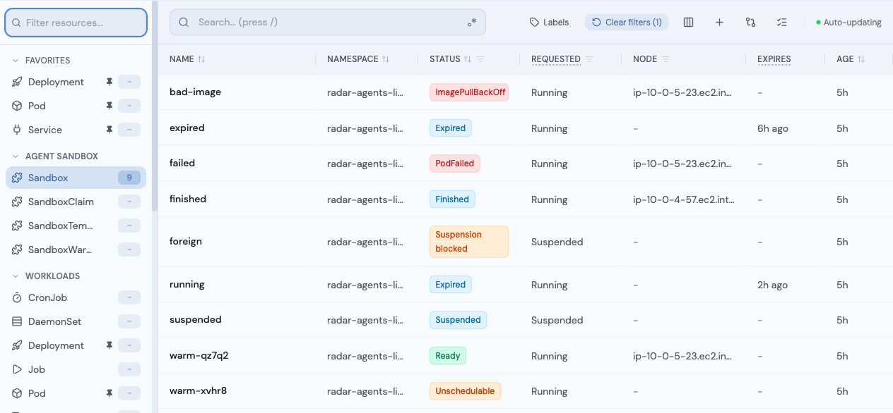
   <em>Sandboxes: each status names the reason Agent Sandbox reports, colored by how much it needs attention</em>

**WorkerPool.** Its only condition, `Resolved`, sits per sandbox class in `status.sandboxClasses[]`, where Radar's generic condition handling never looks. A class that does not resolve to a usable SandboxConfig (`SandboxConfigNotFound`, `SandboxConfigDeleting`, `SandboxClassMismatch`, `DefaultConfigNotFound`) is an Issue, since Substrate keeps ready workers running on the last resolved config but cannot start new ones. Severity follows one rule: **critical** (red) when workers are wanted and none is ready; otherwise a warning (orange). A condition recorded for an older generation is reported as such rather than trusted, and a spec edit is not read as recovery. `pkg/health` holds this reading for AI summaries, and `pkg/health/testdata/substrate_workerpool.json` pins the UI to it. Workers that are not ready are left to the worker Deployment the pool owns. A Deployment that is never created has nothing to report it, and Substrate's controller only logs a rejected create (an admission policy, or a ServiceAccount or Deployment it may not create), so Radar raises a critical `DeploymentNotCreated` Issue when a pool wants workers, every class has resolved on the current generation, and 10 minutes later there is still no `status.selector` and no worker Pod. The pool's status then reads **Provisioning stalled** (red), from the same rule in `pkg/health`, so the badge and the Issue agree. A SandboxConfig stuck deleting because a pool still uses it is attributed to `ate-controller` (finalizer `sandboxconfig.ate.dev/workerpool-protection`).

**Worker Pods.** A Pod labelled `ate.dev/worker-pool` gets a note in its drawer: Substrate places actors on it in turn, so its logs, metrics and restarts are shared by every actor it has hosted.

**Agent Substrate health (Prometheus).** With [Prometheus connected](workload-metrics.md#what-radar-discovers-automatically), a WorkerPool, and a Node that runs Substrate's `atelet`, get an Agent Substrate section at the top of their Overview tab (capacity on a WorkerPool, snapshot uploads on a Node) and charts on their Metrics tab, from the metrics Substrate exports. The section gives the verdict, a sentence saying what it means for someone who has not met Substrate before, and the facts behind it. They are aggregates: Substrate keeps actor names out of metric labels.

  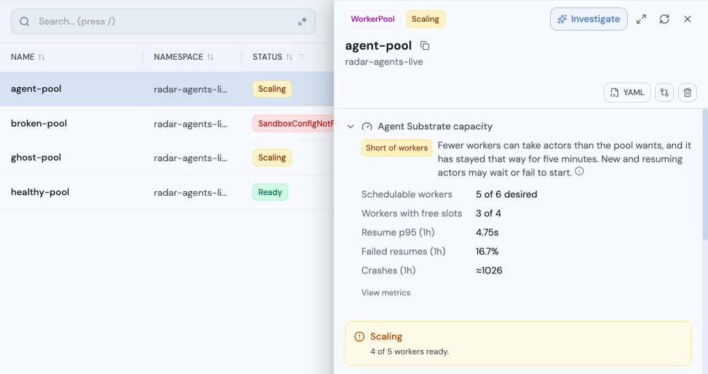
   <em>A WorkerPool short of workers: the verdict, what it means, and the facts behind it</em>

The verdict and the capacity and snapshot facts read now; resume p95, failed resumes and crashes summarize the charts' hour:

| Resource | Verdict (wire `state`) | Means | Facts |
|---|---|---|---|
| WorkerPool | **Short of workers** (amber), `workerShortfall` | Substrate's own `SubstrateWorkerPoolCapacityNotDelivered` condition has held at every minute for the last five (six one-minute points), and holds now: schedulable workers, the highest count any API replica reports for each state and class summed, are below the fewest desired | Schedulable workers of desired, first: the comparison Substrate's alert makes, the highest count any API replica reports for each worker state and class, summed (while replicas disagree, more than any one replica's total), out of the fewest desired over five minutes; workers with free slots, of schedulable workers in the states Substrate defines (averaged across replicas, shown as approximate when fractional); resume p95 and failed resumes of actors placed on this pool, and crashes, over the hour |
| WorkerPool | **Full** (neutral), `noFreeActorSlots` | No API replica sees a free actor slot (an idle or partial worker) | |
| WorkerPool | Free slots, `freeActorSlots` | Some worker has a free actor slot. Substrate counts slots by actors alone, so an actor that needs more CPU or memory than a worker has left can still fail to place, and that failure names no pool: it is in neither the pool's charts nor its failed resumes | |
| WorkerPool | No schedulable workers, `noSchedulableWorkers` | No schedulable worker of a known class, and none short | |
| Node | **Uploads overdue** (amber), `uploadsOverdue` | Some actor's snapshot upload to object storage is overdue | Overdue uploads by band, worst first; oldest snapshot not yet in storage |
| Node | No overdue uploads, `noUploadsOverdue` | atelet counts no overdue upload. Snapshots with no storage destination are not counted, so this is not proof that every snapshot is saved; the oldest unsaved snapshot fact shows that | |

Facts are uncolored. An hourly fact is computed from the data Prometheus holds for the hour, so a gap in collection makes the crash count cover less than the hour; the fact's tooltip says so. One Radar could not read says **Unavailable** with the reason (the same reason its chart gives), never 0, and so does an hourly fact whose own population (successful resumes, all resumes, crashes) stopped reporting: the hour's number would count only the time before. One whose series exist but recorded nothing for this pool or node says **None**. When the verdict cannot be read it says **Unknown** with the reason, as it does when workers report a state Substrate's registry does not define.

Only Short of workers needs the controller's `ate.workerpool.desired_workers`. Substrate's bundled Prometheus does not collect the controller's metrics, so without it the pool is still judged Full, Free slots or No schedulable workers from the API server's counts, and the section's sentence says the shortfall cannot be judged and why. An info mark carries the note when Radar could not confirm the series belong to this cluster.

| Resource | Chart | Series (each counts only what Substrate attributes) |
|---|---|---|
| WorkerPool | Workers by state | `ate_workerpool_workers`, averaged across API replicas (each reports the whole fleet) by pool, state and sandbox class; each line names its class, and class `unknown` is not capacity |
| WorkerPool | Ready and desired workers | `ate_workerpool_{desired,ready}_workers` |
| WorkerPool | Resume time (p50, p95), Failed resumes (%) | `ate_actor_lifecycle_operation_duration_seconds`, operation `resume`: only resumes of actors placed on this pool |
| WorkerPool | Placement time (p95) | `ate_scheduler_assignment_duration_seconds`, outcome `assigned`. A placement that found no capacity names no pool, so it is not counted |
| WorkerPool | Actor crashes per minute | `ate_actor_crashes_total`: only actors that had a worker of this pool |
| Node | Oldest snapshot not yet in storage | `atelet_snapshot_undurable_age_max_seconds` |
| Node | Actors with overdue uploads | `atelet_snapshot_upload_overdue_actors` by band |
| Node | Snapshot upload time, Failed uploads | `atelet_snapshot_upload_duration_seconds` |
| Node | Restore and checkpoint time | `ate_actor_{restore,checkpoint}_duration_seconds`, phase `total` (the two overlap; they are not added) |

- **Names.** The table uses the names Substrate's exporter and Prometheus's OTLP receiver produce by default (`ate_actor_crashes_total`, `*_seconds_bucket`, labels such as `ate_workerpool_name`). Radar also reads the dotted UTF-8 names Google Managed Prometheus keeps, with or without unit suffixes (`ate.actor.lifecycle.operation.duration_bucket`, labels such as `ate.workerpool.name`), and copies dotted labels to underscore names before grouping, since GMP rejects dotted labels in a `by` clause. It finds which names Prometheus holds by listing metric names over the range (a partial list is an error). Each component (`ateapi`, `atecontroller`, `atelet`) is resolved on its own, so an API server scraped under underscore names next to a controller pushing dotted names over OTLP reads correctly. When Prometheus holds more than one name for a component's series (both spellings, or with and without unit suffixes), the one with series for this pool or node within this cluster is read. Two spellings with series refuse that component's charts, and two suffix styles of one instrument with series refuse only the charts reading that instrument: after a pipeline changes how it names metrics, that lasts until the range no longer spans the change, and for good if the component is exported twice. Native histograms read as not found.
- **Empty and sparse charts.** A chart whose first sample comes well after the range starts says so ("No samples before 08:33"), rather than leaving most of the plot blank unexplained. A WorkerPool with no metrics whose status reports 0 worker Pods says so, instead of explaining metric names.
- **Nodes.** atelet's series are attributed by the `node` label a Kubernetes scrape adds, as in Substrate's reference Prometheus configuration. Series without it are reported as not attributable rather than guessed from current Pods. A Node whose cluster serves no WorkerPools, or that runs no atelet, shows no section.
- **Accuracy.** Each family's cluster identity is checked over the chart's range (ambiguous and mismatched identities are reported, not charted). A partial or warning answer from Prometheus is an error, not a chart. A family that is summed or averaged and arrives through more than one scrape job is reported instead of being counted twice, and copies that differ only by an HA Prometheus pair's or a deduplicating store's replica label (`prometheus`, `prometheus_replica`, `replica`, `__replica__`) are collapsed. On a Node, duplicate scrape jobs are judged within that node's series. A chart that combines two families is drawn only when both resolve to the same cluster identity, and a Node's attribution is decided within this cluster's series.
- **Access.** `GET /api/prometheus/substrate/workerpools/{namespace}/{name}` requires `get` on that WorkerPool; `GET /api/prometheus/substrate/nodes/{name}` requires `get` on Nodes. A Node's verdict and charts count every actor Substrate places on that node, including actors of WorkerPools in namespaces the caller cannot read: they show counts, timings and overdue state, never actor or pool names, the same policy as the Node's CPU and memory charts. Both take `range` (`10m` … `14d`, default `1h`; an unknown value is served as `1h` and the response's `range` says so), are read-only, and are advertised by the `substrateHealthMetrics` capability, so Radar Hub asks only a Radar that serves them.

**Not covered:** Substrate's actors, actor templates and worker assignments live in Substrate's own control plane (PostgreSQL behind a gRPC API), not in Kubernetes, so Radar does not see them. kagent's `api.kagent.dev` kinds are grouped in the sidebar but otherwise use generic discovery; the chart does not collect them by default. The drawer's conditions list shows each condition as recorded, so a settled sandbox's `Ready=False` keeps its red mark there. Topology shows the generic owner edges only (WorkerPool → Deployment → Pods; Sandbox → Pod).

**Chart RBAC.** `rbac.crdGroups.agentSandbox` (`agents.x-k8s.io`, `extensions.agents.x-k8s.io`) and `rbac.crdGroups.agentSubstrate` (`ate.dev`) grant read access and are on by default. Sandboxes and SandboxTemplates carry Pod templates, which can hold inline environment values; with authentication on, users see them in namespaces they can read, like the Pods and Deployments there.

## Local runtime evidence: RabbitMQ, NATS and Vault

When Radar runs locally, MCP clients can use `collect_application_evidence` to read one Pod endpoint after operator approval:

| Integration | Endpoint | Evidence |
|---|---|---|
| RabbitMQ | Port 15692, `/metrics` | Node-reported disk/memory alarms, optional resource measurements and watermarks |
| NATS | Port 8222, `/jsz` | JetStream pending, acknowledgement-pending and redelivery counts; delivery/acknowledgement positions, activity times and waiting pull requests when reported |
| Vault | Port 8200, `/v1/sys/health` | HTTP status, initialization/seal/standby state, and HA connection/removal facts when reported |

Requires Pod-read/port-forward permissions, a recognized application image and its declared default plaintext port. RabbitMQ metrics and NATS monitoring must already be enabled. Credentials, TLS, custom ports, authenticated/remote/hosted/in-cluster deployments and built-in investigations are unsupported.

In local resource details, use **Collect RabbitMQ evidence**, **Collect NATS evidence** or **Collect Vault evidence** to select a Pod and collect explicitly after a permission check. **Retry permission check** does not contact the application; neither does opening or refreshing a resource. Results show the target, observation time and selected-Pod scope. **Collection limits** expands the qualifications; **Copy observation** always includes them. If a Pod is missing from discovery, open it directly. Resource or cluster changes clear results; a replaced Pod requires a new selection and explicit collection.

These are selected-endpoint observations, not automatic Issues or an application health verdict. See [MCP collection and result semantics](mcp.md#explicit-local-runtime-evidence).

## Any Other CRD

Radar automatically discovers and displays **every** CRD installed in your cluster — no configuration or plugins required. Resources appear in the sidebar, can be filtered and searched, and show full YAML with syntax highlighting in the detail drawer. The integrations above add richer presentation, but every CRD is browsable out of the box.
